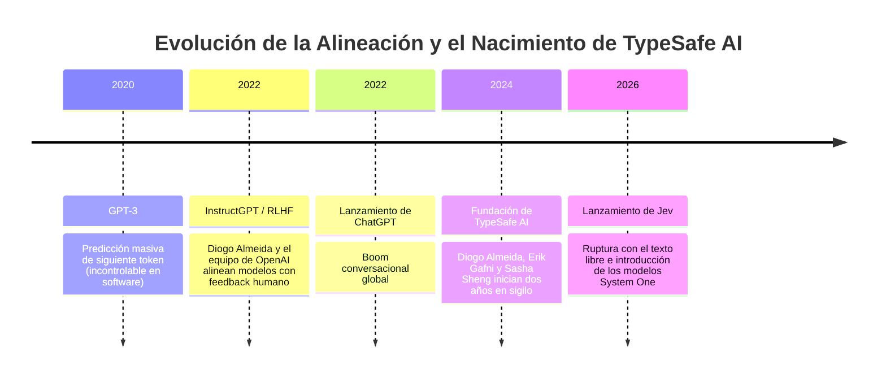
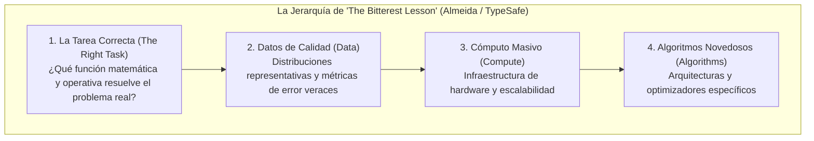

# Módulo 1: Introducción y Tesis Central de Jev
## Apartado 1.1: Origen e Historia de TypeSafe AI

**Serie:** *Fundamentos y Arquitectura de Sistemas con Modelos System One (Jev)*  
**Autor:** Antigravity Engineering Lab  
**Bibliografía y Referencias O'Reilly:**
* [Reinforcement Learning from Human Feedback](https://learning.oreilly.com/library/view/-/9781633434301/?orm_source=mcp) por Nathan Lambert (*Manning Publications / O'Reilly*)
* [Reinforcement Learning](https://learning.oreilly.com/library/view/-/9781492072386/?orm_source=mcp) por Phil Winder (*O'Reilly Media, Inc.*)
* [Generative AI Design Patterns](https://learning.oreilly.com/library/view/-/9798341622654/?orm_source=mcp) por Valliappa Lakshmanan y Hannes Hapke (*O'Reilly Media, Inc.*)
* [Building Applications with AI Agents](https://learning.oreilly.com/library/view/-/9781098176495/?orm_source=mcp) por Michael Albada (*O'Reilly Media, Inc.*)

---

## 1. El Equipo Fundador y la Ruptura con el Modelo Conversacional

Para comprender la aparición de **Jev** y el nacimiento de **TypeSafe AI**, es indispensable analizar la trayectoria de su fundador principal, **Diogo Almeida**, y su papel en el desarrollo de la inteligencia artificial moderna.

A comienzos de la década de 2020, dentro de los laboratorios de OpenAI, Diogo Almeida formó parte del equipo nuclear de investigadores que abordó uno de los mayores problemas abiertos del aprendizaje profundo: el abismo entre la predicción estadística de texto y la utilidad real para los humanos. Modelos fundacionales como GPT-3 eran extraordinarios calculando probabilidades condicionales sobre miles de millones de páginas web, pero resultaban impredecibles, verborreicos y difíciles de controlar mediante prompts convencionales. 

Almeida fue uno de los coautores clave del histórico artículo de investigación sobre **InstructGPT** (*Training language models to follow instructions with human feedback*, Ouyang et al., 2022). Aquel trabajo introdujo en la industria el uso a gran escala del aprendizaje por refuerzo a partir de retroalimentación humana (**RLHF**), la metodología que alineó los modelos lingüísticos con las instrucciones directas de los usuarios y que constituyó el motor científico que dio origen a ChatGPT.

Tras la explosión mediática de ChatGPT, mientras la industria tecnológica se lanzaba a una carrera desenfrenada por construir chatbots cada vez más elocuentes y modelos gigantescos de cientos de miles de millones de parámetros, Almeida observó un síntoma alarmante en la arquitectura del software empresarial. A pesar de que los modelos demostraban habilidades conversacionales sobrehumanas y las corporaciones invertían cientos de miles de millones de dólares, **la automatización integral de los sistemas de software seguía sin materializarse**. 

Para abordar esta disonancia estructural, en 2024 Diogo Almeida se unió a **Erik Gafni** y **Sasha Sheng** para fundar **TypeSafe AI**. La compañía operó durante dos años en régimen de sigilo (*stealth mode*), respaldada por una ronda semilla de 40 millones de dólares liderada por el fondo de capital riesgo especializado en computación profunda DCVC (*Data Collective*). Su misión no consistía en crear otro competidor de chat ni en refinar prompts, sino en diseñar una infraestructura de inteligencia nativa para máquinas capaz de tomar decisiones deterministas y tipadas dentro del código de producción.

---

## 2. La Paradoja de la Automatización: La Pregunta Impulsora

La génesis de TypeSafe AI se resume en una pregunta que Diogo Almeida formuló tras cuatro años de evolución del sector:

> *«Los modelos llevan años mostrando un nivel sobrehumano en conversación. Entonces, ¿dónde está la verdadera automatización?»*

El software empresarial moderno no funciona mediante intercambios retóricos. Los sistemas informáticos que sostienen la banca, el comercio electrónico, las telecomunicaciones o la logística operan sobre **grafos de dependencias estrictos, tipos de datos predecibles, latencias garantizadas en milisegundos y caminos de ejecución auditables**. 

Cuando los ingenieros intentaron introducir los Modelos de Lenguaje Grande (LLMs) dentro de estos flujos de trabajo críticos, colisionaron con una realidad insalvable:
1. **El cuello de botella de la latencia:** Una llamada a un modelo generativo de frontera requiere entre 3 y 30 segundos para decodificar texto token a token, una cifra inadmisible para microservicios y APIs transaccionales.
2. **La fragilidad del formato:** Para que un programa consuma la salida de un LLM, debe obligarlo a generar una cadena de texto estructurada como JSON, esperar a que termine de escribirse y parsearla en memoria. Cualquier fallo de sintaxis, clave alucinada o campo omitido provoca una excepción en tiempo de ejecución.
3. **La ausencia de calibración real:** Si un LLM comete un error en el 5% de los casos pero responde con el mismo tono de certeza absoluta tanto cuando acierta como cuando alucina, resulta inviable automatizar el proceso sin supervisión humana constante.

Almeida constató que el obstáculo no radicaba en una falta de inteligencia bruta de los modelos, sino en un error de diseño fundamental: **se estaba intentando forzar un modelo concebido para dialogar con personas dentro de un entorno donde solo se necesitaban decisiones binarias o categóricas entre máquinas**.

---

## 3. «The Bitterest Lesson»: Escoger la Tarea Correcta en Machine Learning

El marco filosófico e ingenieril de TypeSafe AI hunde sus raíces en un debate clásico de la ciencia de la computación. En 2019, el pionero del aprendizaje por refuerzo Rich Sutton publicó su celebrado ensayo *The Bitter Lesson* («La lección amarga»). En él, Sutton postulaba que a lo largo de siete décadas de historia de la inteligencia artificial, los métodos que siempre terminaban ganando no eran los algoritmos diseñados a mano con el conocimiento intuitivo de los investigadores, sino los enfoques generales capaces de escalar masivamente mediante cómputo puro.

Diogo Almeida sostiene que la lección de Sutton, siendo certera, es únicamente la punta de un iceberg mucho más profundo. En su tesis denominada **«The Bitterest Lesson»** («La lección más amarga»), Almeida establece una jerarquía de prioridades que redefine el éxito en el aprendizaje automático:

$$\text{Tarea Correcta} \gg \text{Datos} \gg \text{Cómputo} \gg \text{Algoritmos}$$

### El Precedente Histórico de InstructGPT
Almeida ilustra esta ley mediante la propia experiencia vivida en OpenAI:
* **GPT-3 (2020):** Un modelo mastodóntico de 175.000 millones de parámetros, entrenado con ingentes cantidades de cómputo para la tarea de **predecir el siguiente token** en texto web. Pese a su potencia, era incapaz de seguir instrucciones sencillas de manera consistente.
* **El Experimento InstructGPT (2022):** Un modelo con el tamaño de GPT-2 (más de 100 veces inferior en parámetros a GPT-3), pero entrenado explícitamente para la **tarea correcta** (reconocimiento de instrucciones y alineación de preferencias mediante RLHF), pulverizó a GPT-3 en todas las pruebas de utilidad humana, requiriendo apenas una fracción del cómputo. Según los cálculos de Almeida, si OpenAI hubiera intentado alcanzar ese mismo nivel de seguimiento de instrucciones simplemente escalando el preentrenamiento de texto no supervisado, habría necesitado escalar hasta un hipotético GPT-7 o GPT-9.

### Aplicación a la Automatización: La Inferencia No Autorregresiva
La conclusión para TypeSafe AI fue inmediata: la industria actual comete con la automatización del software el mismo error que se cometió con GPT-3. Se pretende alcanzar la fiabilidad en software escalando el cómputo de modelos que predicen cadenas de texto (*strings*). 

Sin embargo, en el 90% de los puntos de integración del software empresarial (enrutamiento de peticiones, detección de fraude, filtros de seguridad, clasificación de estados, guardrails y selección de herramientas en agentes), **la tarea correcta no es la redacción de texto, sino la discriminación semántica calibrada**.

Al formular la tarea como una evaluación atómica que toma un estado desestructurado y devuelve una decisión tipada con su probabilidad exacta, la necesidad de generar texto token a token desaparece. De este cambio de formulación matemática surge **Jev**, el primer modelo de la familia **System One**, capaz de operar con latencias de 70 a 500 milisegundos, con seguridad de tipos garantizada por diseño y con un coste de salida nulo.

---

## 4. Bibliografía y Lecturas Recomendadas para Profundizar

Para asimilar los fundamentos técnicos analizados en este apartado, se recomienda el estudio de las siguientes obras de referencia disponibles en la plataforma **O'Reilly Learning**:

1. **[Reinforcement Learning from Human Feedback](https://learning.oreilly.com/library/view/-/9781633434301/?orm_source=mcp)**  
   *Nathan Lambert (Manning Publications / O'Reilly, 2026)*  
   * **Por qué es relevante:** Es el tratado de referencia sobre cómo la función de recompensa y la selección del objetivo de aprendizaje transformaron los modelos de lenguaje estáticos en sistemas alineados, base técnica directa del trabajo de Diogo Almeida en OpenAI.

2. **[Reinforcement Learning](https://learning.oreilly.com/library/view/-/9781492072386/?orm_source=mcp)**  
   *Phil Winder (O'Reilly Media, Inc., 2020)*  
   * **Por qué es relevante:** Analiza la formulación matemática de los procesos de decisión de Markov y el diseño de políticas de recompensa, esenciales para comprender la transición del modelado generativo al aprendizaje por refuerzo para decisiones calibradas (RLCD).

3. **[Generative AI Design Patterns](https://learning.oreilly.com/library/view/-/9798341622654/?orm_source=mcp)**  
   *Valliappa Lakshmanan y Hannes Hapke (O'Reilly Media, Inc., 2025)*  
   * **Por qué es relevante:** Documenta formalmente los cuellos de botella de latencia y fragilidad de esquemas que sufren los desarrolladores al intentar forzar LLMs generativos en tareas de enrutamiento y guardrails dentro de arquitecturas empresariales.

4. **[Building Applications with AI Agents](https://learning.oreilly.com/library/view/-/9781098176495/?orm_source=mcp)**  
   *Michael Albada (O'Reilly Media, Inc., 2025)*  
   * **Por qué es relevante:** Examina la anatomía de los bucles agénticos y la necesidad crítica de desacoplar los pasos de decisión rápida de los pasos de razonamiento profundo para evitar fallos catastróficos en producción.

---

## 5. Diccionario Fonético Obligatorio para Síntesis de Voz (ElevenLabs)

Para asegurar una locución profesional y sin tropiezos fonéticos en el motor de **ElevenLabs**, se establecen las siguientes reglas de transcripción acústica:

| Término Original | Transcripción Fonética en Texto de Locución | Justificación y Regla Acústica |
| :--- | :--- | :--- |
| **Jev** | `Yev` | Evita que el sintetizador en español pronuncie una jota castellana fuerte /x/. Debe sonar suave y natural como /ʝeβ/. |
| **TypeSafe AI** | `Taip Seif Ei Ai` | Previene la lectura literal españolizada ("ti-pe-sa-fe") y garantiza la pronunciación de marca en inglés. |
| **Diogo Almeida** | `Diogo Almeida` | Nombre propio portugués, pronunciación fonética estándar en español. |
| **OpenAI** | `Open Ei Ai` | Fonética canónica anglosajona de la compañía. |
| **ChatGPT** | `Chat Ye Pe Te` | Evita lecturas truncadas en español y normaliza las siglas del modelo. |
| **InstructGPT** | `Instruct Ye Pe Te` | Homogeneiza la denominación con el estándar del proyecto. |
| **RLHF** | `erre ele ache efe` | Deletreo en español formal de la sigla (sin hache para evitar que ElevenLabs lo lea como jache). |
| **RLCD** | `erre ele ce de` | Deletreo en español formal de la sigla. |
| **LLMs / LLM** | `ele ele emes` / `ele ele eme` | Deletreo estricto de la sigla para evitar que intente pronunciar "llms". |
| **System One** | `Sistema Uno` | Traducción conceptual canónica para locución en español. |
| **Rich Sutton** | `Rich Saton` | Transcripción fonética del apellido inglés para evitar pronunciación literal. |
| **Jevons** | `Yevons` | Fonética adaptada de William Stanley Jevons. |
| **JSON** | `yeison` | Lectura estándar del formato en la industria del software. |
| **APIs / API** | `a pe is` / `a pe i` | Pronunciación correcta de la sigla en español. |

---

## 6. Guión de Locución Íntegro para ElevenLabs (Solo Texto)

*Instrucciones de uso: El siguiente bloque contiene con total exactitud y de forma exclusiva el texto destinado a ser sintetizado por la voz de ElevenLabs. No contiene encabezados, viñetas, bloques de código, tablas ni diagramas.*

---

Para entender por qué el lanzamiento de Yev está generando tanta expectación en la comunidad de inteligencia artificial, es necesario viajar al origen de su empresa creadora, Taip Seif Ei Ai, y a la trayectoria de su fundador principal, Diogo Almeida. 

A comienzos de esta década, dentro de los laboratorios de Open Ei Ai, Diogo Almeida formó parte del equipo de investigadores que resolvió uno de los mayores desafíos del aprendizaje profundo. Modelos como Ye Pe Te tres eran extraordinarios prediciendo palabras en internet, pero resultaban impredecibles, caóticos y muy difíciles de controlar en aplicaciones reales. Almeida fue uno de los autores del trabajo sobre Instruct Ye Pe Te, que introdujo a gran escala el aprendizaje por refuerzo a partir de retroalimentación humana, conocido como erre ele ache efe. Aquella investigación fue el núcleo científico que dio vida a Chat Ye Pe Te y desató la revolución que hoy todos conocemos.

Sin embargo, tras el entusiasmo inicial, Almeida observó un problema estructural muy grave. Aunque los modelos mostraban una elocuencia asombrosa al conversar y la industria invertía cifras astronómicas, la verdadera automatización del software seguía estancada. Las empresas tenían asistentes muy amables, pero sus sistemas informáticos de fondo seguían funcionando exactamente igual que antes. 

Para resolver este obstáculo, en dos mil veinticuatro Diogo Almeida fundó Taip Seif Ei Ai junto a Erik Gafni y Sasha Sheng. La compañía trabajó durante dos años en sigilo con el respaldo de cuarenta millones de dólares de capital riesgo. Su objetivo no era crear otro modelo de conversación para competir con Chat Ye Pe Te, sino diseñar una forma de inteligencia totalmente distinta, pensada desde la raíz para integrarse en la arquitectura del código. 

La pregunta que impulsó este trabajo fue muy clara. Si los modelos llevan años siendo sobrehumanos al conversar, por qué la automatización real del software sigue sin llegar. El software empresarial no funciona leyendo párrafos de texto. Los sistemas informáticos que gestionan transacciones, bases de datos y servicios en la nube necesitan respuestas en menos de cien milisegundos, datos estrictamente estructurados y caminos lógicos completamente predecibles. Intentar meter un modelo lingüístico convencional dentro de esos bucles provoca retrasos de muchos segundos, fallos continuos de formato y alucinaciones imposibles de auditar. 

El fundamento teórico de Taip Seif Ei Ai se apoya en una idea muy potente conocida como la lección más amarga del aprendizaje automático. En dos mil diecinueve, el pionero Rich Saton demostró que en inteligencia artificial, el cómputo a gran escala siempre supera a los algoritmos diseñados a mano. Diogo Almeida amplió este principio señalando que existe algo todavía más determinante que el cómputo, y es acertar en la tarea matemática que se le pide al modelo. 

Cuando Almeida trabajaba en Open Ei Ai, comprobaron que un modelo cien veces más pequeño que Ye Pe Te tres, pero entrenado para la tarea correcta de seguir instrucciones, superaba con creces al modelo gigante. La conclusión para el software actual fue inmediata. Durante años se ha intentado automatizar sistemas pidiéndole a modelos gigantes que redacten texto palabra por palabra, cuando en realidad, en el noventa por ciento de los programas, la tarea adecuada no es escribir prosa, sino tomar una decisión lógica inmediata y con un nivel de certeza comprobable. 

De esta convicción nace Yev, el primer modelo de la familia Sistema Uno, un motor de decisiones no generativo que renuncia por completo al texto libre para ofrecer respuestas tipadas, seguras y ultra rápidas directamente utilizables por el código.
