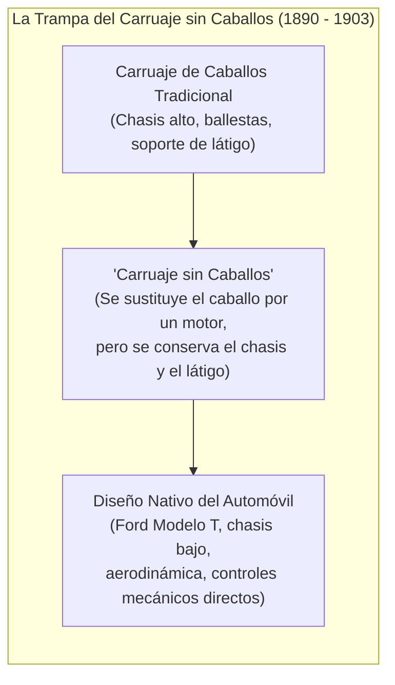
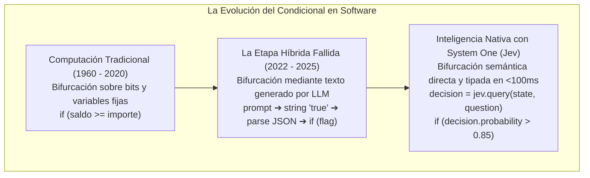

# Módulo 1: Introducción y Tesis Central de Jev
## Apartado 1.2: La Trampa del «Carruaje sin Caballos» (*Horseless Carriage*)

**Serie:** *Fundamentos y Arquitectura de Sistemas con Modelos System One (Jev)*  
**Autor:** Antigravity Engineering Lab  
**Bibliografía y Referencias O'Reilly:**
* [Generative AI Application Integration Patterns](https://learning.oreilly.com/library/view/-/9781835887608/?orm_source=mcp) por Juan Pablo Bustos y Luis Lopez Soria (*Packt Publishing*)
* [Generative AI Design Patterns](https://learning.oreilly.com/library/view/-/9798341622654/?orm_source=mcp) por Valliappa Lakshmanan y Hannes Hapke (*O'Reilly Media, Inc.*)
* [Building Applications with AI Agents](https://learning.oreilly.com/library/view/-/9781098176495/?orm_source=mcp) por Michael Albada (*O'Reilly Media, Inc.*)
* [Architecting Generative AI Applications](https://learning.oreilly.com/library/view/-/9781806678655/?orm_source=mcp) por Leonid Kuligin (*Packt Publishing*)

---

## 1. La Metáfora Histórica: De la Tracción Animal al Motor de Explosión

A finales del siglo XIX y principios del siglo XX, cuando aparecieron los primeros automóviles, los inventores e ingenieros no rediseñaron el transporte desde cero. En lugar de concebir una carrocería adaptada a las nuevas velocidades del motor de combustión interna, tomaron el vehículo preexistente más familiar —el carruaje tirado por caballos— y se limitaron a sustituir al animal por un motor mecánico.

Aquel fenómeno se conoció históricamente como el síndrome del **«carruaje sin caballos» (*horseless carriage*)**. Aquellos primeros vehículos conservaban asientos excesivamente altos pensados para esquivar el estiércol de los caballos, ballestas de suspensión diseñadas para caminos de tierra a baja velocidad e, incluso en algunos modelos de fabricación industrial, **mantenían el soporte para el látigo (*whip socket*)**, a pesar de que ya no existía ningún animal que arrear.



La historia de la tecnología demuestra de forma recurrente que toda disrupción radical se ve forzada inicialmente a adoptar las formas, las inercias y los supuestos de la herramienta a la que reemplaza, antes de descubrir su verdadera **forma nativa**. Solo cuando ingenieros como Henry Ford rompieron con la morfología del carruaje para construir una arquitectura industrial adaptada al motor de combustión, el transporte se transformó en un pilar económico global.

---

## 2. El Síndrome del «Asistente Humano» en la Inteligencia Artificial

En el manifiesto fundacional de TypeSafe AI, Diogo Almeida y su equipo identifican exactamente este mismo fenómeno en el estado del arte de la inteligencia artificial contemporánea: **la IA generativa actual vive atrapada en su propia versión del «carruaje sin caballos»**.

Cuando la investigación demostró que los modelos de lenguaje basados en *Transformers* podían ser alineados mediante RLHF para mantener diálogos coherentes, la industria asumió de forma tácita un diseño universal: **la IA debía adoptar la forma de un asistente humano**.


Entrenar a un modelo para ser un asistente cortés, articulado, agradable y conversador es un objetivo completamente razonable **si se asume que al otro lado de la pantalla siempre hay una persona de carne y hueso**. 

Sin embargo, ese diseño arrastra una consecuencia imprevista y paralizante: **crea una tecnología que exige permanentemente a un ser humano en el bucle (*human-in-the-loop*)**. 

El software empresarial nunca ha funcionado de ese modo. El software no se construye mediante tertulias ni conversaciones educadas; se edifica a través de **capas de abstracción modulares, llamadas a funciones con tipos estrictos, ramas lógicas completamente auditables y procesos desatendidos que corren silenciosamente en segundo plano**.

Forzar a los sistemas informáticos a comunicarse con modelos de inteligencia artificial mediante texto libre equivale a colocarle un soporte para el látigo al motor del software moderno.

---

## 3. El Desajuste de Impedancia: Texto Libre frente a Lógica de Software

El núcleo del problema técnico radica en el denominado **desajuste de impedancia (*impedance mismatch*)** entre la computación clásica y los modelos de lenguaje generativos:

```
[Computación Clásica / Software]        [Modelo Lingüístico Generativo]
• Determinista, binario, exacto         • Estocástico, probabilístico
• Latencia en microsegundos/milisegundos• Latencia en segundos (decodificación token a token)
• Tipos de datos estrictos (int, bool)  • Cadenas de texto arbitrarias (strings)
• Bifurcación sobre bits                • Redacción de prosa continua
```

### La Ineficiencia de Decodificar Texto Token a Token
Cuando un programa informático necesita tomar una decisión —por ejemplo, verificar si una transacción bancaria presenta indicios de fraude o decidir a qué cola de microservicios enviar un paquete de datos—, el código no necesita que nadie le redacte un informe. Solo necesita evaluar una condición: `verdadero` o `falso`, opción `A`, `B` o `C`.

Hacer que un LLM convencional resuelva esa tarea implica:
1. Construir un prompt masivo fingiendo una conversación humana.
2. Iniciar una decodificación autorregresiva donde la GPU debe calcular un vector de probabilidades, seleccionar una palabra, realimentarla a la memoria (*KV cache*) y repetir el ciclo decenas de veces para formar una cadena de texto como:  
   `"{\n  \"es_fraude\": true,\n  \"nivel_riesgo\": \"alto\"\n}"`
3. Pagar una penalización de entre 2.000 y 10.000 milisegundos de tiempo de respuesta.
4. Ejecutar en el backend un parser de JSON y cruzar los dedos para que el modelo no haya intercalado un comentario conversacional, una coma de más o una alucinación que rompa la ejecución del hilo.

Como advierte la literatura sobre patrones de integración (véase *Generative AI Application Integration Patterns* de Bustos y Lopez Soria en O'Reilly), obligar a la infraestructura a parsear cadenas de texto libres generadas por un LLM introduce una fragilidad de acoplamiento que degrada la resiliencia de todo el sistema.

---

## 4. Hacia una Inteligencia Nativa para Máquinas (*Machine-Native Intelligence*)

La verdadera oportunidad de la inteligencia artificial no reside en sustituir a los empleados por chatbots, sino en **dotar al software tradicional de una nueva capacidad primitiva de decisión**.

El software convencional es asombrosamente eficiente bifurcando sobre bits:  
`if (x > 0) then execute_payment()`

Lo que la informática no podía hacer hasta hoy era bifurcar sobre el **sentido común, la intención semántica y el contexto desestructurado**:  
`if (intencion_usuario == CancelacionContrato con certeza > 0.90) then iniciar_retencion()`



### La Lección de las Bases de Datos y los Protocolos de Red
En su manifiesto, TypeSafe AI evoca una lección histórica fundamental:
* Quienes diseñaron las bases de datos relacionales y el lenguaje SQL en los años setenta no estaban imaginando los motores de búsqueda modernos.
* Quienes crearon el protocolo TCP/IP y el estándar HTTP no concibieron las plataformas de pagos globales.

Lo que aquellos pioneros hicieron fue crear **capacidades de bajo nivel tan sólidas, fiables y desatendidas que podían enterrarse cinco capas por debajo de la arquitectura** y apilarse una encima de otra. Solo cuando una tecnología es 100% predecible y segura de integrar, se produce una explosión cámbrica de software.

**Jev es el abandono definitivo del carruaje sin caballos.** Al prescindir de la pose del asistente parlanchín y renunciar a la generación de texto, Jev transforma la potencia semántica de los *Transformers* en una primitiva nativa de ingeniería: un bloque de decisión tipado, sin alucinaciones de formato y con latencia de milisegundos que cualquier programador puede invocar en su código como si fuera una consulta a una base de datos.

---

## 5. Bibliografía y Referencias en O'Reilly Learning

1. **[Generative AI Application Integration Patterns](https://learning.oreilly.com/library/view/-/9781835887608/?orm_source=mcp)**  
   *Juan Pablo Bustos y Luis Lopez Soria (Packt Publishing, 2024)*  
   *Analiza en profundidad los problemas de acoplamiento, la fragilidad de los contratos de interfaz basados en texto y los patrones arquitectónicos para enlazar modelos con sistemas de misión crítica.*

2. **[Generative AI Design Patterns](https://learning.oreilly.com/library/view/-/9798341622654/?orm_source=mcp)**  
   *Valliappa Lakshmanan y Hannes Hapke (O'Reilly Media, Inc., 2025)*  
   *Examina el desajuste entre la decodificación estocástica de cadenas y la necesidad de salidas estructuradas y deterministas en canalizaciones de software empresarial.*

3. **[Building Applications with AI Agents](https://learning.oreilly.com/library/view/-/9781098176495/?orm_source=mcp)**  
   *Michael Albada (O'Reilly Media, Inc., 2025)*  
   *Explica por qué los bucles agénticos que dependen de respuestas en lenguaje natural colapsan debido a la latencia acumulada y los fallos de serialización de esquemas.*

4. **[Architecting Generative AI Applications](https://learning.oreilly.com/library/view/-/9781806678655/?orm_source=mcp)**  
   *Leonid Kuligin (Packt Publishing, 2026)*  
   *Estudia el diseño de infraestructuras compuestas y la sustitución progresiva de generadores de texto monolíticos por evaluadores y clasificadores especializados de baja latencia.*

---

## 6. Versión para Locución en ElevenLabs (Solo Texto)

*Texto limpio, fluido y adaptado fonéticamente para su síntesis directa:*

---

A finales del siglo diecinueve, cuando aparecieron los primeros automóviles, los inventores no diseñaron un vehículo completamente nuevo. Lo que hicieron fue tomar el carruaje de caballos tradicional y limitarse a sustituir al animal por un motor de combustión. 

Aquellos vehículos primitivos se conocieron como carruajes sin caballos. Mantenían asientos altísimos pensados para esquivar el barro y las salpicaduras de los animales, ballestas de carretilla pensadas para ir muy despacio e, incluso en muchos modelos, conservaban un soporte para colocar el látigo, a pesar de que ya no había ningún caballo que arrear. 

La historia de la tecnología demuestra que, cada vez que surge una revolución radical, tendemos a meter la nueva herramienta dentro del molde de lo que ya conocemos antes de descubrir su forma nativa. Solo cuando la industria automovilística rompió con el diseño del carruaje para construir chasis bajos y aerodinámicos adaptados a la potencia del motor, el automóvil transformó el mundo.

En Taip Seif Ei Ai sostienen que la inteligencia artificial actual está cometiendo exactamente el mismo error. Al ver que los modelos lingüísticos eran capaces de mantener conversaciones coherentes, la industria asumió que toda la inteligencia artificial debía tener la forma de un asistente humano: amable, conversador y educado. 

Diseñar un modelo para que hable como una persona es una buena idea si al otro lado de la pantalla hay un ser humano. Pero tiene una consecuencia imprevista: obliga a tener siempre a una persona vigilando la pantalla y esperando una respuesta. 

El software nunca ha funcionado de esa manera. Los sistemas informáticos de la banca, el comercio electrónico o la logística no funcionan mediante charlas ni conversaciones. Se construyen mediante módulos independientes, funciones exactas y procesos automáticos que operan silenciosamente en segundo plano.

Obligar a un programa informático a comunicarse con un modelo de inteligencia artificial mediante texto libre es el equivalente moderno a ponerle un soporte para el látigo al motor del software. Cuando un programa necesita tomar una decisión, como verificar un posible fraude o clasificar una petición, el código no necesita que nadie le escriba un párrafo explicativo; solo necesita saber si una condición es verdadera o falsa, o qué opción debe elegir. 

Hacer que un modelo convencional responda a esa pregunta significa obligar a una máquina a escribir una frase palabra por palabra, tardando varios segundos, gastando una gran cantidad de energía y con el riesgo permanente de que una palabra mal puesta rompa la ejecución del sistema.

Las computadoras llevan décadas transformando el mundo gracias a su capacidad de tomar decisiones basadas en ceros y unos. El gran reto de nuestra época es lograr que el software pueda tomar esas mismas decisiones basadas en el sentido común, la intención y el contexto. 

Yev representa precisamente la superación del carruaje sin caballos. Al renunciar a la pose del asistente parlanchín y negarse a generar texto libre, transforma la comprensión de la inteligencia artificial moderna en una pieza nativa para el software: una herramienta de decisión directa, con tipos de datos seguros, sin alucinaciones de formato y con una velocidad de milisegundos, lista para ser integrada en el código exactamente igual que una consulta a una base de datos.

---

## 7. Versión para Gemini Notebook (Presentación y Diapositivas)

*Texto canónico, con tipografía técnica exacta (`Jev`, `TypeSafe AI`, `Horseless Carriage`, `Transformers`, `LLMs`, `KV Cache`, `SQL`, `TCP/IP`, etc.), números estándar y formato editorial listo para diapositivas:*

# La Trampa del «Carruaje sin Caballos» (Horseless Carriage)
## De la Inercia del Asistente Humano a la Inteligencia Nativa de Software

### 1. La Metáfora Histórica del Transporte
* A finales del siglo XIX, los primeros automóviles se concibieron como **«carruajes sin caballos» (*horseless carriages*)**: se sustituyó al caballo por un motor de explosión, pero se conservaron el chasis alto de madera, la suspensión de carretilla y el soporte para el látigo (*whip socket*).
* Toda tecnología disruptiva se fuerza inicialmente dentro de las inercias y supuestos de la tecnología a la que sustituye, hasta que encuentra su **arquitectura nativa** (el hito del Ford Modelo T frente al carruaje tradicional).

### 2. El Síndrome del «Asistente Humano» en la IA Actual
* Tras la llegada de los Transformers y la alineación mediante RLHF, la industria asumió un diseño monolítico: **la IA debía empaquetarse siempre bajo la forma de un asistente conversacional humano**.
* **El efecto secundario:** Entrenar a los modelos para dialogar, ser amables y redactar respuestas elocuentes los optimiza para usuarios humanos, pero **los inhabilita para operar desatendidos dentro de la arquitectura del software**.
* El software empresarial no funciona mediante charlas; opera sobre grafos de dependencias, contratos de API estrictos, latencias en milisegundos y ejecución silenciosa en segundo plano.

### 3. El Desajuste de Impedancia: Texto Libre vs. Lógica de Software
* **La computación clásica:** Determinista, binaria, exacta, con latencias de milisegundos y tipos de datos fuertes (`int`, `bool`, `enum`).
* **Los LLMs conversacionales:** Estocásticos, lentos (generación token a token mediante *KV Cache*), salidas en texto libre (*strings*) y propensos a alucinaciones sintácticas.
* **La ineficiencia en producción:** Forzar a un modelo generativo a redactar texto libre solo para emitir una decisión lógica de negocio (como una condición de fraude o un enrutamiento de peticiones) introduce retardos de 2 a 10 segundos y riesgos constantes de fallo en el parseo de JSON.

### 4. La Superación del Carruaje: Inteligencia Nativa para Máquinas
* **La analogía histórica de las primitivas de infraestructura:** Quienes diseñaron SQL y las bases de datos relacionales en los años 70 no imaginaban Google; crearon primitivas tan sólidas, fiables y composables que permitieron edificar capas complejas encima de ellas.
* **El salto conceptual de Jev (TypeSafe AI):**
  * Renuncia deliberada al texto libre y al rol de asistente parlanchín.
  * Transforma la comprensión semántica profunda de los Transformers en una primitiva de ejecución directa para software.
  * Permite al código bifurcar no solo sobre bits binarios, sino sobre intención, sentido común y semántica en menos de 100 ms, con seguridad de tipos garantizada (0% de errores de esquema) y coste de salida nulo.
