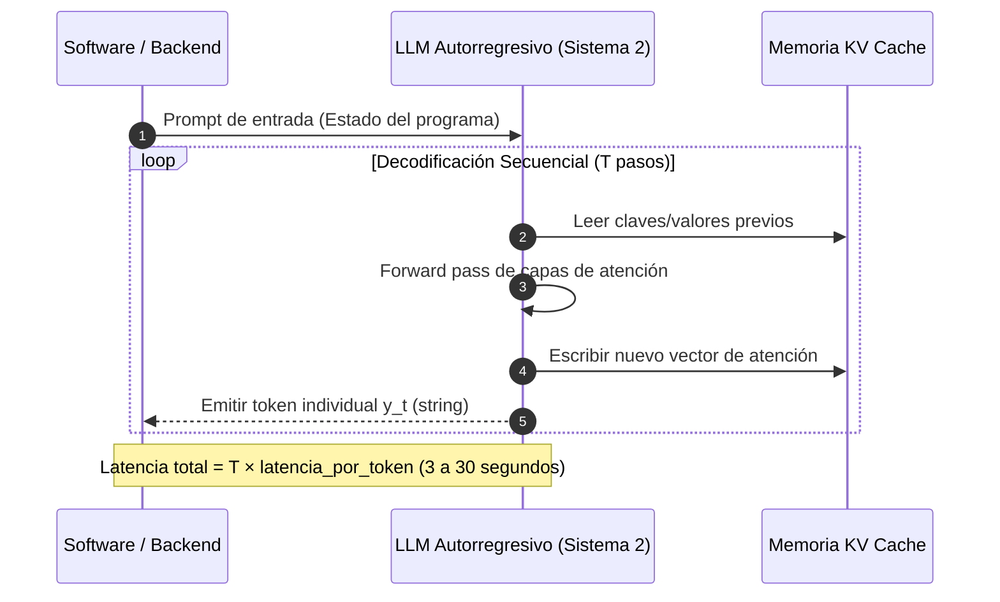
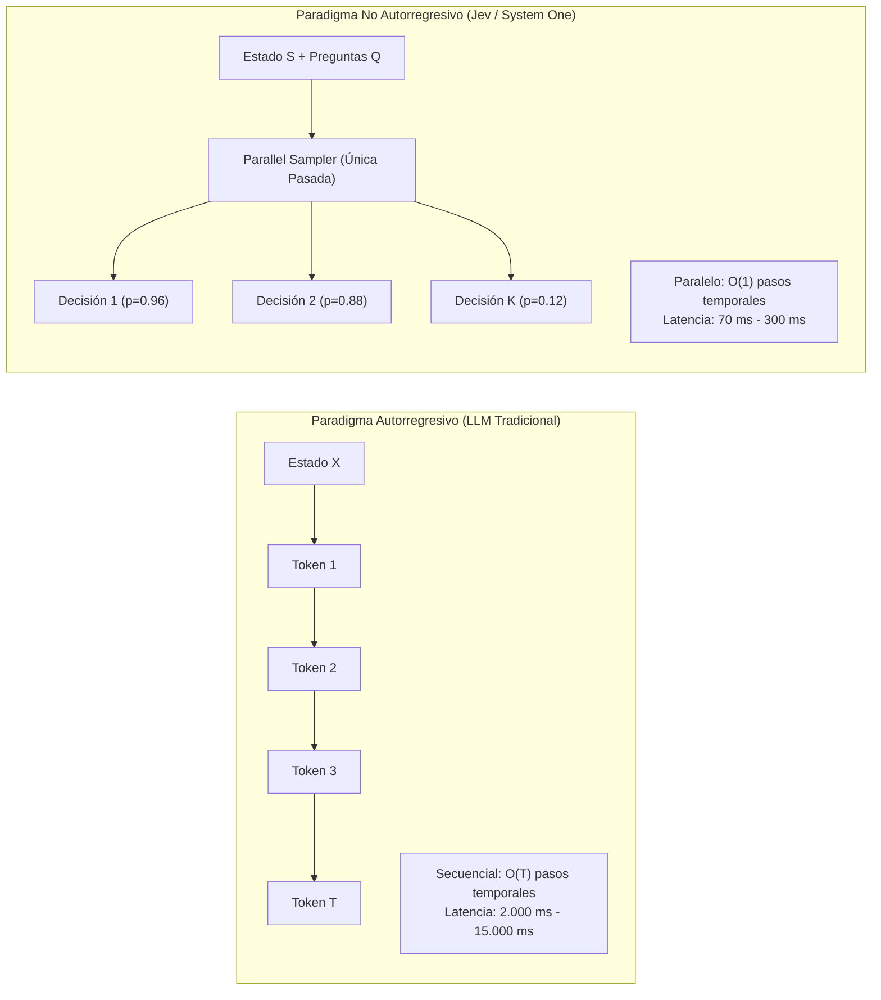
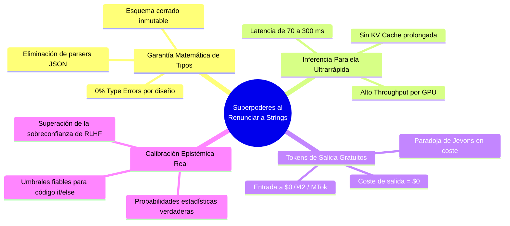

# Módulo 1: Introducción y Tesis Central de Jev
## Apartado 1.3: Definición Formal de «System One Model»

**Serie:** *Fundamentos y Arquitectura de Sistemas con Modelos System One (Jev)*  
**Autor:** Antigravity Engineering Lab  
**Bibliografía y Referencias O'Reilly:**
* [Generative AI Design Patterns](https://learning.oreilly.com/library/view/-/9798341622654/?orm_source=mcp) por Valliappa Lakshmanan y Hannes Hapke (*O'Reilly Media, Inc.*)
* [Building Applications with AI Agents](https://learning.oreilly.com/library/view/-/9781098176495/?orm_source=mcp) por Michael Albada (*O'Reilly Media, Inc.*)
* [Uncertainty in Artificial Intelligence](https://learning.oreilly.com/library/view/-/9781483298566/?orm_source=mcp) por Bruce D'Ambrosio et al. (*Morgan Kaufmann / O'Reilly*)
* [Distributed AI Systems](https://learning.oreilly.com/library/view/-/9781807301712/?orm_source=mcp) por Fuheng Wu (*Packt Publishing*)

---

## 1. El Cuello de Botella de la Inferencia Autorregresiva

Para formalizar qué es un **«System One Model»** (Modelo de Sistema 1), es imprescindible entender primero la física computacional del modelo dominante en la IA generativa: el modelo **autorregresivo**.

Un Modelo de Lenguaje Grande tradicional (como GPT-4 o Claude) genera texto mediante un proceso estrictamente secuencial. Dado un contexto de entrada $X$, el modelo calcula la probabilidad de la secuencia completa factorizándola token a token:

$$\mathbb{P}(Y \mid X) = \prod_{t=1}^{T} \mathbb{P}(y_t \mid y_{<t}, X)$$

Esto significa que para producir una respuesta de $T$ tokens, la GPU debe ejecutar **$T$ pasos secuenciales no paralelizables**:
1. Computa el token $y_1$ a través de todas las capas de atención del Transformer.
2. Almacena las claves y valores en memoria (*KV Cache*).
3. Realimenta $y_1$ como entrada para calcular $y_2$.
4. Repite el ciclo hasta que el modelo emite un token especial de parada (`<|endoftext|>`).



En tareas deliberativas (escribir un ensayo, programar una función compleja o razonar un teorema matemático paso a paso), esta decodificación secuencial es insustituible. Es el equivalente computacional del **Sistema 2 de Kahneman**: un proceso reflexivo, lento, costoso y paso a paso.

Sin embargo, cuando este mecanismo se utiliza dentro de una tubería de software para tomar decisiones lógicas (como clasificar la intención de un usuario, filtrar un prompt malicioso o seleccionar una herramienta), se convierte en un desperdicio masivo de recursos computacionales.

---

## 2. Inferencia No Autorregresiva y Muestreo Paralelo (*Parallel Sampler*)

Un **Modelo de Sistema 1** rompe radicalmente con la decodificación secuencial. En lugar de predecir una cadena de texto token a token a lo largo del tiempo, **Jev implementa inferencia no autorregresiva con un muestreador paralelo (*Parallel Sampler*)**.

Dado un estado arbitrario del sistema $S$ (texto, código, logs o JSON) y un conjunto de preguntas tipadas $Q = \{q_1, q_2, \dots, q_k\}$, el modelo evalúa todas las respuestas **en una única pasada hacia adelante (*single forward pass*)**:

$$\mathbb{P}(D_1, D_2, \dots, D_k \mid S, Q) = \left[ \mathbb{P}(D_1 \mid S, q_1), \, \mathbb{P}(D_2 \mid S, q_2), \, \dots, \, \mathbb{P}(D_k \mid S, q_k) \right]$$



### Ventajas Operativas del Muestreo Paralelo
* **Complejidad temporal $O(1)$ en lugar de $O(T)$:** La latencia no depende de la longitud de la respuesta, sino únicamente del tiempo que tarda la GPU en procesar el estado de entrada.
* **Eliminación de la memoria KV Cache:** Al no haber bucle secuencial de generación de tokens, el consumo de memoria en la tarjeta gráfica se desploma, permitiendo un rendimiento de miles de consultas por segundo por chip.
* **Latencia sub-100 milisegundos:** Respuestas inmediatas en el rango de 70 a 500 ms, aptas para interfaces de usuario en tiempo real y microservicios.

---

## 3. «La Renuncia a los Strings» y sus Superpoderes de Software

El concepto medular introducido por TypeSafe AI en la presentación de Jev se resume en una frase categórica: **«Renunciar a las cadenas de texto (*giving up strings*) otorga superpoderes arquitectónicos al software»**.

Las cadenas de texto (*strings*) son universales y flexibles, pero en ingeniería de software representan la interfaz más costosa, frágil e insegura que existe. Al renunciar por completo a emitir texto en lenguaje natural, Jev adquiere cuatro propiedades que ningún LLM generativo puede ofrecer:



1. **Garantía Matemática de Tipos (0% Type Errors):**  
   En un LLM, incluso usando herramientas como Pydantic, JSON Schema o *grammar-constrained decoding*, el modelo sigue internamente decodificando caracteres individuales intentando encajar en una gramática formal. Si la combinación de claves es compleja o el contexto es ambiguo, el modelo puede colapsar o inventar campos inexistentes. En Jev, las salidas no se decodifican: se proyectan directamente sobre cabezas de clasificación fijas. La coincidencia con el esquema no es empírica: **es matemáticamente imposible cometer un error de tipo**.
2. **Tokens de Salida Gratuitos ($0):**  
   En los LLMs convencionales, los tokens de salida son hasta 5 veces más caros que los de entrada porque exigen computación autorregresiva activa. En Jev, al no haber generación de cadenas de texto, **los tokens de salida son gratuitos (demasiado baratos para medirlos)**. Solo se tarifican los tokens de entrada a un precio residual (\$0.042 por millón de tokens).
3. **Ausencia Total de Alucinaciones Sintácticas:**  
   Un modelo no puede alucinar una llamada a una función que no existe ni escribir mal un valor booleano si su propia arquitectura física no tiene la capacidad de emitir texto libre.

---

## 4. Las Tres Primitivas Atómicas de Decisión de Jev

En lugar de devolver cadenas de texto, Jev canaliza toda la comprensión semántica del mundo hacia tres primitivas de datos estructurados:

| Primitiva | Firma Conceptual | Salida Devuelta | Caso de Uso Canónico |
| :--- | :--- | :--- | :--- |
| **`Choice`** | `Choice(pregunta, options=[...])` | Opción ganadora (`str`) + Distribución completa de probabilidades $\{\text{opt}_i: p_i\}$ | Enrutamiento de tickets, selección fija de herramientas, clasificación multiclase (hasta 255 opciones). |
| **`Score`** | `Score(rubrica_o_criterio)` | Puntuación continua normalizada ($\in \mathbb{R}$) | Evaluación de gravedad de incidentes, nivel de frustración, scoring de riesgo crediticio. |
| **`Noul`** | `Noul(afirmacion_o_hipotesis)` | Valor booleano (`True`/`False`) + Probabilidad calibrada $p \in [0, 1]$ | *Guardrails* de seguridad, verificación de jailbreaks, comprobación de cumplimiento de políticas. |

### Ejemplo de Definición de Contrato en Código:
```python
from typesafe_sdk import TypeSafeClient, Choice, Noul, Score

client = TypeSafeClient()

# El estado puede ser texto no estructurado, un JSON complejo o un dump de logs
estado_transaccion = {
    "usuario_id": "usr_9921",
    "ip": "194.26.29.11",
    "pais": "Nigeria",
    "historial_compras": "España",
    "importe_eur": 4500.00
}

# Invocación atómica en una única pasada de GPU
resultado = client.system_one(
    state=estado_transaccion,
    questions={
        "es_fraude": Noul("¿Presenta la transacción anomalías críticas de geolocalización o importe?"),
        "accion_recomendada": Choice("Acción de mitigación", options=["bloquear", "solicitar_2fa", "aprobar"]),
        "nivel_riesgo": Score("Puntuación de riesgo de 0.0 a 1.0 según la política de seguridad")
    }
)

# Acceso inmediato y tipado en código Python nativo:
# resultado.answers.es_fraude.noul          -> True
# resultado.answers.es_fraude.probability   -> 0.9412
# resultado.answers.accion_recomendada.choice -> "bloquear"
# resultado.answers.nivel_riesgo.score       -> 0.89
```

---

## 5. Calibración Epistémica frente a Sobreconfianza

La última pieza que define formalmente a un Modelo de Sistema 1 es la **calibración epistémica**.

En los LLMs alineados con RLHF, el modelo está optimizado para sonar convincente y persuasivo ante evaluadores humanos. Como demuestran numerosos estudios en la literatura de incertidumbre en IA (véase *Uncertainty in Artificial Intelligence* en O'Reilly), esto produce modelos **groseramente sobreconfiados**: un LLM puede asignar un 99% de probabilidad subjetiva a una respuesta que es completamente falsa. Si un modelo acierta el 95% de las veces pero no es capaz de señalar cuándo se encuentra en el 5% de error, **no se puede automatizar un sistema de software sobre él**.

Jev está entrenado mediante **RLCD (*Reinforcement Learning for Calibrated Decisions*)**. Su función de pérdida penaliza el Error de Calibración Esperado (*Expected Calibration Error* - ECE):

$$\text{ECE} = \sum_{m=1}^{M} \frac{|B_m|}{N} \left| \text{acc}(B_m) - \text{conf}(B_m) \right| \longrightarrow 0$$

Esto garantiza que cuando Jev emite una confianza del 90%, el software puede confiar estadísticamente en que acertará exactamente 90 de cada 100 veces. Esto permite construir bifurcaciones lógicas auditables en producción:

```python
decision = resultado.answers.es_fraude

if decision.probability >= 0.90:
    bloquear_cuenta_inmediatamente()
elif decision.probability >= 0.50:
    escalar_a_operador_humano_o_sistema_dos() # LLM deliberativo lento
else:
    procesar_pago()
```

---

## 6. Bibliografía y Referencias en O'Reilly Learning

1. **[Generative AI Design Patterns](https://learning.oreilly.com/library/view/-/9798341622654/?orm_source=mcp)**  
   *Valliappa Lakshmanan y Hannes Hapke (O'Reilly Media, Inc., 2025)*  
   *Detalla los patrones de Structured Outputs y Evaluator, destacando las deficiencias del muestreo autorregresivo frente a las clasificaciones tipadas directas.*

2. **[Building Applications with AI Agents](https://learning.oreilly.com/library/view/-/9781098176495/?orm_source=mcp)**  
   *Michael Albada (O'Reilly Media, Inc., 2025)*  
   *Analiza la acumulación de latencia en grafos de agentes y la necesidad de motores de inferencia no autorregresivos para el enrutamiento de herramientas.*

3. **[Uncertainty in Artificial Intelligence](https://learning.oreilly.com/library/view/-/9781483298566/?orm_source=mcp)**  
   *Bruce D'Ambrosio et al. (Morgan Kaufmann / O'Reilly)*  
   *La obra teórica fundacional sobre calibración probabilística, redes bayesianas y toma de decisiones bajo incertidumbre matemática.*

4. **[Distributed AI Systems](https://learning.oreilly.com/library/view/-/9781807301712/?orm_source=mcp)**  
   *Fuheng Wu (Packt Publishing, 2026)*  
   *Explica la optimización de hardware en inferencia paralela, la saturación de la memoria KV cache y el diseño de microservicios de baja latencia con aceleradores GPU.*

---

## 7. Versión para Locución en ElevenLabs (Solo Texto)

*Texto continuo, adaptado fonéticamente (`Yev`, `Taip Seif Ei Ai`, `Sistema Uno`, `Sistema Dos`, `GPT`, etc.) y listo para síntesis directa:*

---

Para entender qué es exactamente un modelo de Sistema Uno, primero debemos comprender cómo funcionan los modelos de lenguaje tradicionales y cuál es el gran cuello de botella que arrastran. 

Los modelos generativos como GPT funcionan mediante un proceso llamado decodificación autorregresiva. Esto significa que generan las respuestas de forma estrictamente secuencial, calculando una palabra, guardándola en la memoria de la tarjeta gráfica y volviendo a empezar para calcular la siguiente palabra. Si una respuesta tiene cincuenta palabras, el modelo tiene que repetir ese ciclo cincuenta veces consecutivas. Este proceso paso a paso es ideal cuando necesitamos que la máquina reflexione, redacte un texto largo o resuelva un problema complejo; es el equivalente computacional del Sistema Dos humano: lento, deliberado y exigente. 

Sin embargo, cuando un programa informático solo necesita saber si un correo es peligroso o a qué departamento dirigir una consulta, obligar a una máquina a escribir una frase palabra por palabra es un desperdicio absoluto de tiempo y dinero. 

Un modelo de Sistema Uno rompe por completo con este esquema. En lugar de escribir texto de forma secuencial, Yev utiliza lo que se conoce como inferencia no autorregresiva con un muestreador paralelo. Cuando el software le envía un paquete de datos y una serie de preguntas, Yev evalúa todas las respuestas al mismo tiempo en una única pasada de la tarjeta gráfica. 

El resultado es un salto de rendimiento espectacular. La latencia se reduce de varios segundos a un intervalo de entre setenta y trescientos milisegundos, permitiendo que la inteligencia artificial responda a la misma velocidad a la que se actualiza una pantalla o se procesa una tarjeta de crédito. Además, al no tener que generar cadenas de texto paso a paso, el consumo de memoria en los servidores se desploma. 

Aquí llegamos a la gran decisión de diseño de Taip Seif Ei Ai: renunciar por completo a las cadenas de texto libre. Escribir texto es muy flexible, pero para la ingeniería de software es la interfaz más lenta, frágil e insegura que existe. Al renunciar al texto libre, Yev adquiere ventajas determinantes. 

La primera es la seguridad matemática de tipos. En los modelos convencionales, la inteligencia artificial a menudo comete errores de formato o inventa campos inexistentes. En Yev, las respuestas se proyectan directamente sobre estructuras de datos cerradas: opciones fijas, puntuaciones numéricas o verificaciones de verdadero y falso. La posibilidad de cometer un error de formato es exactamente del cero por ciento. 

La segunda ventaja es económica: al no existir generación de texto libre, los datos de salida son totalmente gratuitos para el usuario. Y la tercera es la honestidad de sus probabilidades. Los modelos tradicionales suelen mostrar una seguridad absoluta incluso cuando están completamente equivocados. Yev, en cambio, está entrenado mediante un método de calibración que asegura que sus porcentajes de confianza coincidan con la realidad estadística. Si el modelo afirma tener un noventa por ciento de certeza, el programador sabe que puede confiar en ese dato para que su código tome decisiones automáticas sin miedo a fallos inesperados.

---

## 8. Versión para Gemini Notebook (Presentación y Diapositivas)

*Texto estructurado y canónico (`Jev`, `TypeSafe AI`, `System One`, `Parallel Sampler`, `KV Cache`, `Choice`, `Score`, `Noul`, `RLCD`, etc.), listo para generación de diapositivas:*

# Definición Formal de «System One Model»
## Inferencia No Autorregresiva y la Renuncia a las Cadenas de Texto

### 1. El Cuello de Botella Secuencial: Inferencia Autorregresiva (Sistema 2)
* **La mecánica tradicional:** Los LLMs generativos factorizan la probabilidad secuencialmente:  
  $$\mathbb{P}(Y \mid X) = \prod_{t=1}^T \mathbb{P}(y_t \mid y_{<t}, X)$$
* **La penalización computacional:** Para generar $T$ tokens, la GPU ejecuta $T$ pasos secuenciales en memoria (*KV Cache*), generando latencias de 3 a 30 segundos.
* Adecuado para razonamiento deliberativo y redacción de documentos; completamente ineficiente para la toma de decisiones dentro del código.

### 2. Inferencia No Autorregresiva y Muestreo Paralelo (Sistema 1)
* **La arquitectura de Jev:** Evalúa el estado del software $S$ y un catálogo de preguntas tipadas $Q$ en una **única pasada hacia adelante (*single forward pass*)**:  
  $$\text{Latencia temporal: } O(1) \quad (\text{frente a } O(T) \text{ en LLMs})$$
* **Rendimiento:** Latencias de **70 ms a 300 ms** (tiempo real interactivo), eliminación del almacenamiento prolongado de memoria *KV Cache* y multiplicación del *throughput* por GPU.

### 3. La «Renuncia a los Strings» y sus Superpoderes Arquitectónicos
* **0% Type Errors (Garantizado por Construcción):** Las salidas se mapean directamente a primitivas estructuradas; la coincidencia con el esquema de datos no es probabilística, es matemáticamente obligatoria.
* **Tokens de Salida a Coste Cero ($0):** Al no existir decodificación autorregresiva prolongada, los tokens de salida son gratuitos; los de entrada se procesan a \$0.042 / MTok.
* **Cero Alucinaciones Sintácticas:** Imposibilidad física de emitir texto malformado, JSONs corruptos o llamadas a herramientas inexistentes.

### 4. Las Tres Primitivas Atómicas de Decisión de Jev
1. **`Choice` (Selección Categórica):** Devuelve la opción elegida dentro de un catálogo cerrado (cardinalidad hasta 255) junto a la distribución completa de probabilidades.
2. **`Score` (Puntuación Continua):** Calificación numérica normalizada sobre una rúbrica o criterio cualitativo.
3. **`Noul` (Booleano Probabilístico):** Verificación de veracidad (`True`/`False`) acompañada de una probabilidad calibrada $p \in [0, 1]$.

### 5. Calibración Epistémica Real mediante RLCD
* **El problema de RLHF:** Los modelos generativos optimizan la persuasión humana, derivando en sobreconfianza patológica (afirman falsedades con 99% de certeza subjetiva).
* **El entrenamiento RLCD (*Reinforcement Learning for Calibrated Decisions*):** Minimiza activamente el Error de Calibración Esperado (ECE), garantizando que:  
  $$\mathbb{P}(\text{Decisión Correcta} \mid \text{Confianza} = p) = p$$
* Habilita a los ingenieros de software a programar bifurcaciones condicionales seguras (`if/else`) basadas en umbrales estadísticos auditables.
