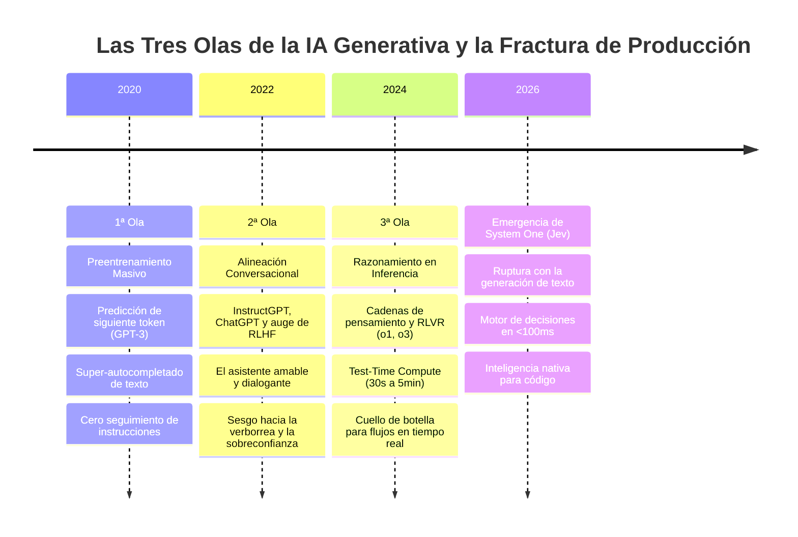
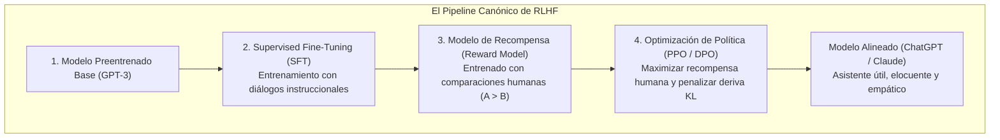
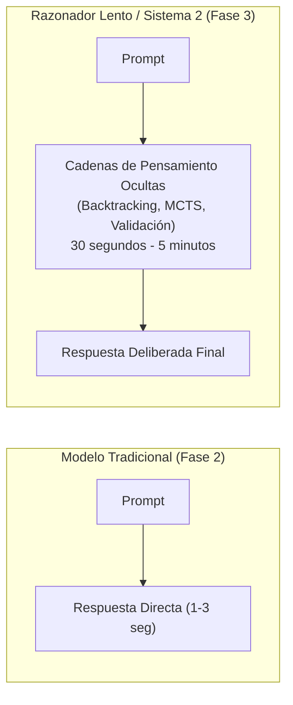

# Módulo 2: Jev en la Evolución General de la IA Generativa
## Apartado 2.1: De la Predicción de Tokens a RLHF y los Razonadores Lentos

**Serie:** *Fundamentos y Arquitectura de Sistemas con Modelos System One (Jev)*  
**Autor:** Antigravity Engineering Lab  
**Bibliografía y Referencias O'Reilly:**
* [Reinforcement Learning from Human Feedback](https://learning.oreilly.com/library/view/-/9781633434301/?orm_source=mcp) por Nathan Lambert (*Manning Publications / O'Reilly*)
* [Generative AI Design Patterns](https://learning.oreilly.com/library/view/-/9798341622654/?orm_source=mcp) por Valliappa Lakshmanan y Hannes Hapke (*O'Reilly Media, Inc.*)
* [Building Applications with AI Agents](https://learning.oreilly.com/library/view/-/9781098176495/?orm_source=mcp) por Michael Albada (*O'Reilly Media, Inc.*)
* [Architecting Generative AI Applications](https://learning.oreilly.com/library/view/-/9781806678655/?orm_source=mcp) por Leonid Kuligin (*Packt Publishing*)

---

## 1. El Arco Evolutivo de la IA Moderna (2020 - 2026)

Para comprender el nicho disruptivo de **Jev**, es imprescindible situarlo en la cronología técnica de los últimos seis años. La inteligencia artificial moderna no ha avanzado de forma lineal; ha transitado por **tres olas arquitectónicas sucesivas**, cada una resolviendo las deficiencias de la anterior pero introduciendo nuevos cuellos de botella para la ingeniería de software:

---

## 2. Primera Ola: Preentrenamiento no Supervisado y el «Super-Autocompletado»

El punto de partida de la revolución contemporánea fue la formulación del modelado lingüístico autorregresivo a escala masiva, personificado en **GPT-3** (Brown et al., 2020).

La función objetivo del preentrenamiento era conceptualmente simple: maximizar la verosimilitud de la predicción del siguiente token sobre un corpus gigantesco de texto web:

$$\mathcal{L}_{\text{MLE}}(\theta) = \sum_{t=1}^{T} \log \mathbb{P}_\theta(w_t \mid w_1, w_2, \dots, w_{t-1})$$

A través de esta tarea, la red neuronal aprendió la gramática, la sintaxis y una vasta red de asociaciones semánticas sobre el conocimiento humano. Sin embargo, operativamente, estos modelos no eran más que **simuladores probabilísticos o «super-autocompletados»**:
* Si se les introducía una pregunta como: *«¿Cuál es la capital de Francia?»*, el modelo a menudo no respondía con la capital, sino que continuaba el texto simulando un examen: *«¿Cuál es la capital de España? ¿Cuál es la capital de Italia?»*.
* Eran caóticos, propensos a vomitar ruido de internet y totalmente incapaces de seguir instrucciones de negocio de manera consistente.

---

## 3. Segunda Ola: Alineación Conversacional mediante RLHF

La segunda gran transformación técnica fue liderada por el equipo de OpenAI (con Diogo Almeida entre sus autores) mediante el desarrollo de **InstructGPT** (Ouyang et al., 2022), sentando las bases de **ChatGPT**.

Para transformar un predictor estadístico ciego en una herramienta útil para los humanos, se implementó el paradigma del **Aprendizaje por Refuerzo a partir de Retroalimentación Humana (RLHF)**:

### La Consecuencia Imprevista: El Sesgo Conversacional
El RLHF tuvo un éxito descomunal optimizando los modelos para las preferencias subjetivas de los usuarios: respuestas amables, detalladas, complacientes y corteses. 

Sin embargo, en esa misma fortaleza residía su condena arquitectónica para el software. Los modelos quedaron **sesgados hacia la verborrea y la sobreconfianza**. Cuando un sistema de backend requiere una validación lógica o un enrutamiento booleano, un modelo alineado por RLHF tiende a justificar su razonamiento con párrafos de cortesía y justificaciones no solicitadas, introduciendo una penalización de tokens y latencia intolerable en producción.

---

## 4. Tercera Ola: Razonamiento Lento en Inferencia (*Test-Time Compute* y RLVR)

A medida que el escalado del preentrenamiento comenzó a mostrar rendimientos decrecientes (debido al agotamiento de datos públicos de calidad y limitaciones energéticas), los laboratorios de frontera exploraron un nuevo eje de escalado: **el cómputo en tiempo de inferencia (*Test-Time Compute Scaling*)**.

Modelos como **OpenAI o1** y sus sucesores introdujeron un cambio de paradigma guiado por dos mecanismos:
1. **Cadenas de Pensamiento Ocultas (*Hidden Chains of Thought*):** Antes de responder, el modelo genera cientos o miles de tokens intermedios de razonamiento en un espacio privado (*scratchpad*), explorando hipótesis, detectando errores y corrigiendo su propia lógica.
2. **Aprendizaje por Refuerzo con Recompensas Verificables (RLVR):** En lugar de depender de preferencias humanas subjetivas (RLHF), el modelo se entrena en entornos de validación objetiva (matemáticas formales, pruebas unitarias de código, juegos de lógica) donde un compilador o un validador emite una recompensa binaria indiscutible.

### El Cuello de Botella Operativo del Sistema 2
Los modelos de razonamiento lento representan una proeza matemática para problemas complejos: resolución de olimpiadas científicas, optimización de kernels de GPU o refactorización de bases de código complejas. Son el **Sistema 2** puro en la definición de Kahneman.

Sin embargo, para la infraestructura del software de producción, el modelo de razonamiento lento es un desastre operativo si se utiliza de forma generalizada:
* **Tiempos de espera incompatibles:** Tiempos de respuesta que oscilan entre 20 segundos y varios minutos.
* **Costes prohibitivos:** El consumo de cómputo en inferencia se dispara por el cálculo de miles de tokens de pensamiento intermedio que el usuario ni siquiera ve.
* **Sobrediseño para decisiones simples:** Utilizar un razonador de 100 segundos para decidir si un correo es spam o clasificar una categoría de producto equivale a encargarle a un comité de catedráticos que decida si encender la luz del pasillo.

---

## 5. El Gran Vacío: La Necesidad de un Modelo «System One»

La evolución de la IA generativa dejó a la industria dividida entre dos extremos:
* **Asistentes conversacionales (Fase 2):** Inestables, propensos a alucinaciones de formato y diseñados para dialogar con humanos.
* **Razonadores deliberativos (Fase 3):** Extremadamente lentos, caros y diseñados para problemas matemáticos profundos.

En medio de estos dos mundos quedó un vacío crítico: **las millones de decisiones por segundo que constituyen el corazón del software empresarial**. 

Aquí es donde se inserta **Jev**: un modelo que aprovecha la inmensa comprensión semántica cultivada a lo largo de estas tres olas, pero que descarta tanto la verborrea de los chatbots como la lentitud agónica de los razonadores, proporcionando una respuesta no generativa, calibrada y tipada en menos de cien milisegundos.

---

## 6. Bibliografía y Referencias en O'Reilly Learning

1. **[Reinforcement Learning from Human Feedback](https://learning.oreilly.com/library/view/-/9781633434301/?orm_source=mcp)**  
   *Nathan Lambert (Manning Publications / O'Reilly, 2026)*  
   *El texto definitivo sobre la transición del preentrenamiento autorregresivo a la alineación mediante modelos de recompensa, analizando los sesgos de longitud y sobreconfianza introducidos por RLHF.*

2. **[Generative AI Design Patterns](https://learning.oreilly.com/library/view/-/9798341622654/?orm_source=mcp)**  
   *Valliappa Lakshmanan y Hannes Hapke (O'Reilly Media, Inc., 2025)*  
   *Analiza la brecha de rendimiento entre tareas de síntesis y tareas de decisión dentro de canalizaciones compuestas en producción.*

3. **[Building Applications with AI Agents](https://learning.oreilly.com/library/view/-/9781098176495/?orm_source=mcp)**  
   *Michael Albada (O'Reilly Media, Inc., 2025)*  
   *Examina el impacto letal de la latencia cuando se integran modelos lentos de razonamiento en bucles de ejecución de agentes autónomos.*

4. **[Architecting Generative AI Applications](https://learning.oreilly.com/library/view/-/9781806678655/?orm_source=mcp)**  
   *Leonid Kuligin (Packt Publishing, 2026)*  
   *Estudia los límites económicos y de escalabilidad de los modelos pesados de inferencia frente a la necesidad de clasificadores ultrarrápidos en el perímetro.*

---

## 7. Versión para Gemini Notebook (Texto Exacto con Ortografía Canónica)
*Para procesar en Gemini Notebook y generar presentaciones perfectamente sincronizadas con el audio:*

Para entender el papel que juega Jev en el panorama actual de la inteligencia artificial, es necesario examinar las tres grandes olas que han marcado la evolución reciente de esta tecnología. 

La primera ola comenzó en 2020 con el lanzamiento de modelos masivos como GPT-3. En aquel momento, estos sistemas funcionaban simplemente prediciendo cuál era la palabra más probable que debía ir a continuación en un texto. Aunque tenían una capacidad impresionante para recordar datos de internet, no entendían instrucciones y actuaban como un super-autocompletado. Si alguien les hacía una pregunta directa, a menudo se limitaban a inventarse más preguntas en lugar de dar una respuesta útil. 

Para solucionar ese problema, en 2022 nació la segunda ola con InstructGPT y ChatGPT. Aquí se introdujo el aprendizaje por refuerzo a partir de retroalimentación humana, conocido como RLHF. Esta técnica enseñó a los modelos a comportarse como asistentes educados, amables y serviciales, optimizados para dialogar con personas. Sin embargo, este enfoque trajo consigo una trampa imprevista: los modelos se volvieron excesivamente habladores y adquirieron una sobreconfianza peligrosa, contestando con tono de absoluta seguridad incluso cuando cometían errores graves. 

En 2024 la industria dio un nuevo salto con la tercera ola: los modelos de razonamiento deliberado, conocidos como Sistema 2, cuyo exponente más visible es OpenAI o1. En lugar de responder de inmediato, estos modelos utilizan cadenas de pensamiento internas y métodos de verificación matemática para reflexionar durante decenas de segundos, e incluso minutos, antes de emitir una respuesta. Son herramientas extraordinarias para resolver teoremas complejos o programar algoritmos difíciles, pero su lentitud y su elevado coste los hacen inviables para el funcionamiento cotidiano del software. 

Esta evolución dejó a la industria dividida entre dos extremos: por un lado, asistentes conversacionales rápidos pero charlatanes e inseguros; y por otro, razonadores profundos pero desesperadamente lentos y caros. Ninguno de ellos resuelve lo que el software empresarial necesita miles de veces por minuto: tomar decisiones lógicas simples, inmediatas y fiables. 

Es en ese espacio vacío donde encaja Jev. En lugar de obligar al código a dialogar con un asistente o a esperar a que un razonador reflexione durante medio minuto, Jev toma la comprensión del contexto desarrollada por estas tres olas y la transforma en un reflejo instantáneo: una decisión segura, calibrada y en milisegundos.

---

## 8. Versión para ElevenLabs (Texto de Locución con Adaptación Fonética)
*Texto idéntico al anterior, adaptado para pronunciación natural en voz en off:*

Para entender el papel que juega Yev en el panorama actual de la inteligencia artificial, es necesario examinar las tres grandes olas que han marcado la evolución reciente de esta tecnología.

La primera ola comenzó en dos mil veinte con el lanzamiento de modelos masivos como GPT tres. En aquel momento, estos sistemas funcionaban simplemente prediciendo cuál era la palabra más probable que debía ir a continuación en un texto. Aunque tenían una capacidad impresionante para recordar datos de internet, no entendían instrucciones y actuaban como un super-autocompletado. Si alguien les hacía una pregunta directa, a menudo se limitaban a inventarse más preguntas en lugar de dar una respuesta útil.

Para solucionar ese problema, en dos mil veintidós nació la segunda ola con Instruct GPT y ChatGPT. Aquí se introdujo el aprendizaje por refuerzo a partir de retroalimentación humana, conocido como erre ele ache efe. Esta técnica enseñó a los modelos a comportarse como asistentes educados, amables y serviciales, optimizados para dialogar con personas. Sin embargo, este enfoque trajo consigo una trampa imprevista: los modelos se volvieron excesivamente habladores y adquirieron una sobreconfianza peligrosa, contestando con tono de absoluta seguridad incluso cuando cometían errores graves.

En dos mil veinticuatro la industria dio un nuevo salto con la tercera ola: los modelos de razonamiento deliberado, conocidos como Sistema Dos, cuyo exponente más visible es Open Ei Ai o uno. En lugar de responder de inmediato, estos modelos utilizan cadenas de pensamiento internas y métodos de verificación matemática para reflexionar durante decenas de segundos, e incluso minutos, antes de emitir una respuesta. Son herramientas extraordinarias para resolver teoremas complejos o programar algoritmos difíciles, pero su lentitud y su elevado coste los hacen inviables para el funcionamiento cotidiano del software.

Esta evolución dejó a la industria dividida entre dos extremos: por un lado, asistentes conversacionales rápidos pero charlatanes e inseguros; y por otro, razonadores profundos pero desesperadamente lentos y caros. Ninguno de ellos resuelve lo que el software empresarial necesita miles de veces por minuto: tomar decisiones lógicas simples, inmediatas y fiables.

Es en ese espacio vacío donde encaja Yev. En lugar de obligar al código a dialogar con un asistente o a esperar a que un razonador reflexione durante medio minuto, Yev toma la comprensión del contexto desarrollada por estas tres olas y la transforma en un reflejo instantáneo: una decisión segura, calibrada y en milisegundos.
