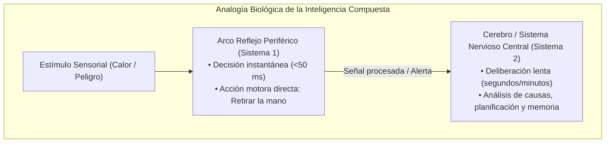
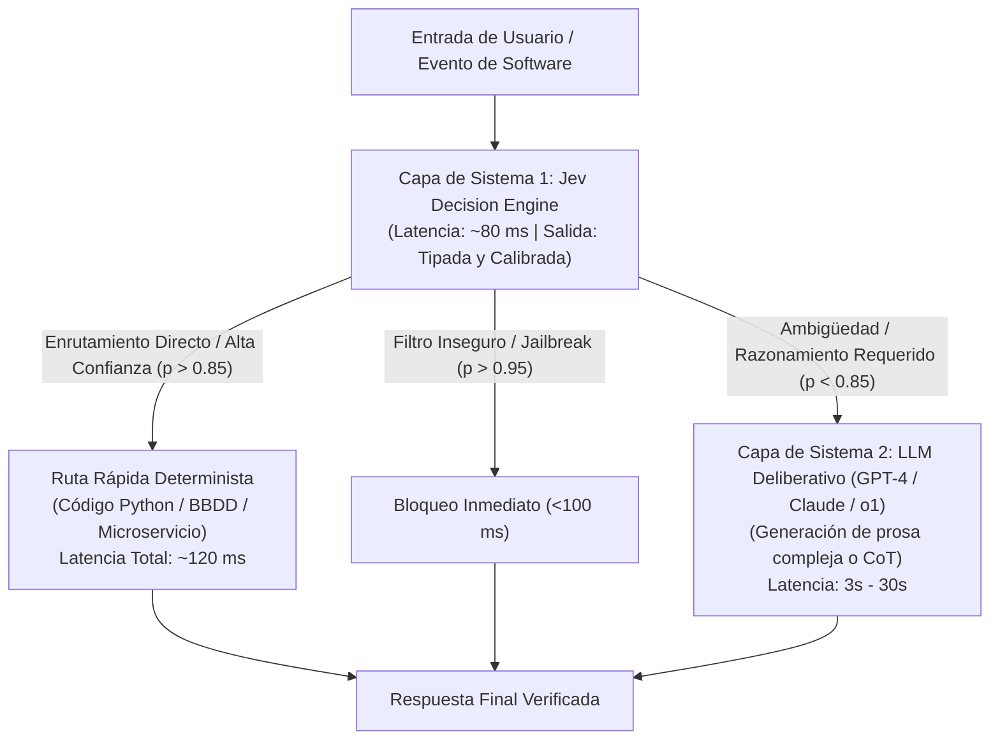
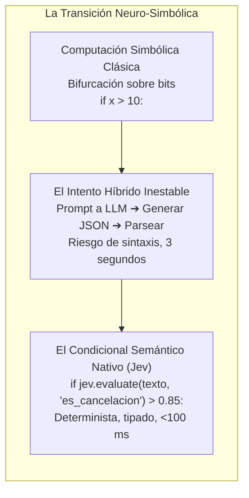

# Módulo 2: Jev en la Evolución General de la IA Generativa
## Apartado 2.2: El Lugar Arquitectónico de Jev

**Serie:** *Fundamentos y Arquitectura de Sistemas con Modelos System One (Jev)*  
**Autor:** Antigravity Engineering Lab  
**Bibliografía y Referencias O'Reilly:**
* [Generative AI Design Patterns](https://learning.oreilly.com/library/view/-/9798341622654/?orm_source=mcp) por Valliappa Lakshmanan y Hannes Hapke (*O'Reilly Media, Inc.*)
* [Building Applications with AI Agents](https://learning.oreilly.com/library/view/-/9781098176495/?orm_source=mcp) por Michael Albada (*O'Reilly Media, Inc.*)
* [Neuro-Symbolic AI](https://learning.oreilly.com/library/view/-/9781804617625/?orm_source=mcp) por Alexiei Dingli y David Farrugia (*Packt Publishing*)
* [Composite Artificial Intelligence](https://learning.oreilly.com/library/view/-/9781394393039/?orm_source=mcp) por T. S. Arun Samuel et al. (*Wiley-Scrivener*)

---

## 1. La Metáfora Biológica: El Arco Reflejo y el Sistema Nervioso Periférico

Para comprender dónde encaja **Jev** en una arquitectura de software moderna, resulta muy clarificador acudir a la biología de los organismos complejos.

En el cuerpo humano coexisten dos redes neuronales con funciones diametralmente opuestas:
1. **El Sistema Nervioso Central (El Cerebro / Sistema 2):** Es responsable del pensamiento abstracto, la deliberación, el lenguaje, la planificación a largo plazo y la resolución de problemas inéditos. Es extraordinariamente sofisticado, pero es lento y consume una gran cantidad de glucosa y energía.
2. **El Sistema Nervioso Periférico y el Arco Reflejo (Sistema 1):** Es responsable de la supervivencia inmediata y las respuestas automáticas. Cuando una persona apoya la mano sobre una superficie al rojo vivo, no espera a que la señal viaje hasta la corteza cerebral, sea analizada conscientemente y el cerebro decida redactar una orden de retirada. La médula espinal ejecuta un **arco reflejo**: una respuesta motora instantánea en milisegundos que retira el brazo antes de que el cerebro sea siquiera consciente del dolor.



### El Error Arquitectónico de la IA Temprana
Durante los primeros años de la IA generativa, la industria intentó construir sistemas conectando directamente cada estímulo sensorial al cerebro deliberativo más grande disponible. Cada petición HTTP, cada ticket de soporte y cada validación de datos se enviaba a un LLM masivo de 30 segundos de tiempo de respuesta. 

Esto equivale biológicamente a obligar al cerebro a procesar conscientemente cada latido cardíaco, cada parpadeo y cada respiración: un colapso por saturación de recursos y latencia.

**Jev no compite con el cerebro deliberativo; se convierte en el arco reflejo del software.** Actúa como el sistema nervioso periférico que filtra, enruta, protege y toma decisiones inmediatas en el perímetro, permitiendo que los modelos de razonamiento profundo solo intervengan cuando su potencia es estrictamente necesaria.

---

## 2. Jev en los Sistemas Compuestos de IA (*Compound AI Systems*)

En la literatura de arquitectura de sistemas (véase la investigación seminal de Matei Zaharia y el laboratorio de Berkeley sobre *Compound AI Systems*, así como el texto canónico *Generative AI Design Patterns* en O'Reilly), se ha demostrado formalmente que los mayores avances en rendimiento y fiabilidad no provienen de entrenar LLMs monolíticos más grandes, sino de diseñar **sistemas compuestos**: arquitecturas donde múltiples componentes especializados se orquestan entre sí.

En una arquitectura compuesta de producción, Jev ocupa la **capa de decisión de baja latencia**:



### El Desacople Operativo del 90/10
En un entorno corporativo real:
* **El 80% - 90% de los eventos** son rutinarios: clasificar un formulario, comprobar un permiso, filtrar una inyección maliciosa o elegir una herramienta fija dentro de un bucle agéntico. Jev resuelve estos eventos en menos de 100 milisegundos con coste cero en tokens de salida.
* **Solo el 10% restante** de los casos (que presentan verdadera ambigüedad conceptual, necesidad de síntesis literaria o resolución matemática profunda) se escalan al modelo de Sistema 2.

Este desacople reduce los costes de inferencia de la empresa entre un 70% y un 90% y desploma la latencia media percibida por los usuarios de segundos a milisegundos.

---

## 3. La IA como Condicional Semántico Seguro (*Smart If-Statement*)

Desde los orígenes de la informática con las máquinas de Turing y la arquitectura von Neumann, toda la potencia del software ha dependido de una única instrucción primitiva: **el salto condicional sobre bits**:

```text
SI (condición_binaria_exacta == VERDADERO) ENTONCES
    ejecutar_rama_A()
SINO
    ejecutar_rama_B()
```

Esta lógica discreta funciona de manera intachable cuando las variables son numéricas, cadenas exactas o estados de bases de datos. Sin embargo, el mundo real es desestructurado, ruidoso y semántico. Los programas colapsan cuando se enfrentan a preguntas como:
* *«¿Este comentario expresa una amenaza creíble o es sarcasmo?»*
* *«¿El cliente solicita una baja del servicio o solo está pidiendo información sobre su tarifa?»*
* *«¿La respuesta generada por el agente viola la política de privacidad de la empresa?»*

Hasta hoy, los desarrolladores intentaban resolver esto mediante expresiones regulares frágiles, árboles de palabras clave imposibles de mantener o pesados LLMs generativos que devuelven JSONs inestables.



### La Realización del Paradigma Neuro-Simbólico
En la obra *Neuro-Symbolic AI* de Dingli y Farrugia (O'Reilly / Packt), se defiende que la verdadera inteligencia artificial aplicada nacerá de la unión entre:
* **La percepción neuronal:** Capaz de captar el contexto difuso, la polisemia y los matices del mundo real.
* **El control simbólico:** Capaz de garantizar la auditoría, la precisión de tipos y la seguridad operativa del código tradicional.

Jev es la encarnación práctica de este principio: el **«smart if-statement»**. No intenta reemplazar al código con texto generado; le proporciona al código tradicional una función matemática que evalúa semántica y devuelve un booleano, una opción o una puntuación calibrada con la misma naturalidad con la que se evalúa un operador de comparación en cualquier lenguaje de programación.

---

## 4. Bibliografía y Referencias en O'Reilly Learning

1. **[Generative AI Design Patterns](https://learning.oreilly.com/library/view/-/9798341622654/?orm_source=mcp)**  
   *Valliappa Lakshmanan y Hannes Hapke (O'Reilly Media, Inc., 2025)*  
   *Analiza formalmente el patrón de Enrutador Semántico (*Semantic Router*) y la arquitectura de compuertas de seguridad (*Guardrails Gateway*), pilares donde Jev opera como filtro de primera línea.*

2. **[Building Applications with AI Agents](https://learning.oreilly.com/library/view/-/9781098176495/?orm_source=mcp)**  
   *Michael Albada (O'Reilly Media, Inc., 2025)*  
   *Detalla el desacople de bucles de control en sistemas agénticos, argumentando por qué las decisiones de paso intermedio deben delegarse en motores rápidos no autorregresivos.*

3. **[Neuro-Symbolic AI](https://learning.oreilly.com/library/view/-/9781804617625/?orm_source=mcp)**  
   *Alexiei Dingli y David Farrugia (Packt Publishing, 2023)*  
   *Tratado sobre la convergencia entre modelos de aprendizaje profundo para percepción y lógica simbólica estricta para ejecución de reglas.*

4. **[Composite Artificial Intelligence](https://learning.oreilly.com/library/view/-/9781394393039/?orm_source=mcp)**  
   *T. S. Arun Samuel et al. (Wiley-Scrivener, 2026)*  
   *Estudia la ingeniería de sistemas compuestos de inteligencia artificial distribuidos, integrando modelos de baja latencia con procesadores de conocimiento centralizados.*

---

## 5. Versión para Gemini Notebook (Texto Exacto con Ortografía Canónica)
*Para procesar en Gemini Notebook y generar presentaciones perfectamente sincronizadas con el audio:*

Para entender el lugar exacto que ocupa Jev en la arquitectura del software, resulta muy útil compararlo con el sistema nervioso de los seres vivos. 

En nuestro cuerpo existen dos redes neuronales complementarias. Por un lado está el cerebro, que se encarga del pensamiento reflexivo, la deliberación profunda y el lenguaje. Es extraordinariamente sofisticado, pero es lento y consume mucha energía. Por otro lado está el sistema nervioso periférico, responsable de los reflejos inmediatos. Si apoyamos la mano en una superficie ardiendo, la médula espinal ejecuta un arco reflejo que retira el brazo en milisegundos, mucho antes de que el cerebro haya tenido tiempo de analizar la situación o sentir el dolor. 

Durante los primeros años de la inteligencia artificial generativa, la industria cometió el error de conectar cada pequeña tarea directamente al cerebro más grande y lento del mercado. Enviar cada petición de un usuario a un modelo masivo de 30 segundos solo para comprobar un dato equivale a obligar a nuestro cerebro a pensar conscientemente cada vez que nuestro corazón late o parpadeamos. 

Jev no compite con los grandes modelos deliberativos; se convierte en el sistema nervioso periférico del software. En las arquitecturas modernas, conocidas como Sistemas Compuestos de IA, Jev actúa como un filtro ultrarrápido en el perímetro del sistema. Resuelve el 90% de las tareas cotidianas en menos de 100 milisegundos y con coste cero en tokens de salida, dejando que los modelos de razonamiento profundo solo se despierten cuando es estrictamente indispensable redactar prosa compleja o resolver problemas muy difíciles. 

Esta función permite hacer realidad uno de los viejos sueños de la informática: el condicional semántico seguro, o smart if-statement. Las computadoras llevan décadas tomando decisiones basadas en números exactos o ceros y unos. Lo que nunca habían podido hacer es tomar decisiones basadas en el sentido común, la intención o el contexto humano. 

Jev introduce esa capacidad directamente dentro del código de producción. Al renunciar a generar texto libre y devolver exclusivamente datos tipados y probabilidades calibradas, permite que cualquier programador evalúe el significado de una frase con la misma rapidez, sencillez y seguridad con la que hoy se comprueba si un número es mayor que otro.

---

## 6. Versión para ElevenLabs (Texto de Locución con Adaptación Fonética)
*Texto idéntico al anterior, adaptado para pronunciación natural en voz en off:*

Para entender el lugar exacto que ocupa Yev en la arquitectura del software, resulta muy útil compararlo con el sistema nervioso de los seres vivos.

En nuestro cuerpo existen dos redes neuronales complementarias. Por un lado está el cerebro, que se encarga del pensamiento reflexivo, la deliberación profunda y el lenguaje. Es extraordinariamente sofisticado, pero es lento y consume mucha energía. Por otro lado está el sistema nervioso periférico, responsable de los reflejos inmediatos. Si apoyamos la mano en una superficie ardiendo, la médula espinal ejecuta un arco reflejo que retira el brazo en milisegundos, mucho antes de que el cerebro haya tenido tiempo de analizar la situación o sentir el dolor.

Durante los primeros años de la inteligencia artificial generativa, la industria cometió el error de conectar cada pequeña tarea directamente al cerebro más grande y lento del mercado. Enviar cada petición de un usuario a un modelo masivo de treinta segundos solo para comprobar un dato equivale a obligar a nuestro cerebro a pensar conscientemente cada vez que nuestro corazón late o parpadeamos.

Yev no compite con los grandes modelos deliberativos; se convierte en el sistema nervioso periférico del software. En las arquitecturas modernas, conocidas como Sistemas Compuestos de IA, Yev actúa como un filtro ultrarrápido en el perímetro del sistema. Resuelve el noventa por ciento de las tareas cotidianas en menos de cien milisegundos y con coste cero en tokens de salida, dejando que los modelos de razonamiento profundo solo se despierten cuando es estrictamente indispensable redactar prosa compleja o resolver problemas muy difíciles.

Esta función permite hacer realidad uno de los viejos sueños de la informática: el condicional semántico seguro, o smart if-statement. Las computadoras llevan décadas tomando decisiones basadas en números exactos o ceros y unos. Lo que nunca habían podido hacer es tomar decisiones basadas en el sentido común, la intención o el contexto humano.

Yev introduce esa capacidad directamente dentro del código de producción. Al renunciar a generar texto libre y devolver exclusivamente datos tipados y probabilidades calibradas, permite que cualquier programador evalúe el significado de una frase con la misma rapidez, sencillez y seguridad con la que hoy se comprueba si un número es mayor que otro.
