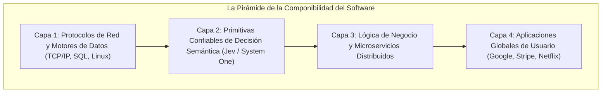

# Módulo 2: Jev en la Evolución General de la IA Generativa
## Apartado 2.3: Emergencia Segura y Componibilidad: De la IA como Destino a la Infraestructura Invisible

**Serie:** *Fundamentos y Arquitectura de Sistemas con Modelos System One (Jev)*  
**Autor:** Antigravity Engineering Lab  
**Bibliografía y Referencias O'Reilly:**
* [Designing Data-Intensive Applications, 2nd Edition](https://learning.oreilly.com/library/view/-/9781098119058/?orm_source=mcp) por Martin Kleppmann y Chris Riccomini (*O'Reilly Media, Inc.*)
* [Building Applications with AI Agents](https://learning.oreilly.com/library/view/-/9781098176495/?orm_source=mcp) por Michael Albada (*O'Reilly Media, Inc.*)
* [Generative AI Design Patterns](https://learning.oreilly.com/library/view/-/9798341622654/?orm_source=mcp) por Valliappa Lakshmanan y Hannes Hapke (*O'Reilly Media, Inc.*)
* [Software Architecture: Foundations, Theory, and Practice](https://learning.oreilly.com/library/view/-/9780470167748/?orm_source=mcp) por Richard N. Taylor et al. (*Wiley / O'Reilly*)

---

## 1. La Ilusión de la Autonomía Ciega: El Fracaso de los Bucles Abiertos

A finales de 2023, la comunidad tecnológica vivió una intensa fascinación por los llamados «agentes autónomos» basados en LLMs. Proyectos experimentales intentaron crear sistemas capaces de operar de forma desatendida mediante una estructura simple: colocar a un modelo generativo dentro de un bucle `while True`, entregarle acceso a la consola o a una serie de APIs y pedirle que *«resolviera el problema por sí mismo»*.

Aquel enfoque de **bucle abierto y autonomía ciega** colapsó con rapidez en entornos de producción por motivos puramente ingenieriles:
1. **Deriva acumulativa de contexto:** Cada paso generaba más tokens de historial, degradando la atención del modelo y provocando bucles infinitos donde la máquina repetía la misma llamada errónea una y otra vez.
2. **Costes descontrolados:** Un agente autónomo desatendido podía consumir cientos de dólares en llamadas de API en pocos minutos sin haber avanzado en la resolución de la tarea.
3. **Falta absoluta de auditoría:** Si el sistema fallaba, resultaba imposible determinar en qué punto exacto de la cadena de razonamiento probabilístico se había producido la desviación.

La conclusión para los arquitectos de software fue tajante: **la verdadera automatización no se consigue otorgándole autonomía absoluta a un modelo conversacional impredecible, sino construyendo sistemas fiables a partir de piezas pequeñas, auditables y fuertemente tipadas**.

---

## 2. El Principio de la «Emergencia Segura» (*Safe Emergence*)

En el manifiesto de TypeSafe AI se formula una ley histórica fundamental para la ingeniería de sistemas: **la seguridad y el determinismo son la condición previa indispensable para apilar capas de software (*Safe Emergence*)**.

La historia de la computación nunca ha progresado mediante grandes saltos monolíticos diseñados desde arriba:
* Quienes inventaron los protocolos **TCP/IP** en los años setenta no estaban imaginando la economía del comercio electrónico ni los servicios de streaming; diseñaron un protocolo de transporte de paquetes tan robusto que cualquier programador podía confiar a ciegas en que los datos llegarían a su destino.
* Quienes formalizaron el álgebra relacional y el lenguaje **SQL** no concibieron las plataformas bancarias globales modernas; crearon una abstracción para almacenar y consultar información tan matemática y predecible que la industria pudo desentenderse de cómo se gestionaban los sectores del disco duro y construir rascacielos de software encima de ella.

Como explica Martin Kleppmann en su obra canónica *Designing Data-Intensive Applications* (O'Reilly), **solo puedes enterrar un componente a cinco capas de profundidad en tu arquitectura si puedes confiar ciegamente en él**. 

Nadie se atreve a enterrar un LLM tradicional en lo profundo del backend porque nadie sabe cuándo decidirá ignorar el formato JSON, inventar un campo inexistente o tardar veinte segundos en contestar. Para que la inteligencia artificial pueda formar parte de la infraestructura básica del software, necesita la misma solidez aburrida y predecible que tienen una base de datos relacional o una llamada a una función local.

---

## 3. De la IA como Destino a la IA como Infraestructura Invisible

Esta necesidad de componibilidad marca la transición más importante del sector: **el paso de la IA como «destino» a la IA como «infraestructura invisible»**.

| Paradigma | La IA como Destino (2022 - 2024) | La IA como Infraestructura Invisible (2025 - 2026) |
| :--- | :--- | :--- |
| **Punto de Encuentro** | Una interfaz gráfica o ventana de chat a la que el usuario acude deliberadamente (ChatGPT, Claude.ai). | Oculta en el backend de las aplicaciones; el usuario final ni siquiera sabe que hay IA involucrada. |
| **Naturaleza del Flujo** | Conversación interactiva orientada a humanos (*Human-in-the-Loop* permanente). | Procesos silenciosos en segundo plano (*Background Automation* desatendida). |
| **Interfaz de Entrada/Salida** | Párrafos de texto libre en lenguaje natural. | Estados del programa estructurados como entrada; decisiones tipadas y probabilidades como salida. |
| **Latencia Operativa** | De 3 a 30 segundos (tolerable para una persona que lee). | De 70 a 300 milisegundos (obligatoria para no degradar APIs y bases de datos). |
| **Rol de Jev** | Inexistente (Jev no tiene interfaz de chat ni genera prosa). | **Primitiva central:** Actúa como el bloque de construcción semántico nativo para desarrolladores. |

Cuando una tecnología madura, deja de ser el centro de atención y se convierte en infraestructura transparente. La electricidad dejó de ser un espectáculo de feria cuando se escondió en las paredes para hacer funcionar los electrodomésticos; la inteligencia artificial deja de ser un truco de chat cuando se esconde en el código para permitir que el software tome decisiones semánticas fiables a la velocidad de la luz.

---

## 4. Bibliografía y Referencias en O'Reilly Learning

1. **[Designing Data-Intensive Applications, 2nd Edition](https://learning.oreilly.com/library/view/-/9781098119058/?orm_source=mcp)**  
   *Martin Kleppmann y Chris Riccomini (O'Reilly Media, Inc., 2026)*  
   *La obra cumbre sobre fiabilidad, tolerancia a fallos y componibilidad en sistemas distribuidos, fundamental para entender por qué las primitivas desatendidas deben ser deterministas.*

2. **[Building Applications with AI Agents](https://learning.oreilly.com/library/view/-/9781098176495/?orm_source=mcp)**  
   *Michael Albada (O'Reilly Media, Inc., 2025)*  
   *Analiza la transición de los bucles de agentes monolíticos no regulados hacia grafos de control estructurados con capas de decisión desacopladas.*

3. **[Generative AI Design Patterns](https://learning.oreilly.com/library/view/-/9798341622654/?orm_source=mcp)**  
   *Valliappa Lakshmanan y Hannes Hapke (O'Reilly Media, Inc., 2025)*  
   *Examina los patrones de diseño para orquestar modelos dentro de tuberías de datos empresariales sin comprometer la estabilidad del sistema.*

4. **[Software Architecture: Foundations, Theory, and Practice](https://learning.oreilly.com/library/view/-/9780470167748/?orm_source=mcp)**  
   *Richard N. Taylor et al. (Wiley / O'Reilly)*  
   *Tratado formal sobre abstracciones arquitectónicas, acoplamiento modular y los requisitos de predictibilidad necesarios para apilar componentes de software.*

---

## 5. Versión para Gemini Notebook (Texto Exacto con Ortografía Canónica)
*Para procesar en Gemini Notebook y generar presentaciones perfectamente sincronizadas con el audio:*

Para que una nueva tecnología transforme de verdad la economía, no basta con que sea sorprendente; necesita convertirse en una pieza de ingeniería en la que cualquiera pueda confiar a ciegas. 

Durante los dos últimos años, la industria tecnológica se obsesionó con la idea de los agentes autónomos. El experimento consistía en tomar un modelo de lenguaje generativo, encerrarlo en un bucle infinito y pedirle que resolviera problemas complejos por sí mismo. Sin embargo, en el mundo real del software empresarial, ese enfoque de autonomía ciega fracasó rápidamente: los modelos caían en bucles repetitivos, consumían presupuestos enormes en pocos minutos y cometían fallos impredecibles imposibles de rastrear o auditar. 

La historia de la informática demuestra que el software nunca ha progresado a base de experimentos descontrolados. Nadie inventó los servicios modernos de internet de la noche a la mañana. Lo que hicieron los pioneros de la computación fue crear piezas muy sencillas y extraordinariamente fiables, como las bases de datos relacionales o los protocolos de red como TCP/IP. Eran componentes tan sólidos que los programadores podían olvidarse por completo de cómo funcionaban por dentro y construir aplicaciones complejas encima de ellos. 

Existe una ley básica en la ingeniería de software: solo te atreves a enterrar un componente a cinco capas de profundidad en tu sistema si estás completamente seguro de cómo va a reaccionar. Nadie puede enterrar un modelo de lenguaje conversacional tradicional en el fondo de su infraestructura porque nadie sabe en qué momento inventará una palabra extraña o tardará quince segundos en contestar. 

Este principio explica el cambio más profundo que estamos viviendo en este sector: la transición de la inteligencia artificial como un destino a la inteligencia artificial como una infraestructura invisible. En los primeros años, la inteligencia artificial era una página web o una ventana de chat a la que los usuarios acudían expresamente para hablar con una máquina. La nueva fase que representa Jev es totalmente distinta: no hay ventanas de chat ni textos que leer. La inteligencia se vuelve invisible y se traslada al interior del código, operando en segundo plano a cientos de decisiones por segundo. 

Al garantizar cero errores de formato, respuestas en milisegundos y probabilidades calibradas, Jev se convierte en ese bloque de construcción predecible y seguro que el software llevaba años esperando para poder automatizar el mundo real.

---

## 6. Versión para ElevenLabs (Texto de Locución con Adaptación Fonética)
*Texto idéntico al anterior, adaptado para pronunciación natural en voz en off:*

Para que una nueva tecnología transforme de verdad la economía, no basta con que sea sorprendente; necesita convertirse en una pieza de ingeniería en la que cualquiera pueda confiar a ciegas.

Durante los dos últimos años, la industria tecnológica se obsesionó con la idea de los agentes autónomos. El experimento consistía en tomar un modelo de lenguaje generativo, encerrarlo en un bucle infinito y pedirle que resolviera problemas complejos por sí mismo. Sin embargo, en el mundo real del software empresarial, ese enfoque de autonomía ciega fracasó rápidamente: los modelos caían en bucles repetitivos, consumían presupuestos enormes en pocos minutos y cometían fallos impredecibles imposibles de rastrear o auditar.

La historia de la informática demuestra que el software nunca ha progresado a base de experimentos descontrolados. Nadie inventó los servicios modernos de internet de la noche a la mañana. Lo que hicieron los pioneros de la computación fue crear piezas muy sencillas y extraordinariamente fiables, como las bases de datos relacionales o los protocolos de red como TCP/IP. Eran componentes tan sólidos que los programadores podían olvidarse por completo de cómo funcionaban por dentro y construir aplicaciones complejas encima de ellos.

Existe una ley básica en la ingeniería de software: solo te atreves a enterrar un componente a cinco capas de profundidad en tu sistema si estás completamente seguro de cómo va a reaccionar. Nadie puede enterrar un modelo de lenguaje conversacional tradicional en el fondo de su infraestructura porque nadie sabe en qué momento inventará una palabra extraña o tardará quince segundos en contestar.

Este principio explica el cambio más profundo que estamos viviendo en este sector: la transición de la inteligencia artificial como un destino a la inteligencia artificial como una infraestructura invisible. En los primeros años, la inteligencia artificial era una página web o una ventana de chat a la que los usuarios acudían expresamente para hablar con una máquina. La nueva fase que representa Yev es totalmente distinta: no hay ventanas de chat ni textos que leer. La inteligencia se vuelve invisible y se traslada al interior del código, operando en segundo plano a cientos de decisiones por segundo.

Al garantizar cero errores de formato, respuestas en milisegundos y probabilidades calibradas, Yev se convierte en ese bloque de construcción predecible y seguro que el software llevaba años esperando para poder automatizar el mundo real.
