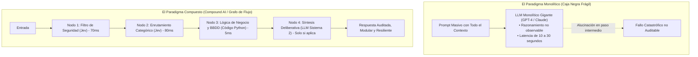
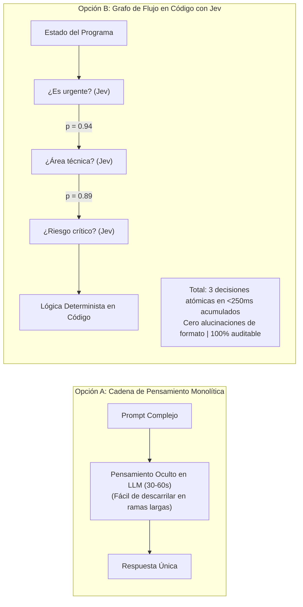

# Módulo 2: Jev en la Evolución General de la IA Generativa
## Apartado 2.4: La Fractura de Producción y el Auge de los Sistemas Compuestos (*Compound AI Systems*)

**Serie:** *Fundamentos y Arquitectura de Sistemas con Modelos System One (Jev)*  
**Autor:** Antigravity Engineering Lab  
**Bibliografía y Referencias O'Reilly:**
* [Building Applications with AI Agents](https://learning.oreilly.com/library/view/-/9781098176495/?orm_source=mcp) por Michael Albada (*O'Reilly Media, Inc.*)
* [Generative AI Design Patterns](https://learning.oreilly.com/library/view/-/9798341622654/?orm_source=mcp) por Valliappa Lakshmanan y Hannes Hapke (*O'Reilly Media, Inc.*)
* [Designing Data-Intensive Applications, 2nd Edition](https://learning.oreilly.com/library/view/-/9781098119058/?orm_source=mcp) por Martin Kleppmann y Chris Riccomini (*O'Reilly Media, Inc.*)
* [Practical MLflow for Generative AI on Databricks](https://learning.oreilly.com/library/view/-/9798341652743/?orm_source=mcp) por Nuwan Ganganath et al. (*O'Reilly Media, Inc.*)

---

## 1. La Fractura de Producción: El Límite del Modelo Monolítico

Durante los primeros años de la eclosión generativa, se extendió la creencia intuitiva de que el progreso de la inteligencia artificial consistía en alimentar un único modelo monolítico gigantesco mediante un prompt masivo y dejar que este resolviera la totalidad del problema de negocio.

Sin embargo, cuando las empresas trasladaron los prototipos a entornos de misión crítica, colisionaron con la denominada **fractura de producción (*production breakdown*)**:
* **El dilema de la caja negra:** Cuando un LLM monolítico comete un error en el paso 7 de una deducción de 10 etapas, resulta imposible interceptar, corregir o auditar ese fallo intermedio sin invalidar toda la salida.
* **El efecto multiplicador de la latencia y el coste:** Si un único modelo debe deliberar sobre políticas de privacidad, enrutamiento, extracción de entidades y formato de respuesta, el tiempo de ejecución se degrada hasta los 10 o 30 segundos por consulta, con un coste computacional insostenible.

---

## 2. La Tesis de Matei Zaharia: De Modelos a Sistemas Compuestos

La respuesta arquitectónica formal a esta crisis fue formulada por el investigador de Stanford, cofundador de Databricks y creador de Apache Spark, **Matei Zaharia**, en su célebre trabajo sobre los **Sistemas Compuestos de Inteligencia Artificial (*Compound AI Systems*)**.

Zaharia y su equipo en el laboratorio BAIR de Berkeley demostraron que **las mayores cotas de rendimiento en el estado del arte ya no se logran escalando el tamaño del modelo, sino componiendo múltiples llamadas especializadas con lógica de software**:

$$\text{Rendimiento del Sistema Compuesto} \gg \text{Rendimiento del LLM Monolítico Más Grande}$$

Un sistema compuesto sustituye la improvisación del modelo único por un **grafo de computación explícito (*compute graph*)**, donde:
1. El código tradicional gestiona el flujo de control, las bifurcaciones y el estado.
2. Los modelos especializados resuelven tareas atómicas delimitadas.
3. Cada paso intermedio es medible, almacenable en caché (*caching*) y sujeto a pruebas unitarias deterministas.

---

## 3. Grafos de Cómputo frente a Cadenas de Pensamiento (*Chain-of-Thought*)

En las evaluaciones técnicas publicadas por TypeSafe AI, Diogo Almeida documentó un hallazgo empírico trascendental que confirma la tesis de Zaharia:

> *Cuando se compara un modelo de razonamiento monolítico realizando toda la lógica dentro de su cadena de pensamiento interna, frente al mismo problema descompuesto en un flujo de código con preguntas atómicas, **el flujo en código supera al razonador monolítico por casi dos órdenes de magnitud en la frontera de Pareto de coste y velocidad**.*

La descomposición en preguntas independientes y tipadas permite que el software tome decisiones finas basadas en probabilidades matemáticas calibradas, en lugar de confiar ciegamente en que el modelo «razone bien» dentro de un texto oculto.

---

## 4. El Rol de Jev como Motor del Grafo de Flujo

Como advierte el arquitecto de sistemas **Michael Albada** en su obra de referencia en O'Reilly (*Building Applications with AI Agents*), un grafo de flujo compuesto solo es viable en la práctica si el coste temporal y económico de cada nodo intermedio es despreciable.

Si cada comprobación intermedia requiere una llamada a un LLM tradicional que tarda 3 segundos y factura miles de tokens:
* Un grafo con 10 decisiones encadenadas tardaría **30 segundos** en responder.
* El coste computacional se multiplicaría por diez en cada transacción.

**Aquí es donde Jev desbloquea la viabilidad real de los sistemas compuestos:**
* **Latencia atómica:** Cada nodo del grafo se resuelve en **70 a 100 milisegundos**.
* **Tokens de salida a $0:** Evaluar 15 preguntas simultáneas sobre el mismo estado no incrementa la factura de salida.
* **Composabilidad sin fricción:** Al devolver tipos nativos (`bool`, `choice`, `score`), el resultado de un nodo se pasa directamente como argumento de entrada al siguiente nodo sin necesidad de parsers intermedios.

---

## 5. Bibliografía y Referencias en O'Reilly Learning

1. **[Building Applications with AI Agents](https://learning.oreilly.com/library/view/-/9781098176495/?orm_source=mcp)**  
   *Michael Albada (O'Reilly Media, Inc., 2025)*  
   *Examina el diseño de grafos de ejecución modular para agentes autónomos y la necesidad de desacoplar los pasos de decisión rápida de los pasos de síntesis.*

2. **[Generative AI Design Patterns](https://learning.oreilly.com/library/view/-/9798341622654/?orm_source=mcp)**  
   *Valliappa Lakshmanan y Hannes Hapke (O'Reilly Media, Inc., 2025)*  
   *La referencia canónica sobre los patrones de Enrutamiento Semántico (*Semantic Routing*) y Grafos de Decisión en canalizaciones empresariales.*

3. **[Designing Data-Intensive Applications, 2nd Edition](https://learning.oreilly.com/library/view/-/9781098119058/?orm_source=mcp)**  
   *Martin Kleppmann y Chris Riccomini (O'Reilly Media, Inc., 2026)*  
   *Establece los principios de descomposición de sistemas complejos en primitivas atómicas fiables y auditables.*

4. **[Practical MLflow for Generative AI on Databricks](https://learning.oreilly.com/library/view/-/9798341652743/?orm_source=mcp)**  
   *Nuwan Ganganath et al. (O'Reilly Media, Inc., 2026)*  
   *Aborda la instrumentación, trazabilidad y evaluación de sistemas compuestos de IA basados en la arquitectura formal de Matei Zaharia.*

---

## 6. Versión para Gemini Notebook (Texto Exacto con Ortografía Canónica)
*Para procesar en Gemini Notebook y generar presentaciones perfectamente sincronizadas con el audio:*

Durante los primeros años de la explosión generativa, existía la creencia de que un único modelo gigantesco podría resolver cualquier problema si se le daba un prompt lo bastante largo. Sin embargo, cuando las empresas intentaron llevar esos prototipos a producción, se toparon con lo que los ingenieros llaman la fractura de producción: los modelos monolíticos son lentos, caros de mantener y casi imposibles de depurar cuando cometen un error en un paso intermedio.

Como demostró el investigador de Stanford y creador de Apache Spark, Matei Zaharia, en su célebre trabajo sobre Sistemas Compuestos de Inteligencia Artificial, el verdadero salto cualitativo en la industria no consiste en entrenar modelos cada vez más grandes, sino en diseñar arquitecturas compuestas. En lugar de confiar en una sola caja negra, los mejores sistemas combinan código tradicional, bases de datos y pequeños componentes inteligentes especializados que colaboran entre sí.

Aquí es donde se produce una de las revelaciones técnicas más potentes documentadas por el equipo de TypeSafe AI. Cuando intentas que un modelo haga toda la lógica dentro de su propia cadena de pensamiento, el rendimiento cae drásticamente. En cambio, si descompones el problema en un grafo de flujo en código, donde el programa gobierna los pasos y la inteligencia artificial solo responde preguntas atómicas de decisión, la precisión y la eficiencia aumentan en casi dos órdenes de magnitud.

El especialista en arquitectura de agentes, Michael Albada, advierte en sus manuales de O'Reilly que un grafo de decisiones solo es viable en la práctica si cada comprobación intermedia se ejecuta en una fracción de segundo. Si cada paso tarda tres segundos en un modelo tradicional, un flujo de diez comprobaciones tardaría medio minuto y costaría una fortuna. Con Jev, cada nodo del grafo se resuelve en 70 milisegundos y con coste cero en tokens de salida, permitiendo encadenar decenas de decisiones semánticas complejas en tiempo real.

De este modo, Jev no es solo una alternativa rápida a los modelos generativos, sino la pieza que faltaba para consolidar la era de los sistemas compuestos: el motor que permite a los programadores construir flujos de inteligencia modulares, transparentes y económicamente sostenibles.

---

## 7. Versión para ElevenLabs (Texto de Locución con Adaptación Fonética)
*Texto idéntico al anterior, adaptado para pronunciación natural en voz en off:*

Durante los primeros años de la explosión generativa, existía la creencia de que un único modelo gigantesco podría resolver cualquier problema si se le daba un prompt lo bastante largo. Sin embargo, cuando las empresas intentaron llevar esos prototipos a producción, se toparon con lo que los ingenieros llaman la fractura de producción: los modelos monolíticos son lentos, caros de mantener y casi imposibles de depurar cuando cometen un error en un paso intermedio.

Como demostró el investigador de Stanford y creador de Apache Spark, Matei Zaharia, en su célebre trabajo sobre Sistemas Compuestos de Inteligencia Artificial, el verdadero salto cualitativo en la industria no consiste en entrenar modelos cada vez más grandes, sino en diseñar arquitecturas compuestas. En lugar de confiar en una sola caja negra, los mejores sistemas combinan código tradicional, bases de datos y pequeños componentes inteligentes especializados que colaboran entre sí.

Aquí es donde se produce una de las revelaciones técnicas más potentes documentadas por el equipo de Taip Seif Ei Ai. Cuando intentas que un modelo haga toda la lógica dentro de su propia cadena de pensamiento, el rendimiento cae drásticamente. En cambio, si descompones el problema en un grafo de flujo en código, donde el programa gobierna los pasos y la inteligencia artificial solo responde preguntas atómicas de decisión, la precisión y la eficiencia aumentan en casi dos órdenes de magnitud.

El especialista en arquitectura de agentes, Michael Albada, advierte en sus manuales de O Reili que un grafo de decisiones solo es viable en la práctica si cada comprobación intermedia se ejecuta en una fracción de segundo. Si cada paso tarda tres segundos en un modelo tradicional, un flujo de diez comprobaciones tardaría medio minuto y costaría una fortuna. Con Yev, cada nodo del grafo se resuelve en setenta milisegundos y con coste cero en tokens de salida, permitiendo encadenar decenas de decisiones semánticas complejas en tiempo real.

De este modo, Yev no es solo una alternativa rápida a los modelos generativos, sino la pieza que faltaba para consolidar la era de los sistemas compuestos: el motor que permite a los programadores construir flujos de inteligencia modulares, transparentes y económicamente sostenibles.
