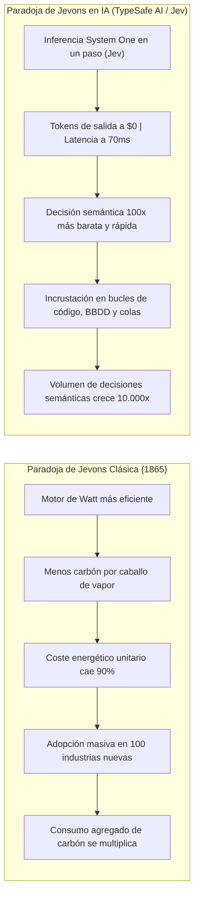

# Módulo 3: Comparativa Exhaustiva: Jev vs. LLMs Tradicionales
## Apartado 3.2: La Paradoja de Jevons Aplicada a la Inteligencia Artificial

**Serie:** *Fundamentos y Arquitectura de Sistemas con Modelos System One (Jev)*  
**Autor:** Antigravity Engineering Lab  
**Bibliografía y Referencias O'Reilly:**
* [Artificial Integrity](https://learning.oreilly.com/library/view/-/9781394297986/?orm_source=mcp) por Hamilton Mann (*Wiley / O'Reilly*)
* [Software Engineering at Google](https://learning.oreilly.com/library/view/-/9781492082781/?orm_source=mcp) por Titus Winters, Tom Manshreck y Hyrum Wright (*O'Reilly Media, Inc.*)
* [Cloudonomics: The Business Value of Cloud Computing](https://learning.oreilly.com/library/view/-/9781118282885/?orm_source=mcp) por Joe Weinman (*Wiley / O'Reilly*)
* [AI-Native Software Engineering](https://learning.oreilly.com/library/view/-/0642572352530/?orm_source=mcp) por Alfonso Graziano (*O'Reilly Media, Inc.*)
* [Designing Data-Intensive Applications, 2nd Edition](https://learning.oreilly.com/library/view/-/9781098119058/?orm_source=mcp) por Martin Kleppmann y Chris Riccomini (*O'Reilly Media, Inc.*)

---

## 1. El Origen Histórico del Nombre: William Stanley Jevons y la Máquina de Vapor

El nombre del modelo **Jev** desarrollado por TypeSafe AI no es una sigla fortuita: constituye un homenaje explícito al economista y lógico británico **William Stanley Jevons**.

En 1865, en su obra pionera *The Coal Question*, Jevons analizó una aparente contradicción económica tras la introducción de la máquina de vapor perfeccionada por James Watt:
* La creencia popular sostenía que, al multiplicar la eficiencia del consumo de carbón y requerir mucho menos combustible por caballo de vapor producido, el consumo agregado de carbón en Inglaterra disminuiría sustancialmente.
* La realidad empírica demostró lo contrario: al hacer que la energía fuera drásticamente más barata, compacta y fiable, la máquina de vapor se volvió rentable para cientos de industrias que antes dependían de la tracción animal o molinos hidráulicos (ferrocarriles, navegación, hilaturas, siderurgia y minería profunda).
* **Resultado:** El abaratamiento unitario provocó una **explosión de la demanda agregada**, disparando el consumo total de carbón a niveles jamás vistos.

$$\text{Elasticidad de Demanda} \quad \varepsilon = \left| \frac{\% \Delta \text{Demanda}}{\% \Delta \text{Coste Unitario}} \right| > 1 \implies \text{Consumo Agregado Total} \uparrow\uparrow$$

---

## 2. La Paradoja de Jevons en la Inteligencia Artificial

Trasladado a la computación moderna, el equipo fundador de TypeSafe AI (encabezado por Diogo Almeida, Erik Gafni y Sasha Sheng) identificó que la inteligencia artificial generativa convencional se encuentra limitada por un **umbral económico y temporal restrictivo**:

1. **La barrera del LLM tradicional:**
   * Cuando invocar a un modelo cuesta **3 a 10 segundos** y **0,03 a 0,10 dólares**, el desarrollador se ve forzado a tratar la inteligencia como un evento extraordinario.
   * La IA se relega exclusivamente a los bordes exteriores de la aplicación: una caja de chat donde el usuario humano espera pasivamente o un proceso por lotes nocturno.
   * Sería un disparate de ingeniería colocar un LLM de 3 segundos dentro de un disparador (*trigger*) de base de datos SQL o en el bucle principal de un microservicio de autenticación.

2. **La disrupción de Jev:**
   * Al reducir la latencia a **70 milisegundos**, garantizar **cero errores de tipo** y facturar los **tokens de salida a 0 dólares**, la barrera económica y temporal se desmorona.
   * Una decisión semántica pasa a costar fracciones microscópicas de centavo ($0,000042) y se ejecuta dentro del presupuesto de tiempo de una transacción web estándar.

Lejos de reducir la inversión en infraestructura de servidores o GPUs, **esta eficiencia hiperbólica desencadena la Paradoja de Jevons en el software**: los ingenieros dejan de racionar la inteligencia artificial y comienzan a incrustarla en todos los estratos internos de la arquitectura de sistemas.

---

## 3. La Colonización del Interior del Software

Como señalan **Titus Winters y Hyrum Wright** en su clásico *Software Engineering at Google* (O'Reilly), cuando una operación computacional cruza el umbral de los 100 milisegundos hacia abajo, su naturaleza arquitectónica muta cualitativamente: deja de ser una llamada asíncrona pesada para convertirse en una primitiva síncrona componible en línea.

Con Jev, la inteligencia artificial coloniza cuatro capas operativas previamente vedadas:

### 3.1. Enrutadores de Tráfico y Pasarelas de API (*API Gateways*)
Inspección en tiempo real de cada carga útil entrante. En menos de 100 milisegundos, el proxy evalúa semánticamente la intención, detecta vectores de ataque (*prompt injection*, exfiltración) y redirige la solicitud al servicio especializado correspondiente sin intervención humana.

### 3.2. Colas de Mensajería y Procesamiento de Flujos (*Event Streaming*)
En arquitecturas orientadas a eventos basadas en Apache Kafka o RabbitMQ, los procesos consumidores tradicionales solo podían filtrar mediante expresiones regulares o campos fijos. Jev permite evaluar predicados semánticos sobre miles de mensajes por segundo (por ejemplo: `Noul("¿este evento indica una fuga de clientes de alto valor?")`), disparando alertas de negocio de forma inmediata.

### 3.3. Disparadores de Base de Datos y Comprobaciones de Integridad (*Database Triggers*)
En bases de datos relacionales o documentales, Jev actúa como un validador semántico previo a la escritura (*pre-commit hook*). Antes de persistir un registro en PostgreSQL, una función evaluadora puntúa la coherencia de los campos textuales o clasifica el registro en categorías normalizadas, previniendo datos corruptos en origen.

### 3.4. Bucles Internos de Agentes Autónomos
Como subraya **Hamilton Mann** en *Artificial Integrity* (Wiley / O'Reilly), los agentes autónomos fracasan cuando deben pausar su ejecución en cada paso reflexivo. Con Jev, un agente puede ejecutar cincuenta micro-decisiones tipadas en pocos segundos, evaluando ramas de ejecución de manera paralela antes de invocar herramientas críticas.

---

## 4. Bibliografía y Referencias en O'Reilly Learning

1. **[Artificial Integrity](https://learning.oreilly.com/library/view/-/9781394297986/?orm_source=mcp)**  
   *Hamilton Mann (Wiley / O'Reilly, 2024)*  
   *Examina el impacto de la eficiencia algorítmica y la Paradoja de Jevons en la proliferación exponencial de modelos predictivos y de decisión en las organizaciones.*

2. **[Software Engineering at Google](https://learning.oreilly.com/library/view/-/9781492082781/?orm_source=mcp)**  
   *Titus Winters, Tom Manshreck y Hyrum Wright (O'Reilly Media, Inc., 2020)*  
   *La referencia definitiva sobre presupuestos de latencia en sistemas distribuidos a gran escala y la transformación de servicios pesados en primitivas síncronas de bajo coste.*

3. **[Cloudonomics: The Business Value of Cloud Computing](https://learning.oreilly.com/library/view/-/9781118282885/?orm_source=mcp)**  
   *Joe Weinman (Wiley / O'Reilly)*  
   *Trata la economía de escala en la infraestructura informática y el efecto rebote de la elasticidad de demanda al reducirse el coste marginal por ciclo de cómputo.*

4. **[AI-Native Software Engineering](https://learning.oreilly.com/library/view/-/0642572352530/?orm_source=mcp)**  
   *Alfonso Graziano (O'Reilly Media, Inc., 2027)*  
   *Analiza el diseño de software donde la inteligencia artificial no se utiliza como interfaz de usuario externa, sino como condicional semántico incrustado en el núcleo de la aplicación.*

5. **[Designing Data-Intensive Applications, 2nd Edition](https://learning.oreilly.com/library/view/-/9781098119058/?orm_source=mcp)**  
   *Martin Kleppmann y Chris Riccomini (O'Reilly Media, Inc., 2026)*  
   *Aborda la integración de operadores de predicción y consistencia dentro de canalizaciones de transmisión de eventos de alta velocidad.*

---

## 5. Versión para Gemini Notebook (Texto Exacto con Ortografía Canónica)
*Para procesar en Gemini Notebook y generar diapositivas y esquemas visuales perfectamente sincronizados:*

El nombre de Jev no es una sigla casual, sino un homenaje directo al célebre economista británico William Stanley Jevons. En el siglo diecinueve, Jevons formuló una paradoja fascinante: cuando la máquina de vapor de James Watt multiplicó la eficiencia en el uso del carbón, el consumo de combustible no disminuyó, sino que se disparó. Al abaratar radicalmente el coste de la energía por caballo de vapor, la máquina se volvió rentable para cientos de fábricas y transportes, provocando una explosión masiva de la demanda agregada.

El equipo de TypeSafe AI, liderado por Diogo Almeida, comprendió que este mismo fenómeno económico estaba a punto de transformar la inteligencia artificial. Hoy en día, invocar un modelo de lenguaje convencional cuesta varios segundos y varios céntimos por consulta. Por esa razón, los desarrolladores se ven obligados a racionar la inteligencia, relegándola a los bordes exteriores del software, como una ventana de chat donde el usuario espera con paciencia.

Sin embargo, al reducir la latencia a 70 milisegundos y eliminar por completo el coste de los tokens de salida, Jev derriba esa barrera económica. Como analizan Titus Winters y Hyrum Wright en sus estudios para O'Reilly sobre ingeniería a gran escala, cuando una operación baja de los 100 milisegundos, su naturaleza cambia radicalmente: deja de ser una llamada pesada y se convierte en una primitiva que los programadores pueden invocar de manera síncrona dentro del código.

Aquí es donde se desencadena la Paradoja de Jevons en la computación moderna. Lejos de reducir el uso global de la inteligencia artificial, abaratar una decisión semántica multiplica su consumo por millones. En lugar de una sola consulta ocasional, los ingenieros comienzan a incrustar decisiones inteligentes en los bucles internos de los microservicios, en el filtrado de eventos en tiempo real en Kafka y hasta en los disparadores de las bases de datos relacionales.

Como señala el analista Hamilton Mann en sus ensayos sobre economía digital, la verdadera revolución no consiste en abaratar lo que ya hacíamos, sino en colonizar áreas donde antes era impensable aplicar inteligencia. Jev transforma la inteligencia artificial de un destino lento al que se acude de vez en cuando, en un tejido invisible y omnipresente que late en cada capa del software moderno.

---

## 6. Versión para ElevenLabs (Texto de Locución con Adaptación Fonética)
*Texto idéntico al anterior, adaptado para pronunciación natural en voz en off:*

El nombre de Yev no es una sigla casual, sino un homenaje directo al célebre economista británico Uilliam Stenli Yevons. En el siglo diecinueve, Yevons formuló una paradoja fascinante: cuando la máquina de vapor de Yeims Uat multiplicó la eficiencia en el uso del carbón, el consumo de combustible no disminuyó, sino que se disparó. Al abaratar radicalmente el coste de la energía por caballo de vapor, la máquina se volvió rentable para cientos de fábricas y transportes, provocando una explosión masiva de la demanda agregada.

El equipo de Taip Seif Ei Ai, liderado por Diogo Almeida, comprendió que este mismo fenómeno económico estaba a punto de transformar la inteligencia artificial. Hoy en día, invocar un modelo de lenguaje convencional cuesta varios segundos y varios céntimos por consulta. Por esa razón, los desarrolladores se ven obligados a racionar la inteligencia, relegándola a los bordes exteriores del software, como una ventana de chat donde el usuario espera con paciencia.

Sin embargo, al reducir la latencia a setenta milisegundos y eliminar por completo el coste de los tokens de salida, Yev derriba esa barrera económica. Como analizan Taitus Uinters y Jairum Rait en sus estudios para O Reili sobre ingeniería a gran escala, cuando una operación baja de los cien milisegundos, su naturaleza cambia radicalmente: deja de ser una llamada pesada y se convierte en una primitiva que los programadores pueden invocar de manera síncrona dentro del código.

Aquí es donde se desencadena la Paradoja de Yevons en la computación moderna. Lejos de reducir el uso global de la inteligencia artificial, abaratar una decisión semántica multiplica su consumo por millones. En lugar de una sola consulta ocasional, los ingenieros comienzan a incrustar decisiones inteligentes en los bucles internos de los microservicios, en el filtrado de eventos en tiempo real en Kafka y hasta en los disparadores de las bases de datos relacionales.

Como señala el analista Jamilton Man en sus ensayos sobre economía digital, la verdadera revolución no consiste en abaratar lo que ya hacíamos, sino en colonizar áreas donde antes era impensable aplicar inteligencia. Yev transforma la inteligencia artificial de un destino lento al que se acude de vez en cuando, en un tejido invisible y omnipresente que late en cada capa del software moderno.
