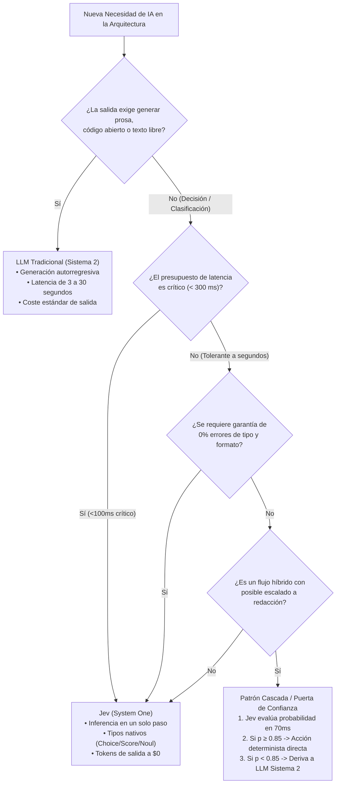

# Módulo 3: Comparativa Exhaustiva: Jev vs. LLMs Tradicionales
## Apartado 3.3: Matriz de Idoneidad y Selección de Casos de Uso

**Serie:** *Fundamentos y Arquitectura de Sistemas con Modelos System One (Jev)*  
**Autor:** Antigravity Engineering Lab  
**Bibliografía y Referencias O'Reilly:**
* [AI Engineering](https://learning.oreilly.com/library/view/-/9781098166298/?orm_source=mcp) por Chip Huyen (*O'Reilly Media, Inc.*)
* [Generative AI Design Patterns](https://learning.oreilly.com/library/view/-/9798341622654/?orm_source=mcp) por Valliappa Lakshmanan y Hannes Hapke (*O'Reilly Media, Inc.*)
* [Building Applications with AI Agents](https://learning.oreilly.com/library/view/-/9781098176495/?orm_source=mcp) por Michael Albada (*O'Reilly Media, Inc.*)
* [Hands-On Large Language Models](https://learning.oreilly.com/library/view/-/9781098150952/?orm_source=mcp) por Jay Alammar y Maarten Grootendorst (*O'Reilly Media, Inc.*)
* [Designing Large Language Model Applications](https://learning.oreilly.com/library/view/-/9781098150495/?orm_source=mcp) por Suhas Pai (*O'Reilly Media, Inc.*)

---

## 1. El Principio de Adecuación Arquitectónica

Uno de los errores más costosos en la ingeniería de software actual consiste en asumir que, por el mero hecho de que un LLM generativo *pueda* realizar una tarea, *deba* ser el componente responsable de ejecutarla.

Como expone **Chip Huyen** en su obra de referencia *AI Engineering* (O'Reilly), la madurez de un sistema de inteligencia artificial no se mide por la potencia de su modelo más grande, sino por la precisión con la que se distribuyen las cargas de trabajo entre modelos especializados de baja latencia y modelos deliberativos pesados. Emplear un LLM generativo de 70.000 millones de parámetros con decodificación autorregresiva de 4 segundos para determinar si un correo es spam o para extraer una categoría fija equivale a utilizar un tren de alta velocidad para cruzar el pasillo de una oficina.

La arquitectura **System One (Jev)** y los **LLMs Tradicionales (Sistema 2)** no son tecnologías excluyentes, sino polos complementarios de un continuo de diseño:

$$\text{Decisión Rápida, Tipada y Calibrada} \longleftrightarrow \text{Generación Abierta, Creativa y Sintética}$$

---

## 2. Matriz de Idoneidad de Casos de Uso

| Escenario Operativo | Modelo Idóneo | Métrica Clave | Justificación Arquitectónica |
| :--- | :--- | :--- | :--- |
| **Enrutamiento Semántico de Peticiones (*Routing*)** | **Jev** | Latencia < 100 ms | Despacho instantáneo a microservicios según intención. Cero coste de salida. |
| **Cortafuegos y *Guardrails* en Tiempo Real** | **Jev** | Latencia < 80 ms, 0% fallos de esquema | Bloqueo síncrono de inyecciones (*jailbreak*) y datos sensibles sin degradar la respuesta al usuario. |
| **Selección Fija de Herramientas en Agentes** | **Jev** | Exactitud categórica | Elección determinista entre un catálogo de hasta 255 funciones sin inventar nombres ni parámetros. |
| **Evaluación de Pasos y Condición de Parada (*Agent Loop*)** | **Jev** | Calibración probabilística | Comprobación de avance (`Noul`) tras cada acción sin incurrir en esperas de varios segundos por ciclo. |
| **Triggers Semánticos en Bases de Datos** | **Jev** | Tipo estricto, $0 salida | Validación y categorización previa al *commit* en PostgreSQL o Elasticsearch sin bloquear la transacción. |
| **Redacción de Contenidos Creativos y Correos** | **LLM Tradicional** | Coherencia discursiva | Requiere generación sintética de prosa rica, estilo variado y matices humanos abiertos. |
| **Síntesis de Código Fuente Abierto (*Code Gen*)** | **LLM Tradicional** | Completitud contextual | Requiere generación autorregresiva de cadenas arbitrarias y razonamiento de sintaxis abierta. |
| **Deducción Matemática y Pruebas Formales** | **LLM Tradicional** | Cadena de deducción | Requiere espacio de trabajo explícito (*scratchpad*) y deliberación multi-paso no acotada. |
| **Atención al Cliente con Triage Híbrido** | **Híbrido (Cascada)** | P50 < 100 ms, P99 < 3 s | Jev resuelve y enruta el 85% de casos comunes; escala al LLM o al humano solo si $p < 0.85$. |

---

## 3. Diagrama de Decisión de Ingeniería

---

## 4. El Patrón de Puerta de Confianza (*Confidence Gate*)

En el diseño de sistemas de producción, uno de los patrones más potentes documentados por **Valliappa Lakshmanan y Hannes Hapke** (*Generative AI Design Patterns*, O'Reilly) es la **Puerta de Confianza**:

1. En lugar de enviar el 100% de las transacciones a un LLM generativo pesado, se coloca a Jev como primer filtro evaluador en línea.
2. Jev procesa la consulta en **70 milisegundos** y emite una probabilidad matemáticamente calibrada ($p$).
3. **Regla de decisión determinista en código:**
   * **Si $p \ge 0.85$:** El sistema ejecuta la acción correspondiente de forma automática y determinista. El coste de salida es $0 y la latencia total percibida es submétrica.
   * **Si $p < 0.85$:** El sistema reconoce honestamente su incertidumbre y deriva la consulta a un LLM deliberativo (Sistema 2) o a un operador humano.

En implementaciones reales en banca y soporte técnico, este patrón resuelve de forma instantánea entre el **80% y el 90% del volumen total**, reservando los LLMs costosos únicamente para la cola residual de casos complejos.

---

## 5. Bibliografía y Referencias en O'Reilly Learning

1. **[AI Engineering](https://learning.oreilly.com/library/view/-/9781098166298/?orm_source=mcp)**  
   *Chip Huyen (O'Reilly Media, Inc., 2024)*  
   *La obra fundamental sobre arquitectura de sistemas de IA, análisis de costes de inferencia, presupuestos de latencia y diseño de patrones de enrutamiento y cascada.*

2. **[Generative AI Design Patterns](https://learning.oreilly.com/library/view/-/9798341622654/?orm_source=mcp)**  
   *Valliappa Lakshmanan y Hannes Hapke (O'Reilly Media, Inc., 2025)*  
   *Establece los patrones formales de Semantic Router, Confidence Cascades y Guardrails de aislamiento para canalizaciones corporativas.*

3. **[Building Applications with AI Agents](https://learning.oreilly.com/library/view/-/9781098176495/?orm_source=mcp)**  
   *Michael Albada (O'Reilly Media, Inc., 2025)*  
   *Aborda la optimización del bucle de decisión de los agentes mediante el desacoplamiento entre el control de estado de baja latencia y la síntesis generativa.*

4. **[Hands-On Large Language Models](https://learning.oreilly.com/library/view/-/9781098150952/?orm_source=mcp)**  
   *Jay Alammar y Maarten Grootendorst (O'Reilly Media, Inc., 2024)*  
   *Analiza la idoneidad funcional de los cabezales de clasificación frente a la generación de texto autorregresiva según la naturaleza de la tarea.*

5. **[Designing Large Language Model Applications](https://learning.oreilly.com/library/view/-/9781098150495/?orm_source=mcp)**  
   *Suhas Pai (O'Reilly Media, Inc., 2025)*  
   *Examina los riesgos de utilizar modelos generativos en tareas de clasificación estricta y la importancia de la calibración en entornos regulados.*

---

## 6. Versión para Gemini Notebook (Texto Exacto con Ortografía Canónica)
*Para procesar en Gemini Notebook y generar diapositivas y esquemas visuales perfectamente sincronizados:*

Para construir sistemas de software eficientes, el primer paso es desterrar la idea de que un modelo generativo debe encargarse de todas las tareas. Como explica la experta en arquitectura de inteligencia artificial Chip Huyen en sus manuales para O'Reilly, la madurez en ingeniería consiste en elegir la herramienta adecuada para cada presupuesto de tiempo y coste. Usar un modelo de lenguaje masivo para clasificar un mensaje o comprobar un permiso es un desperdicio injustificable de recursos.

La regla de decisión es nítida. Si una tarea requiere redactar prosa creativa, sintetizar código nuevo desde cero o desplegar una deducción matemática abierta, los modelos generativos tradicionales son insustituibles. Pero si la necesidad del software es tomar una decisión tipada, clasificar una intención, aplicar un filtro de seguridad o seleccionar una herramienta fija dentro de un bucle de agentes, Jev es la opción óptima por velocidad, coste y fiabilidad.

Los investigadores Valliappa Lakshmanan y Hannes Hapke han formalizado esta convivencia mediante el patrón arquitectónico de la puerta de confianza. En lugar de enviar todas las consultas a un modelo lento y caro, se coloca a Jev como primer evaluador en la línea de fuego. En apenas 70 milisegundos, Jev evalúa el estado y devuelve una probabilidad matemáticamente calibrada.

Si la confianza supera el 85 por ciento, el sistema ejecuta la acción correspondiente de forma directa en código tradicional, con coste cero en tokens de salida y respuesta instantánea. Solo cuando la incertidumbre es elevada, la consulta se deriva al modelo deliberativo de razonamiento lento o a un operador humano. En entornos de producción reales, este diseño híbrido resuelve entre el 80 y el 90 por ciento de las transacciones en tiempo real.

De este modo, Jev y los modelos generativos tradicionales no compiten entre sí, sino que colaboran en perfecta armonía. Jev actúa como el reflejo instantáneo y protector que procesa miles de decisiones por segundo, permitiendo que los modelos lentos de razonamiento se reserven exclusivamente para aquellos momentos en los que una pausa reflexiva resulta verdaderamente indispensable.

---

## 7. Versión para ElevenLabs (Texto de Locución con Adaptación Fonética)
*Texto idéntico al anterior, adaptado para pronunciación natural en voz en off, con cifras en palabras y sin etiquetas de formato:*

Para construir sistemas de software eficientes, el primer paso es desterrar la idea de que un modelo generativo debe encargarse de todas las tareas. Como explica la experta en arquitectura de inteligencia artificial Chip Juyen en sus manuales para O Reili, la madurez en ingeniería consiste en elegir la herramienta adecuada para cada presupuesto de tiempo y coste. Usar un modelo de lenguaje masivo para clasificar un mensaje o comprobar un permiso es un desperdicio injustificable de recursos.

La regla de decisión es nítida. Si una tarea requiere redactar prosa creativa, sintetizar código nuevo desde cero o desplegar una deducción matemática abierta, los modelos generativos tradicionales son insustituibles. Pero si la necesidad del software es tomar una decisión tipada, clasificar una intención, aplicar un filtro de seguridad o seleccionar una herramienta fija dentro de un bucle de agentes, Yev es la opción óptima por velocidad, coste y fiabilidad.

Los investigadores Valiapa Laksmanan y Janes Japke han formalizado esta convivencia mediante el patrón arquitectónico de la puerta de confianza. En lugar de enviar todas las consultas a un modelo lento y caro, se coloca a Yev como primer evaluador en la línea de fuego. En apenas setenta milisegundos, Yev evalúa el estado y devuelve una probabilidad matemáticamente calibrada.

Si la confianza supera el ochenta y cinco por ciento, el sistema ejecuta la acción correspondiente de forma directa en código tradicional, con coste cero en tokens de salida y respuesta instantánea. Solo cuando la incertidumbre es elevada, la consulta se deriva al modelo deliberativo de razonamiento lento o a un operador humano. En entornos de producción reales, este diseño híbrido resuelve entre el ochenta y el noventa por ciento de las transacciones en tiempo real.

De este modo, Yev y los modelos generativos tradicionales no compiten entre sí, sino que colaboran en perfecta armonía. Yev actúa como el reflejo instantáneo y protector que procesa miles de decisiones por segundo, permitiendo que los modelos lentos de razonamiento se reserven exclusivamente para aquellos momentos en los que una pausa reflexiva resulta verdaderamente indispensable.
