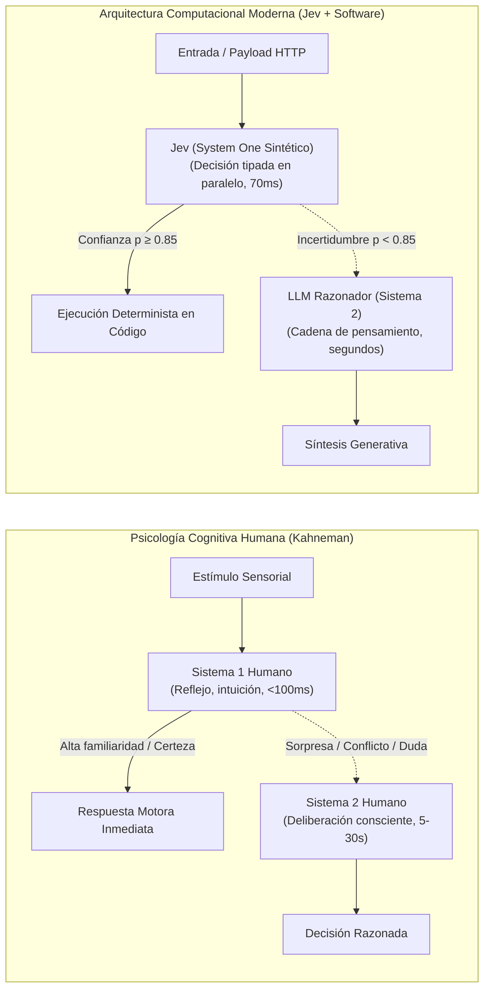

# Módulo 4: Fundamentos Teóricos Documentados en la Biblioteca O'Reilly
## Apartado 4.1: Psicología Cognitiva y Sistemas Duales en Inteligencia Artificial

**Serie:** *Fundamentos y Arquitectura de Sistemas con Modelos System One (Jev)*  
**Autor:** Antigravity Engineering Lab  
**Bibliografía y Referencias O'Reilly:**
* [Neuro-Symbolic AI](https://learning.oreilly.com/library/view/-/9781804617625/?orm_source=mcp) por Alexiei Dingli y David Farrugia (*Packt / O'Reilly, 2023*)
* [An Illustrated Guide to AI Agents](https://learning.oreilly.com/library/view/-/9798341662681/?orm_source=mcp) por Maarten Grootendorst y Jay Alammar (*O'Reilly Media, Inc., 2026*)
* [Behavioral AI](https://learning.oreilly.com/library/view/-/9781394196869/?orm_source=mcp) por Rogayeh Tabrizi (*Wiley / O'Reilly, 2025*)
* [Building Applications with AI Agents](https://learning.oreilly.com/library/view/-/9781098176495/?orm_source=mcp) por Michael Albada (*O'Reilly Media, Inc., 2025*)
* [AI Engineering](https://learning.oreilly.com/library/view/-/9781098166298/?orm_source=mcp) por Chip Huyen (*O'Reilly Media, Inc., 2024*)

---

## 1. La Teoría de Procesamiento Dual: De Daniel Kahneman a la Computación

En 2011, el psicólogo y Premio Nobel de Economía **Daniel Kahneman** sintetizó décadas de investigación experimental en su célebre taxonomía de la mente humana (*Thinking, Fast and Slow*), consolidando la distinción entre dos modos fundamentales de cognición:

1. **Sistema 1 (*System One*):**
   * **Naturaleza:** Inconsciente, asociativo, automático, implícito y de consumo energético casi despreciable.
   * **Función biológica:** Reconocimiento instantáneo de patrones, detección visual de amenazas, reflejos condicionados y calibración intuitiva de riesgo.
   * **Velocidad y latencia:** Decenas de milisegundos. No requiere esfuerzo reflexivo ni genera monólogo interno.

2. **Sistema 2 (*System Two*):**
   * **Naturaleza:** Consciente, deliberativo, analítico, secuencial y con una intensa demanda de energía metabólica (glucosa).
   * **Función biológica:** Deducción lógica formal, cálculo aritmético complejo, planificación estratégica a largo plazo y autocontrol crítico.
   * **Velocidad y latencia:** De segundos a minutos. Requiere atención sostenida y un espacio de trabajo discursivo explícito (*working memory*).

---

## 2. El Error Histórico: Forzar a una Red Neuronal a Ser Sistema 2 Mediante Prosa

En 2019, el pionero del aprendizaje profundo y Premio Turing **Yoshua Bengio** pronunció una conferencia histórica en NeurIPS titulada *«From System 1 Deep Learning to System 2 Deep Learning»*. Bengio postuló que el aprendizaje profundo había dominado con maestría la percepción intuitiva (Sistema 1), pero carecía de mecanismos para el razonamiento simbólico composicional (Sistema 2).

La industria de la inteligencia artificial generativa intentó resolver esta brecha de manera tosca: forzando a los modelos generativos autorregresivos a «pensar en voz alta» token a token mediante cadenas de pensamiento (*Chain-of-Thought*).

Como demuestran **Alexiei Dingli y David Farrugia** en su obra de referencia para O'Reilly (*Neuro-Symbolic AI*), este enfoque monolítico adolece de contradicciones insalvables:
* **Ineficiencia física radical:** Utilizar decodificación autorregresiva de texto para simular lógica formal es computacionalmente aberrante. Cada paso deductivo intermedio requiere recalcular gigabytes de activaciones en memoria GPU simplemente para escupir palabras intermedias.
* **Alucinación acumulativa:** Al no existir separación entre la percepción y el razonamiento simbólico, un pequeño sesgo en la cadena de palabras descarrila inevitablemente la conclusión final.
* **Fragilidad de tipos:** Las cadenas de razonamiento libre no pueden enlazarse con los tipos estrictos que exige la infraestructura de software de misión crítica.

---

## 3. La Separación Arquitectónica: Jev como Sistema 1 Puro para Software

El equipo de TypeSafe AI, guiado por **Diogo Almeida**, tomó la determinación de no intentar fusionar ambos sistemas dentro de un único modelo mastodóntico. En su lugar, formalizaron el principio de separación de funciones:

> **La inteligencia artificial no debe actuar como un oráculo monolítico que diserta sobre todo el proceso, sino como un Sistema 1 sintético de alta precisión que nutre a un Sistema 2 formal constituido por el propio software.**

En esta concepción:
1. **Jev es el Sistema 1 puro:**
   * No genera cadenas de texto ni monólogos interiores.
   * Ejecuta un reconocimiento de patrones probabilístico en un único paso hacia adelante (*forward pass*).
   * Traduce entradas no estructuradas (texto, logs, eventos) a tipos matemáticos cerrados (`Choice`, `Score`, `Noul`) con latencias de 70 a 100 milisegundos.
2. **El software tradicional y los LLMs de razonamiento actúan como el Sistema 2:**
   * Las reglas de negocio, bases de datos y algoritmos en Python o Go representan la lógica simbólica exacta, determinista y auditable.
   * Los LLMs deliberativos pesados (como o1 o Claude 3.5 Sonnet) solo se invocan cuando el Sistema 1 (Jev) detecta una anomalía de alta incertidumbre ($p < 0.85$), reproduciendo con exactitud la economía cognitiva del cerebro humano.

---

## 4. Bibliografía y Referencias en O'Reilly Learning

1. **[Neuro-Symbolic AI](https://learning.oreilly.com/library/view/-/9781804617625/?orm_source=mcp)**  
   *Alexiei Dingli y David Farrugia (Packt / O'Reilly, 2023)*  
   *La referencia canónica sobre la integración de sistemas neuronales conexionistas (percepción Sistema 1) con lógica simbólica y reglas formales de software (razonamiento Sistema 2).*

2. **[An Illustrated Guide to AI Agents](https://learning.oreilly.com/library/view/-/9798341662681/?orm_source=mcp)**  
   *Maarten Grootendorst y Jay Alammar (O'Reilly Media, Inc., 2026)*  
   *Aborda la arquitectura funcional de los agentes cognitivos modernos, contrastando la inferencia reactiva inmediata con la planificación deliberativa de múltiples etapas.*

3. **[Behavioral AI](https://learning.oreilly.com/library/view/-/9781394196869/?orm_source=mcp)**  
   *Rogayeh Tabrizi (Wiley / O'Reilly, 2025)*  
   *Analiza la traslación de los modelos cognitivos humanos y los sesgos del Sistema 1 hacia sistemas informáticos y motores de recomendación autónomos.*

4. **[Building Applications with AI Agents](https://learning.oreilly.com/library/view/-/9781098176495/?orm_source=mcp)**  
   *Michael Albada (O'Reilly Media, Inc., 2025)*  
   *Estudia los cuellos de botella de latencia cuando los agentes intentan resolver tareas reactivas utilizando modelos deliberativos lentos.*

5. **[AI Engineering](https://learning.oreilly.com/library/view/-/9781098166298/?orm_source=mcp)**  
   *Chip Huyen (O'Reilly Media, Inc., 2024)*  
   *Profundiza en la segmentación de canalizaciones entre clasificadores densos y modelos de generación de lenguaje.*

---

## 5. Versión para Gemini Notebook (Texto Exacto con Ortografía Canónica)
*Para procesar en Gemini Notebook y generar diapositivas y esquemas visuales perfectamente sincronizados:*

Para comprender por qué Jev representa un cambio de paradigma tan profundo, debemos remontarnos a los descubrimientos del psicólogo y Premio Nobel de Economía Daniel Kahneman. En su influyente teoría del procesamiento dual, Kahneman demostró que la mente humana opera mediante dos mecanismos complementarios: un Sistema 1, rápido, intuitivo, automático y energéticamente muy eficiente, y un Sistema 2, lento, deliberativo, analítico y con un enorme coste biológico.

El pionero del aprendizaje profundo Yoshua Bengio advirtió hace años de que las redes neuronales sobresalían en el reconocimiento de patrones del Sistema 1, pero carecían de la capacidad simbólica del Sistema 2. Ante este dilema, la industria de la inteligencia artificial generativa intentó forzar a los grandes modelos de lenguaje a imitar la deliberación haciéndoles hablar consigo mismos mediante cadenas de texto interminables.

Como demuestran Alexiei Dingli y David Farrugia en su tratado de O'Reilly sobre inteligencia artificial neuro-simbólica, este intento de fusionar ambos mundos en un único modelo generativo es un error de ingeniería. Obligar a una red neuronal a escupir texto token a token para resolver lógica matemática básica dispara la latencia a varios segundos y multiplica el riesgo de alucinaciones. En el ser humano, el cerebro no verbaliza un discurso en voz alta cada vez que frena de golpe ante un obstáculo: activa un reflejo instantáneo y silencioso.

Aquí es donde TypeSafe AI, bajo la dirección de Diogo Almeida, introduce su ruptura conceptual. Jev no intenta ser un pensador lento que simula razonamiento mediante prosa libre. Jev es, por definición, un modelo de Sistema 1 puro: un motor que evalúa contextos complejos en una sola pasada de 70 milisegundos, devolviendo decisiones tipadas con probabilidades matemáticas calibradas.

De este modo, se restituye la división natural del trabajo computacional. Jev asume el rol del Sistema 1 biológico, respondiendo a la percepción inmediata y protegiendo los flujos de datos a toda velocidad, mientras que el código de software y los modelos de razonamiento lento conforman el Sistema 2, interviniendo con su coste y su pausa únicamente cuando la situación exige una deliberación profunda.

---

## 6. Versión para ElevenLabs (Texto de Locución con Adaptación Fonética)
*Texto idéntico al anterior, adaptado para pronunciación natural en voz en off, con cifras en palabras y sin etiquetas de formato:*

Para comprender por qué Yev representa un cambio de paradigma tan profundo, debemos remontarnos a los descubrimientos del psicólogo y Premio Nobel de Economía Daniel Káneman. En su influyente teoría del procesamiento dual, Káneman demostró que la mente humana opera mediante dos mecanismos complementarios: un Sistema Uno, rápido, intuitivo, automático y energéticamente muy eficiente, y un Sistema Dos, lento, deliberativo, analítico y con un enorme coste biológico.

El pionero del aprendizaje profundo Yosua Benyio advirtió hace años de que las redes neuronales sobresalían en el reconocimiento de patrones del Sistema Uno, pero carecían de la capacidad simbólica del Sistema Dos. Ante este dilema, la industria de la inteligencia artificial generativa intentó forzar a los grandes modelos de lenguaje a imitar la deliberación haciéndoles hablar consigo mismos mediante cadenas de texto interminables.

Como demuestran Aleksi Dingli y Deivid Farruya en su tratado de O Reili sobre inteligencia artificial neuro-simbólica, este intento de fusionar ambos mundos en un único modelo generativo es un error de ingeniería. Obligar a una red neuronal a escupir texto token a token para resolver lógica matemática básica dispara la latencia a varios segundos y multiplica el riesgo de alucinaciones. En el ser humano, el cerebro no verbaliza un discurso en voz alta cada vez que frena de golpe ante un obstáculo: activa un reflejo instantáneo y silencioso.

Aquí es donde Taip Seif Ei Ai, bajo la dirección de Diogo Almeida, introduce su ruptura conceptual. Yev no intenta ser un pensador lento que simula razonamiento mediante prosa libre. Yev es, por definición, un modelo de Sistema Uno puro: un motor que evalúa contextos complejos en una sola pasada de setenta milisegundos, devolviendo decisiones tipadas con probabilidades matemáticas calibradas.

De este modo, se restituye la división natural del trabajo computacional. Yev asume el rol del Sistema Uno biológico, respondiendo a la percepción inmediata y protegiendo los flujos de datos a toda velocidad, mientras que el código de software y los modelos de razonamiento lento conforman el Sistema Dos, interviniendo con su coste y su pausa únicamente cuando la situación exige una deliberación profunda.
