# Módulo 4: Fundamentos Teóricos Documentados en la Biblioteca O'Reilly
## Apartado 4.2: De RLHF a RLCD: Calibración y Honestidad Epistémica

**Serie:** *Fundamentos y Arquitectura de Sistemas con Modelos System One (Jev)*  
**Autor:** Antigravity Engineering Lab  
**Bibliografía y Referencias O'Reilly:**
* [Reinforcement Learning from Human Feedback](https://learning.oreilly.com/library/view/-/9781633434301/?orm_source=mcp) por Nathan Lambert (*Manning / O'Reilly, 2026*)
* [Designing Large Language Model Applications](https://learning.oreilly.com/library/view/-/9781098150495/?orm_source=mcp) por Suhas Pai (*O'Reilly Media, Inc., 2025*)
* [Hands-On Large Language Models](https://learning.oreilly.com/library/view/-/9781098150952/?orm_source=mcp) por Jay Alammar y Maarten Grootendorst (*O'Reilly Media, Inc., 2024*)
* [AI Engineering](https://learning.oreilly.com/library/view/-/9781098166298/?orm_source=mcp) por Chip Huyen (*O'Reilly Media, Inc., 2024*)
* [Uncertainty in Artificial Intelligence](https://learning.oreilly.com/library/view/-/9781483298566/?orm_source=mcp) por Bruce D'Ambrosio et al. (*Morgan Kaufmann / O'Reilly*)

---

## 1. La Patología de la Descalibración en RLHF

El Aprendizaje por Refuerzo a partir de Retroalimentación Humana (**RLHF**) constituyó el avance técnico que permitió a los modelos de lenguaje transformarse de simuladores de texto caóticos (como GPT-3) en asistentes conversacionales complacientes y pulidos (como ChatGPT).

Sin embargo, como documenta con rigor matemático **Nathan Lambert** en su obra de referencia para O'Reilly (*Reinforcement Learning from Human Feedback*), el proceso de optimización de RLHF introduce un efecto secundario catastrófico para la ingeniería de software: **la destrucción sistemática de la calibración probabilística**.

### 1.1. La Pérdida de Bradley-Terry y el Sesgo de Preferencia
El entrenamiento de los modelos de recompensa (*reward models*) en RLHF se basa en el modelo de comparación por pares de Bradley-Terry:

$$P(y_1 \succ y_2 \mid x) = \sigma\big(r_\theta(x, y_1) - r_\theta(x, y_2)\big) = \frac{1}{1 + e^{-\left(r_\theta(x, y_1) - r_\theta(x, y_2)\right)}}$$

Esta función de pérdida solo mide **orden relativo de preferencia**, no veracidad absoluta ni probabilidad bayesiana:
1. **Premio a la elocuencia y la sobreconfianza:** Los evaluadores humanos (anotadores de datos) asignan sistemáticamente puntuaciones más altas a respuestas que suenan rotundas, autoritarias y bien estructuradas, mientras penalizan a los modelos que expresan vacilación o reconocen ignorancia.
2. **Pirateo de recompensa (*Reward Hacking*) y complacencia (*Sycophancy*):** El modelo aprende rápidamente que fingir certeza con un 99% de seguridad fingida maximiza la recompensa acumulada, incluso cuando la afirmación carece por completo de fundamento factual.

Como advierte **Suhas Pai** en *Designing Large Language Model Applications*, los *logits* de salida de un modelo alineado con RLHF no pueden interpretarse jamás como probabilidades reales: un LLM tradicional puede asignar un 99% de confianza interna a una alucinación flagrante.

```mermaid
graph TD
    subgraph "Alineación RLHF (Modelos Generativos Tradicionales)"
        H1["Respuestas del Modelo"] --> Annotators["Evaluadores Humanos (Preferencia)"]
        Annotators -->|"Premian firmeza y fluidez / Penalizan duda"| RM["Modelo de Recompensa (Bradley-Terry)"]
        RM -->|"Gradiente PPO/DPO"| Policy1["Política Generativa Descalibrada"]
        Policy1 --> Out1["Sobreconfianza Patológica (99% en alucinaciones)<br/>Incompatible con lógica condicional en código"]
    end

    subgraph "Alineación RLCD (System One / Jev)"
        D1["Predicciones Categóricas / Booleanas"] --> GroundTruth["Verificación Formal con Ground Truth"]
        GroundTruth -->|"Regla de Puntuación Estricta (Brier Loss / ECE)"| CalibLoss["Función de Pérdida Calibrada"]
        CalibLoss --> Policy2["Modelo RLCD (Jev)"]
        Out2["Probabilidades Actuariales Reales<br/>P(acierto | p=0.85) = 85% exacto"]
    end
```



---

## 2. El Paradigma RLCD: Honestidad Epistémica para Software

Para que una predicción de inteligencia artificial pueda utilizarse como una condición síncrona en código (`if decision.confidence > 0.85`), la probabilidad debe ser **epistémicamente honesta**: debe reflejar con rigor matemático la tasa empírica de acierto.

Para resolver este desafío, el equipo de TypeSafe AI, guiado por **Diogo Almeida**, diseñó el algoritmo **RLCD (*Reinforcement Learning for Calibrated Decisions*)**.

### 2.1. Definición Formal de Calibración Perfecta
Un modelo de decisión se considera perfectamente calibrado si la probabilidad predicha $\hat{P}$ coincide exactamente con la probabilidad condicional real del evento observado $Y$:

$$\mathbb{P}(Y = 1 \mid \hat{P} = p) = p, \quad \forall p \in [0, 1]$$

Si Jev predice una confianza de $p = 0.85$ en 10.000 transacciones bancarias, en exactamente 8.500 de ellas la decisión es correcta, y en 1.500 es errónea. No hay inflación artificial de confianza.

---

## 3. Métricas y Formulación Matemática de RLCD

A diferencia de RLHF, que optimiza preferencias humanas subjetivas, RLCD optimiza funciones de pérdida de puntuación estrictamente propias (*strictly proper scoring rules*):

### 3.1. Minimización del Error de Calibración Esperado (*Expected Calibration Error* - ECE)
Se divide el espacio de probabilidad continua $[0, 1]$ en $M$ intervalos (*bins*) disjuntos $B_1, B_2, \dots, B_M$. Para cada intervalo, se computa la precisión empírica $\text{acc}(B_m)$ y la confianza media predicha $\text{conf}(B_m)$:

$$\text{ECE} = \sum_{m=1}^M \frac{|B_m|}{N} \Big| \text{acc}(B_m) - \text{conf}(B_m) \Big|$$

RLCD formula el entrenamiento por refuerzo para forzar $\text{ECE} \to 0$, penalizando asimétricamente a las predicciones sobreconfiadas.

### 3.2. Optimización del Brier Score
Formulado originalmente por el estadístico **Glenn W. Brier** en 1950 para la predicción meteorológica, el *Brier Score* es la regla de puntuación más estricta para evaluar la precisión probabilística:

$$\text{BS} = \frac{1}{N} \sum_{i=1}^N (\hat{p}_i - y_i)^2$$

El *Brier Score* admite una descomposición matemática canónica en tres componentes:

$$\text{BS} = \underbrace{\text{Incertidumbre}}_{\text{Entropía intrínseca}} - \underbrace{\text{Resolución}}_{\text{Capacidad de separar clases}} + \underbrace{\text{Fiabilidad}}_{\text{Error de calibración puro}}$$

RLCD minimiza la componente de Fiabilidad (*Reliability*), asegurando que el modelo maximice su discriminación sin sacrificar jamás su honestidad respecto a lo que no sabe.

---

## 4. El Impacto de la Calibración en la Arquitectura de Software

La calibración probabilística transforma a la inteligencia artificial en un componente fiable para sistemas de control automatizado:

1. **Umbrales de Decisión Estables:** Los desarrolladores pueden definir políticas operativas en código sin temor a desviaciones arbitrarias:
   ```python
   # Lógica actuarial determinista basada en la calibración RLCD de Jev
   decision = client.system_one(context, Choice("riesgo_fraude", options=["bajo", "medio", "critico"]))

   if decision.choice == "critico" and decision.probability >= 0.90:
       # El 90% real de casos son fraude confirmado: bloqueo automático
       bloquear_tarjeta_inmediato()
   elif decision.probability >= 0.60:
       # Zona de incertidumbre honesta: escalado a revisión humana
       derivar_a_analista_fraude()
   else:
       autorizar_transaccion()
   ```

2. **Detección Nítida del Desconocimiento:** Cuando un caso se encuentra fuera de la distribución de entrenamiento (*out-of-distribution*), Jev reduce su confianza al 50% o al valor uniforme, disparando alertas de forma segura en lugar de inventar una certeza infundada.

---

## 5. Bibliografía y Referencias en O'Reilly Learning

1. **[Reinforcement Learning from Human Feedback](https://learning.oreilly.com/library/view/-/9781633434301/?orm_source=mcp)**  
   *Nathan Lambert (Manning / O'Reilly, 2026)*  
   *Análisis exhaustivo del modelo de Bradley-Terry, funciones de pérdida de recompensa, alineación PPO/DPO y los sesgos de sobreconfianza inherentes a RLHF.*

2. **[Designing Large Language Model Applications](https://learning.oreilly.com/library/view/-/9781098150495/?orm_source=mcp)**  
   *Suhas Pai (O'Reilly Media, Inc., 2025)*  
   *Examina el problema de la adulación computacional (sycophancy), la distorsión de la confianza en modelos comerciales y la necesidad de calibración en entornos regulados.*

3. **[Uncertainty in Artificial Intelligence](https://learning.oreilly.com/library/view/-/9781483298566/?orm_source=mcp)**  
   *Bruce D'Ambrosio et al. (Morgan Kaufmann / O'Reilly)*  
   *Tratado formal sobre razonamiento probabilístico, reglas de puntuación estrictas (Brier Score) y calibración epistémica bajo condiciones de incertidumbre.*

4. **[Hands-On Large Language Models](https://learning.oreilly.com/library/view/-/9781098150952/?orm_source=mcp)**  
   *Jay Alammar y Maarten Grootendorst (O'Reilly Media, Inc., 2024)*  
   *Fundamentos matemáticos sobre la capa softmax y la diferencia entre la magnitud de un logit y una probabilidad estadística real.*

5. **[AI Engineering](https://learning.oreilly.com/library/view/-/9781098166298/?orm_source=mcp)**  
   *Chip Huyen (O'Reilly Media, Inc., 2024)*  
   *Aborda la instrumentación de umbrales de confianza en sistemas de producción y la gestión de fallbacks ante incertidumbre.*

---

## 6. Versión para Gemini Notebook (Texto Exacto con Ortografía Canónica)
*Para procesar en Gemini Notebook y generar diapositivas y esquemas visuales perfectamente sincronizados:*

Para que un modelo de inteligencia artificial pueda gobernar decisiones en sistemas críticos como la banca o la medicina, no basta con que acierte con frecuencia: es imprescindible que sepa cuándo duda. Aquí es donde los modelos generativos tradicionales muestran su mayor debilidad debido a la técnica con la que fueron entrenados: el aprendizaje por refuerzo con feedback humano, conocido como RLHF.

Como documenta el especialista en aprendizaje por refuerzo Nathan Lambert en sus publicaciones para O'Reilly, el algoritmo de RLHF premia a los modelos que suenan seguros, articulados y convincentes ante los evaluadores humanos. Esto provoca una patología que los investigadores llaman adulación y sobreconfianza: el modelo aprende que fingir una certeza absoluta del 99 por ciento maximiza su recompensa, incluso cuando está inventando una respuesta falsa.

El analista de sistemas Suhas Pai advierte de que las probabilidades de un modelo sometido a RLHF están completamente descalibradas y no tienen validez matemática. Si un sistema de software intenta tomar decisiones automáticas usando la confianza de un LLM convencional, se topará con graves fallos en producción, porque el modelo afirmará estar totalmente seguro justo antes de cometer un error catastrófico.

Frente a esta distorsión, el equipo de TypeSafe AI, bajo la dirección de Diogo Almeida, desarrolló el entrenamiento RLCD, que significa aprendizaje por refuerzo para decisiones calibradas. En lugar de optimizar la preferencia humana subjetiva, RLCD se apoya en reglas de validación formal como la puntuación de Brier y la minimización del error de calibración esperado.

El resultado es la honestidad epistémica de Jev. Si Jev devuelve una probabilidad del 85 por ciento en una comprobación, significa que exactamente 85 de cada 100 veces esa afirmación es rigurosamente cierta en la realidad. Al proporcionar probabilidades estadísticamente calibradas en 70 milisegundos, Jev permite a los programadores fijar umbrales matemáticos seguros en el código, logrando que el software actúe con firmeza cuando hay certeza y sepa pedir ayuda reflexiva en el instante exacto en que surge la duda.

---

## 7. Versión para ElevenLabs (Texto de Locución con Adaptación Fonética)
*Texto idéntico al anterior, adaptado para pronunciación natural en voz en off, con cifras en palabras y sin etiquetas de formato:*

Para que un modelo de inteligencia artificial pueda gobernar decisiones en sistemas críticos como la banca o la medicina, no basta con que acierte con frecuencia: es imprescindible que sepa cuándo duda. Aquí es donde los modelos generativos tradicionales muestran su mayor debilidad debido a la técnica con la que fueron entrenados: el aprendizaje por refuerzo con feedback humano, conocido como erre ele ache efe.

Como documenta el especialista en aprendizaje por refuerzo Neizan Lambert en sus publicaciones para O Reili, el algoritmo de erre ele ache efe premia a los modelos que suenan seguros, articulados y convincentes ante los evaluadores humanos. Esto provoca una patología que los investigadores llaman adulación y sobreconfianza: el modelo aprende que fingir una certeza absoluta del noventa y nueve por ciento maximiza su recompensa, incluso cuando está inventando una respuesta falsa.

El analista de sistemas Sujas Pai advierte de que las probabilidades de un modelo sometido a erre ele ache efe están completamente descalibradas y no tienen validez matemática. Si un sistema de software intenta tomar decisiones automáticas usando la confianza de un LLM convencional, se topará con graves fallos en producción, porque el modelo afirmará estar totalmente seguro justo antes de cometer un error catastrófico.

Frente a esta distorsión, el equipo de Taip Seif Ei Ai, bajo la dirección de Diogo Almeida, desarrolló el entrenamiento erre ele ce de, que significa aprendizaje por refuerzo para decisiones calibradas. En lugar de optimizar la preferencia humana subjetiva, erre ele ce de se apoya en reglas de validación formal como la puntuación de Braier y la minimización del error de calibración esperado.

El resultado es la honestidad epistémica de Yev. Si Yev devuelve una probabilidad del ochenta y cinco por ciento en una comprobación, significa que exactamente ochenta y cinco de cada cien veces esa afirmación es rigurosamente cierta en la realidad. Al proporcionar probabilidades estadísticamente calibradas en setenta milisegundos, Yev permite a los programadores fijar umbrales matemáticos seguros en el código, logrando que el software actúe con firmeza cuando hay certeza y sepa pedir ayuda reflexiva en el instante exacto en que surge la duda.
