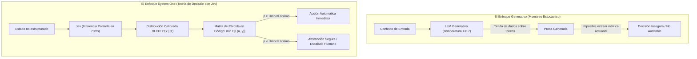

# Módulo 4: Fundamentos Teóricos Documentados en la Biblioteca O'Reilly
## Apartado 4.3: Gestión de Incertidumbre y Decisión Bajo Riesgo

**Serie:** *Fundamentos y Arquitectura de Sistemas con Modelos System One (Jev)*  
**Autor:** Antigravity Engineering Lab  
**Bibliografía y Referencias O'Reilly:**
* [Uncertainty in Artificial Intelligence](https://learning.oreilly.com/library/view/-/9781483298566/?orm_source=mcp) por Bruce D'Ambrosio, Philippe Smets y Piero Bonissone (*Morgan Kaufmann / O'Reilly*)
* [Designing Machine Learning Systems](https://learning.oreilly.com/library/view/-/9781098107956/?orm_source=mcp) por Chip Huyen (*O'Reilly Media, Inc., 2022*)
* [AI Engineering](https://learning.oreilly.com/library/view/-/9781098166298/?orm_source=mcp) por Chip Huyen (*O'Reilly Media, Inc., 2024*)
* [Designing Large Language Model Applications](https://learning.oreilly.com/library/view/-/9781098150495/?orm_source=mcp) por Suhas Pai (*O'Reilly Media, Inc., 2025*)
* [Generative AI Design Patterns](https://learning.oreilly.com/library/view/-/9798341622654/?orm_source=mcp) por Valliappa Lakshmanan y Hannes Hapke (*O'Reilly Media, Inc., 2025*)

---

## 1. Muestreo Estocástico frente a Decisión Racional Bajo Riesgo

En los modelos de lenguaje generativos tradicionales, la gestión de la incertidumbre suele confundirse con el **muestreo estocástico**: la inyección de aleatoriedad en el proceso de decodificación mediante hiperparámetros como la temperatura (`temperature`), el filtrado nuclear (`top_p`) o el muestreo de los $k$ mejores (`top_k`).

Si bien este mecanismo es valioso para la redacción creativa o la generación de diálogos amenos, resulta inaceptable e inútil para la ingeniería de software de misión crítica:
* **Aleatoriedad cosmética:** Cambiar la temperatura de un LLM no hace que el modelo evalúe mejor su propia duda; simplemente altera la forma en que se tiran los dados sobre los *logits* de salida. Si se ejecuta dos veces la misma consulta, se obtienen textos divergentes, pero el software sigue careciendo de un indicador cuantitativo de riesgo.
* **Falsa certidumbre en las cadenas de razonamiento:** Como han demostrado los análisis de fiabilidad en producción, un LLM puede generar tres explicaciones convincentes y mutuamente contradictorias para un mismo problema financiero o legal sin proporcionar al sistema informático una métrica auditable para discernir cuál es la correcta.

Frente a esta fragilidad, la literatura clásica sobre incertidumbre en inteligencia artificial —representada por el tratado fundacional de **Bruce D'Ambrosio et al.** (*Uncertainty in Artificial Intelligence*, Morgan Kaufmann / O'Reilly)— establece que **una decisión racional bajo riesgo no consiste en un muestreo estocástico de texto, sino en la asignación explícita de probabilidades a estados del mundo para optimizar una función de pérdida esperada**.

---

## 2. Taxonomía de la Incertidumbre: Aleatoria vs. Epistémica

En el diseño de sistemas de producción, el modelo de decisión debe discriminar entre dos fuentes de incertidumbre cualitativamente diferentes:

1. **Incertidumbre Aleatoria (*Aleatoric Uncertainty*):**
   * Es el ruido irreductible inherente a la naturaleza de los datos.
   * *Ejemplo:* Una solicitud de un cliente que contiene una descripción genuinamente ambigua o contradictoria. Ni siquiera un comité de expertos humanos podría resolver el departamento con un 100% de certeza.
   * Jev refleja esta incertidumbre distribuyendo su masa de probabilidad entre varias opciones cerradas (por ejemplo: `{"soporte": 0.48, "facturacion": 0.52}`).

2. **Incertidumbre Epistémica (*Epistemic Uncertainty*):**
   * Deriva del desconocimiento del propio modelo ante entradas que caen fuera de su distribución de entrenamiento (*Out-of-Distribution - OOD*).
   * En lugar de alucinar una certeza categórica ficticia (como hacen los LLMs generativos alineados con RLHF), la calibración RLCD de Jev colapsa su confianza hacia una distribución uniforme o declara una baja probabilidad en la afirmación (`Noul`), señalando formalmente al software que el modelo no sabe cómo clasificar la entrada.

---

## 3. Teoría de Decisión Bayesiana y Políticas de Abstención (*Selective Prediction*)

Como subraya **Chip Huyen** en *Designing Machine Learning Systems* (O'Reilly), la verdadera prueba de fuego de un sistema de aprendizaje automático en producción no es su precisión en los casos fáciles, sino su **capacidad de abstención selectiva (*selective prediction / abstention*)**: la facultad matemática de rechazar la toma de decisiones automáticas cuando el riesgo supera el presupuesto de tolerancia del negocio.

### 3.1. Formulación de la Pérdida Esperada
Sea $\mathcal{A}$ el conjunto de acciones posibles del software (por ejemplo: `{autorizar_pago, bloquear_cuenta, derivar_a_humano}`), y sea $\mathcal{Y}$ el conjunto de estados reales de la transacción (`{legitima, fraude}`). 

Para cada acción $a \in \mathcal{A}$, la pérdida esperada $\mathcal{R}(a \mid x)$ condicionada a la entrada $x$ se define como:

$$\mathcal{R}(a \mid x) = \sum_{y \in \mathcal{Y}} L(a, y) \cdot \mathbb{P}(y \mid x)$$

Donde $L(a, y)$ es la matriz de costes del negocio (por ejemplo, el coste económico de bloquear una tarjeta a un cliente legítimo versus el coste de permitir un fraude de 5.000 euros), y $\mathbb{P}(y \mid x)$ es la probabilidad proporcionada por Jev.

### 3.2. El Umbral Matemático de Decisión
La acción óptima $a^*$ es aquella que minimiza el riesgo bayesiano:

$$a^* = \arg\min_{a \in \mathcal{A}} \mathcal{R}(a \mid x)$$

Si el coste de un falso positivo ($C_{\text{FP}}$) es diez veces superior al coste de una revisión humana ($C_{\text{FN}}$), la regla de decisión no requiere suponer ni adivinar: se deduce formalmente el umbral exacto de corte $\tau$:

$$\tau = \frac{C_{\text{FP}}}{C_{\text{FP}} + C_{\text{FN}}} = \frac{10}{10 + 1} \approx 0.909$$

* **Si $\mathbb{P}(\text{fraude} \mid x) \ge 0.91$:** La acción óptima es el bloqueo inmediato.
* **Si $\mathbb{P}(\text{fraude} \mid x) < 0.91$:** El software se abstiene de actuar de forma automática y deriva el evento a la cola de auditoría o a un LLM de razonamiento lento (Sistema 2).

Esta formalización es impracticable con LLMs tradicionales debido a la descalibración patológica de sus salidas de texto. Con Jev, se convierte en una simple línea de código síncrona evaluada en **70 milisegundos**.

---

## 4. Bibliografía y Referencias en O'Reilly Learning

1. **[Uncertainty in Artificial Intelligence](https://learning.oreilly.com/library/view/-/9781483298566/?orm_source=mcp)**  
   *Bruce D'Ambrosio, Philippe Smets y Piero Bonissone (Morgan Kaufmann / O'Reilly)*  
   *Tratado clásico indispensable sobre modelado de incertidumbre epistémica y aleatoria, redes de creencia bayesiana y teoría de la decisión bajo condiciones de información incompleta.*

2. **[Designing Machine Learning Systems](https://learning.oreilly.com/library/view/-/9781098107956/?orm_source=mcp)**  
   *Chip Huyen (O'Reilly Media, Inc., 2022)*  
   *La referencia estándar sobre compensaciones entre falsos positivos y falsos negativos, ajuste de umbrales de coste y arquitectura de predicción selectiva en sistemas de producción.*

3. **[AI Engineering](https://learning.oreilly.com/library/view/-/9781098166298/?orm_source=mcp)**  
   *Chip Huyen (O'Reilly Media, Inc., 2024)*  
   *Profundiza en la mitigación de fallos operativos, monitorización de deriva de datos y el diseño de políticas de salvaguarda mediante modelos discriminativos.*

4. **[Designing Large Language Model Applications](https://learning.oreilly.com/library/view/-/9781098150495/?orm_source=mcp)**  
   *Suhas Pai (O'Reilly Media, Inc., 2025)*  
   *Analiza la incompetencia de los LLMs generativos para proporcionar cuantificación de incertidumbre y los riesgos de derivar decisiones críticas a partir de texto libre.*

5. **[Generative AI Design Patterns](https://learning.oreilly.com/library/view/-/9798341622654/?orm_source=mcp)**  
   *Valliappa Lakshmanan y Hannes Hapke (O'Reilly Media, Inc., 2025)*  
   *Documenta los patrones de enrutamiento con puertas de confianza y evaluación de riesgo en tuberías empresariales compuestas.*

---

## 5. Versión para Gemini Notebook (Texto Exacto con Ortografía Canónica)
*Para procesar en Gemini Notebook y generar diapositivas y esquemas visuales perfectamente sincronizados:*

En la inteligencia artificial generativa convencional, existe una peligrosa confusión entre la verdadera gestión del riesgo y el simple muestreo estocástico. Cuando los desarrolladores ajustan la temperatura de un modelo de lenguaje para obtener variedad en las respuestas, no están cuantificando la incertidumbre: están introduciendo una tirada de dados aleatoria sobre las palabras. En sistemas de software donde hay vidas, dinero o seguridad en juego, jugar a los dados con las respuestas no es una opción de ingeniería admisible.

Como expone el investigador Bruce D'Ambrosio en el tratado clásico de O'Reilly sobre incertidumbre en inteligencia artificial, una decisión racional bajo riesgo no consiste en adivinar texto con mayor o menor variabilidad, sino en asignar probabilidades matemáticas calibradas a la realidad para calcular la pérdida esperada de cada acción.

Aquí es donde entra en juego el concepto de predicción selectiva o política de abstención, un principio analizado en profundidad por la especialista en sistemas Chip Huyen. La mayor virtud de un modelo en producción no es responder a todo de forma temeraria, sino tener la honestidad matemática de abstenerse cuando la incertidumbre es elevada, derivando el control al código o a un operador humano antes de provocar un fallo costoso.

Con los modelos generativos tradicionales, implementar esta política es casi imposible porque su alineación conversacional destruye las probabilidades internas, sustituyéndolas por una falsa certidumbre. En cambio, Jev devuelve distribuciones de probabilidad calibradas mediante RLCD en apenas 70 milisegundos. Si un caso presenta ambigüedad en los datos o se aleja de la experiencia del modelo, Jev refleja esa duda de manera transparente en su puntuación.

De este modo, los programadores pueden aplicar la teoría de decisión formal en el código tradicional. Una comprobación semántica ya no es una caja negra que genera párrafos impredecibles, sino una primitiva matemática que permite fijar umbrales de riesgo exactos, garantizando que el software solo ejecute acciones automáticas cuando la confianza es legítima y blindando a la organización contra los costes de la falsa seguridad.

---

## 6. Versión para ElevenLabs (Texto de Locución con Adaptación Fonética)
*Texto idéntico al anterior, adaptado para pronunciación natural en voz en off, con cifras en palabras y sin etiquetas de formato:*

En la inteligencia artificial generativa convencional, existe una peligrosa confusión entre la verdadera gestión del riesgo y el simple muestreo estocástico. Cuando los desarrolladores ajustan la temperatura de un modelo de lenguaje para obtener variedad en las respuestas, no están cuantificando la incertidumbre: están introduciendo una tirada de dados aleatoria sobre las palabras. En sistemas de software donde hay vidas, dinero o seguridad en juego, jugar a los dados con las respuestas no es una opción de ingeniería admisible.

Como expone el investigador Brus Dambrosio en el tratado clásico de O Reili sobre incertidumbre en inteligencia artificial, una decisión racional bajo riesgo no consiste en adivinar texto con mayor o menor variabilidad, sino en asignar probabilidades matemáticas calibradas a la realidad para calcular la pérdida esperada de cada acción.

Aquí es donde entra en juego el concepto de predicción selectiva o política de abstención, un principio analizado en profundidad por la especialista en sistemas Chip Juyen. La mayor virtud de un modelo en producción no es responder a todo de forma temeraria, sino tener la honestidad matemática de abstenerse cuando la incertidumbre es elevada, derivando el control al código o a un operador humano antes de provocar un fallo costoso.

Con los modelos generativos tradicionales, implementar esta política es casi imposible porque su alineación conversacional destruye las probabilidades internas, sustituyéndolas por una falsa certidumbre. En cambio, Yev devuelve distribuciones de probabilidad calibradas mediante erre ele ce de en apenas setenta milisegundos. Si un caso presenta ambigüedad en los datos o se aleja de la experiencia del modelo, Yev refleja esa duda de manera transparente en su puntuación.

De este modo, los programadores pueden aplicar la teoría de decisión formal en el código tradicional. Una comprobación semántica ya no es una caja negra que genera párrafos impredecibles, sino una primitiva matemática que permite fijar umbrales de riesgo exactos, garantizando que el software solo ejecute acciones automáticas cuando la confianza es legítima y blindando a la organización contra los costes de la falsa seguridad.
