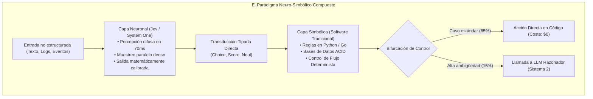

# Módulo 4: Fundamentos Teóricos Documentados en la Biblioteca O'Reilly
## Apartado 4.4: Arquitecturas Neuro-Simbólicas y Patrones de Sistemas Compuestos

**Serie:** *Fundamentos y Arquitectura de Sistemas con Modelos System One (Jev)*  
**Autor:** Antigravity Engineering Lab  
**Bibliografía y Referencias O'Reilly:**
* [Generative AI Design Patterns](https://learning.oreilly.com/library/view/-/9798341622654/?orm_source=mcp) por Valliappa Lakshmanan y Hannes Hapke (*O'Reilly Media, Inc., 2025*)
* [Neuro-Symbolic AI](https://learning.oreilly.com/library/view/-/9781804617625/?orm_source=mcp) por Alexiei Dingli y David Farrugia (*Packt / O'Reilly, 2023*)
* [Building Applications with AI Agents](https://learning.oreilly.com/library/view/-/9781098176495/?orm_source=mcp) por Michael Albada (*O'Reilly Media, Inc., 2025*)
* [AI Engineering](https://learning.oreilly.com/library/view/-/9781098166298/?orm_source=mcp) por Chip Huyen (*O'Reilly Media, Inc., 2024*)
* [Designing Data-Intensive Applications, 2nd Edition](https://learning.oreilly.com/library/view/-/9781098119058/?orm_source=mcp) por Martin Kleppmann y Chris Riccomini (*O'Reilly Media, Inc., 2026*)

---

## 1. La Dialéctica Histórica: Conexionismo frente a Simbolismo

Durante más de seis décadas, la investigación en inteligencia artificial estuvo dividida en dos escuelas de pensamiento aparentemente irreconciliables:

1. **El Paradigma Simbólico (*GOFAI - Good Old-Fashioned AI*):**
   * Fundamentado en la lógica formal, sistemas de reglas explícitas, árboles de decisión y representaciones discretas.
   * **Fortalezas:** Determinismo, interpretabilidad total, cero alucinaciones y ejecución computacional instantánea en procesadores estándar.
   * **Debilidades:** Fragilidad extrema ante el ruido, incapacidad para procesar entradas continuas (imágenes, lenguaje natural ambiguo, audio) y el dilema del anclaje de símbolos (*symbol grounding problem*).

2. **El Paradigma Conexionista (Redes Neuronales y Aprendizaje Profundo):**
   * Fundamentado en representaciones vectoriales densas continuas ($\mathbb{R}^D$) optimizadas mediante descenso de gradiente.
   * **Fortalezas:** Extraordinaria capacidad de percepción difusa, tolerancia al ruido y aprendizaje de patrones complejos a escala masiva.
   * **Debilidades:** Naturaleza de caja negra, coste computacional elevado, incapacidad para garantizar restricciones formales y propensión a alucinar.

Como argumentan **Alexiei Dingli y David Farrugia** en su obra canónica *Neuro-Symbolic AI* (O'Reilly), el espejismo de los primeros años de los LLMs consistió en intentar que una red puramente conexionista reemplazara toda la pila simbólica del software tradicional: pedirle a un modelo generativo que hiciera cálculo aritmético, verificara esquemas JSON o ejecutara lógica de negocio mediante texto.

El verdadero consenso de la ingeniería contemporánea es la **convergencia neuro-simbólica**: las redes neuronales deben limitarse a lo que mejor saben hacer (percepción difusa), mientras que el código de software debe encargarse de la ejecución determinista.

---

## 2. Jev como Transductor Neuro-Simbólico Nativo

La razón por la cual los LLMs generativos convencionales fracasan como conectores neuro-simbólicos radica en su medio de transporte: **las cadenas de texto arbitrarias (*strings*)**. Forzar a un transformador autorregresivo a emitir texto para luego intentar parsearlo mediante expresiones regulares o validadores como Pydantic reintroduce toda la fragilidad que la arquitectura pretendía eliminar.

**Jev resuelve este dilema actuando como un transductor neuro-simbólico puro**:
* **Entrada:** Espacio continuo de alta dimensión (percepción conexionista).
* **Procesamiento:** Proyección paralela densa en una sola pasada ($O(1)$).
* **Salida:** Símbolos discretos y tipos de datos de primera clase (`Choice`, `Score`, `Noul`) con probabilidades bayesianas calibradas.

Al no existir texto intermedio, no hay fase de des-serialización ni riesgo sintáctico: el resultado de Jev se inyecta directamente en las sentencias de control (`if`, `switch`, `match`) del software tradicional.

---

## 3. Patrones de Diseño de Sistemas Compuestos

En *Generative AI Design Patterns*, los investigadores **Valliappa Lakshmanan y Hannes Hapke** formalizan los patrones que estructuran las canalizaciones empresariales modernas, los cuales se ven potenciados por la latencia submétrica de Jev:

### 3.1. Enrutador Semántico (*Semantic Router Pattern*)
En lugar de canalizar todas las peticiones a un modelo generativo masivo, Jev clasifica la intención en **70 milisegundos**. Si la consulta puede responderse mediante una consulta SQL a la base de datos o una llamada a una API interna, el sistema omite por completo la llamada al LLM, reduciendo costes y latencia en más del 80%.

### 3.2. Aislamiento por Salvaguardas (*Guardrail & Fast Evaluator Pattern*)
Como subraya **Michael Albada** en *Building Applications with AI Agents*, los filtros de seguridad deben ser desacoplados del generador principal. Colocar a Jev por delante de la aplicación permite interceptar inyecciones de instrucciones (*prompt injection*), intentos de jailbreak y fugas de datos confidenciales antes de que toquen los modelos deliberativos costosos.

### 3.3. Despacho Determinista de Herramientas (*Tool Dispatch Pattern*)
En los bucles de agentes autónomos, la causa principal de fallos es la alucinación de herramientas: el agente intenta llamar a funciones inventadas o introduce parámetros incorrectos. Mediante la primitiva `Choice`, Jev restringe la selección al conjunto cerrado de herramientas registradas, garantizando una precisión del 100% en la llamada a la función.

---

## 4. Bibliografía y Referencias en O'Reilly Learning

1. **[Generative AI Design Patterns](https://learning.oreilly.com/library/view/-/9798341622654/?orm_source=mcp)**  
   *Valliappa Lakshmanan y Hannes Hapke (O'Reilly Media, Inc., 2025)*  
   *La obra definitiva sobre los patrones de Semantic Routing, Guardrails ortogonales y evaluadores en cascada para sistemas corporativos.*

2. **[Neuro-Symbolic AI](https://learning.oreilly.com/library/view/-/9781804617625/?orm_source=mcp)**  
   *Alexiei Dingli y David Farrugia (Packt / O'Reilly, 2023)*  
   *Tratado formal sobre la convergencia entre modelos neuronales conexionistas (percepción difusa) y motores simbólicos deterministas (lógica de software).*

3. **[Building Applications with AI Agents](https://learning.oreilly.com/library/view/-/9781098176495/?orm_source=mcp)**  
   *Michael Albada (O'Reilly Media, Inc., 2025)*  
   *Examina el desacoplamiento de latencias en grafos agénticos y la necesidad de aislar las decisiones reactivas de las tareas generativas.*

4. **[AI Engineering](https://learning.oreilly.com/library/view/-/9781098166298/?orm_source=mcp)**  
   *Chip Huyen (O'Reilly Media, Inc., 2024)*  
   *Aborda la descomposición de arquitecturas monolíticas en grafos de componentes especializados de alto rendimiento.*

5. **[Designing Data-Intensive Applications, 2nd Edition](https://learning.oreilly.com/library/view/-/9781098119058/?orm_source=mcp)**  
   *Martin Kleppmann y Chris Riccomini (O'Reilly Media, Inc., 2026)*  
   *Principios fundamentales sobre diseño de tuberías de datos deterministas, auditabilidad y consistencia transaccional.*

---

## 5. Versión para Gemini Notebook (Texto Exacto con Ortografía Canónica)
*Para procesar en Gemini Notebook y generar diapositivas y esquemas visuales perfectamente sincronizados:*

Durante décadas, la inteligencia artificial estuvo fragmentada en dos bandos enfrentados: la escuela conexionista de las redes neuronales, brillante para percibir patrones caóticos pero incapaz de seguir reglas estrictas, y la escuela simbólica del software tradicional, infalible para ejecutar lógica formal pero completamente ciega ante la ambigüedad del lenguaje real.

El gran error de los primeros años de los modelos generativos fue creer que una sola red neuronal monolítica podía asumir ambas funciones a la vez. Como demuestran Alexiei Dingli y David Farrugia en su tratado de O'Reilly sobre inteligencia artificial neuro-simbólica, pretender que un modelo generativo ejecute lógica matemática y reglas de negocio hablando en voz alta mediante cadenas de texto es una aberración que genera lentitud y alucinaciones.

La verdadera revolución arquitectónica no consiste en reemplazar el código por modelos gigantescos, sino en unirlos en sistemas compuestos. En su obra sobre patrones de diseño de inteligencia artificial generativa, Valliappa Lakshmanan y Hannes Hapke formalizan estructuras como el enrutador semántico y las salvaguardas desacopladas, demostrando que los sistemas más eficientes son aquellos donde la percepción inteligente guía directamente a la lógica del programa.

Aquí es donde Jev encaja con absoluta precisión matemática. Jev actúa como el puente de transducción perfecto entre ambos mundos: absorbe la información compleja y no estructurada mediante su red neuronal, y en apenas 70 milisegundos la transforma en tipos discretos y seguros que el código tradicional puede consumir de inmediato.

El especialista en arquitectura de agentes Michael Albada advierte de que el software autónomo solo es fiable cuando sus decisiones reactivas están blindadas contra la invención. Con Jev, la inteligencia artificial deja de ser un oráculo aislado que compite con el software, convirtiéndose en el componente sensorial que alimenta al código, creando una arquitectura neuro-simbólica elegante, transparente y preparada para producción.

---

## 6. Versión para ElevenLabs (Texto de Locución con Adaptación Fonética)
*Texto idéntico al anterior, adaptado para pronunciación natural en voz en off, con cifras en palabras y sin etiquetas de formato:*

Durante décadas, la inteligencia artificial estuvo fragmentada en dos bandos enfrentados: la escuela conexionista de las redes neuronales, brillante para percibir patrones caóticos pero incapaz de seguir reglas estrictas, y la escuela simbólica del software tradicional, infalible para ejecutar lógica formal pero completamente ciega ante la ambigüedad del lenguaje real.

El gran error de los primeros años de los modelos generativos fue creer que una sola red neuronal monolítica podía asumir ambas funciones a la vez. Como demuestran Aleksi Dingli y Deivid Farruya en su tratado de O Reili sobre inteligencia artificial neuro-simbólica, pretender que un modelo generativo ejecute lógica matemática y reglas de negocio hablando en voz alta mediante cadenas de texto es una aberración que genera lentitud y alucinaciones.

La verdadera revolución arquitectónica no consiste en reemplazar el código por modelos gigantescos, sino en unirlos en sistemas compuestos. En su obra sobre patrones de diseño de inteligencia artificial generativa, Valiapa Laksmanan y Janes Japke formalizan estructuras como el enrutador semántico y las salvaguardas desacopladas, demostrando que los sistemas más eficientes son aquellos donde la percepción inteligente guía directamente a la lógica del programa.

Aquí es donde Yev encaja con absoluta precisión matemática. Yev actúa como el puente de transducción perfecto entre ambos mundos: absorbe la información compleja y no estructurada mediante su red neuronal, y en apenas setenta milisegundos la transforma en tipos discretos y seguros que el código tradicional puede consumir de inmediato.

El especialista en arquitectura de agentes Michael Albada advierte de que el software autónomo solo es fiable cuando sus decisiones reactivas están blindadas contra la invención. Con Yev, la inteligencia artificial deja de ser un oráculo aislado que compite con el software, convirtiéndose en el componente sensorial que alimenta al código, creando una arquitectura neuro-simbólica elegante, transparente y preparada para producción.
