# Módulo 5: Explicación Práctica de Ventajas y Especificación de Ejemplos Funcionales
## Apartado 5.0: El «Efecto DeepSeek» del RLCD y la Comoditización de las Decisiones Calibradas

**Serie:** *Fundamentos y Arquitectura de Sistemas con Modelos System One (Jev)*  
**Autor:** Antigravity Engineering Lab  
**Bibliografía y Referencias O'Reilly:**
* [The DeepSeek Moment: A New Era of Efficiency, Intelligent Design, and Democratization](https://learning.oreilly.com/library/view/-/9798868825989/?orm_source=mcp) por Harshad Oak y Monish Darda (*Apress / O'Reilly, 2026*)
* [AI Engineering](https://learning.oreilly.com/library/view/-/9781098166298/?orm_source=mcp) por Chip Huyen (*O'Reilly Media, Inc., 2024*)
* [Building Applications with AI Agents](https://learning.oreilly.com/library/view/-/9781098176495/?orm_source=mcp) por Michael Albada (*O'Reilly Media, Inc., 2025*)
* [Reinforcement Learning from Human Feedback](https://learning.oreilly.com/library/view/-/9781633434301/?orm_source=mcp) por Nathan Lambert (*Manning / O'Reilly, 2026*)
* [Generative AI Design Patterns](https://learning.oreilly.com/library/view/-/9798341622654/?orm_source=mcp) por Valliappa Lakshmanan y Hannes Hapke (*O'Reilly Media, Inc., 2025*)

---

## 1. La Tesis de la Comoditización: El Producto frente al Paradigma

Al analizar cualquier disrupción tecnológica en inteligencia artificial, los arquitectos de sistemas deben trazar una distinción rigurosa entre dos realidades:
1. **El Producto o Startup Pionera:** En este caso, **Jev**, desarrollado por TypeSafe AI.
2. **El Paradigma Técnico Subyacente:** La renuncia a la generación autorregresiva de texto y la adopción del **RLCD (*Reinforcement Learning for Calibrated Decisions*)** para producir decisiones tipadas con calibración probabilística real en 70 milisegundos.

Si bien el destino comercial de TypeSafe AI como empresa emergente puede estar sujeto a los vaivenes del mercado, adquisiciones corporativas o la competencia feroz de los proveedores de nube, **el avance metodológico del RLCD es irreversible**. 

### 1.1. La Analogía Histórica: DeepSeek y la Mezcla de Expertos (MoE)
Para comprender este fenómeno basta observar lo ocurrido con **DeepSeek**:
* Las arquitecturas de Mezcla de Expertos (*Mixture of Experts - MoE*) existían en la literatura académica desde hacía años (Shazeer et al., 2017). Sin embargo, la industria persistía en entrenar gigantescos modelos densos de 70.000 millones de parámetros que resultaban prohibitivos en inferencia.
* DeepSeek demostró de forma empírica y pública que una arquitectura MoE bien afinada con atención latente reducía drásticamente los costes computacionales sin degradar el rendimiento.
* **El resultado no fue el monopolio de DeepSeek, sino la adopción universal del MoE por toda la industria:** OpenAI (con GPT-4o), Anthropic (con Claude 3.5), Google (con Gemini Flash) y Meta rediseñaron sus modelos frontera para adoptar la mezcla de expertos.

Con **Jev y RLCD** estamos presenciando un fenómeno análogo: TypeSafe AI ha demostrado que **intentar resolver decisiones, guardrails y enrutamiento con LLMs generativos de 3 segundos y tokens caros de salida es un despilfarro insostenible**. En cuestión de meses, el entrenamiento RLCD y los cabezales no autorregresivos serán una funcionalidad estándar adoptada por todas las grandes tecnológicas.

```mermaid
flowchart TD
    subgraph "El Precedente: Caso DeepSeek (2024 - 2025)"
        P1["Idea Teórica Existente: MoE"] --> DS["DeepSeek demuestra eficiencia radical"]
        DS --> Reaction1["La Industria se ve Forzada a Adoptarlo"]
        Reaction1 --> Standard1["MoE se convierte en Estándar Universal (OpenAI, Google, Anthropic, Meta)"]
    end

    subgraph "El Presente: Caso Jev y RLCD (2026)"
        P2["Fractura de Producción: LLMs lentos/descalibrados"] --> JevModel["TypeSafe AI demuestra Jev + RLCD<br/>(Salida tipada a $0 | 70ms | Calibración real)"]
        JevModel --> OpenEfforts["Proyectos Abiertos y Réplicas (OpenJev-RLCD, RouteLLM)"]
        OpenEfforts --> Standard2["Big Tech integra cabezales System One y RLCD de forma ubicua"]
    end
```

---

## 2. El Ecosistema Emergente: Proyectos e Iniciativas Similares

La transición hacia decisiones calibradas de baja latencia no es una hipótesis aislada, sino un movimiento visible en múltiples frentes del ecosistema de investigación y producción:

### 2.1. `OpenJev-RLCD` (Investigación Abierta)
Investigadores independientes han publicado el proyecto *OpenJev-RLCD: A Working RLCD Implementation*, replicando la función de pérdida de calibración estricta sobre modelos de pesos abiertos (como Qwen y Llama). El estudio demuestra que cualquier arquitectura de transformador puede ser reentrenada mediante RLCD para deshabilitar su cabezal autorregresivo y convertirse en un oráculo probabilístico tipado.

### 2.2. `RouteLLM` (LMSYS Org / UC Berkeley)
El consorcio LMSYS, responsable del benchmark global *Chatbot Arena*, desarrolló el framework de código abierto **RouteLLM** (*Learning to Route LLMs with Preference Data*). RouteLLM actúa como un controlador inteligente en tiempo real que inspecciona las peticiones entrantes y deriva hasta el **85% del tráfico** hacia modelos económicos o respuestas directas, ahorrando más del 80% de la factura de GPU.

### 2.3. Meta: De Llama Guard a `Prompt-Guard` (Modelos de 86M)
Meta intentó inicialmente utilizar LLMs generativos completos (Llama 2 y Llama 3) para la seguridad y moderación (*Llama Guard*). Sin embargo, la latencia de varios segundos y el coste de generar texto para decir "inseguro" bloquearon su adopción en producción. Meta reaccionó lanzando **Prompt-Guard**, un modelo de clasificación denso de apenas 86 millones de parámetros que detecta inyecciones en menos de **30 milisegundos**, abandonando la generación de texto para tareas de filtrado.

### 2.4. Predicciones Conformes (*Conformal Prediction*) en Google DeepMind y Berkeley
Investigadores de vanguardia como Anastasios Angelopoulos y Michael I. Jordan han impulsado el uso de la teoría de **predicción conforme (*Conformal Prediction*)** para imponer límites matemáticos rigurosos a los errores de los modelos de inteligencia artificial en producción. Esta línea persigue exactamente el mismo imperativo que RLCD: dotar al software de garantías de cobertura y calibración actuarial antes de ejecutar acciones automáticas.

### 2.5. `RLCDAlignBench` (Auditoría de Alucinación y Adulación)
Científicos del alineamiento están utilizando clasificadores entrenados con RLCD para construir arneses de evaluación como **RLCDAlignBench**. Al ser probabilísticamente honestos, estos modelos se emplean como auditores neutrales para detectar cuándo los LLMs comerciales de OpenAI, Anthropic o Google incurren en adulación (*sycophancy*) o sobreconfianza infundada.

---

## 3. Conclusión Estratégica: El Destino Inevitable de las Grandes Tecnológicas

Las grandes corporaciones tecnológicas (OpenAI, Google, Microsoft, Amazon, Anthropic y Meta) no pueden permitirse que sus clientes gasten 3 segundos y decenas de céntimos de dólar cada vez que una base de datos o un microservicio necesita comprobar un permiso o clasificar un evento.

* **En el corto plazo:** Jev de TypeSafe AI lidera y cataliza la categoría, demostrando la viabilidad del primer modelo comercial System One con tokens de salida a coste cero.
* **En el medio plazo:** La metodología RLCD y las primitivas de inferencia en un solo paso hacia adelante se incorporarán de forma nativa en todas las plataformas de nube (AWS Bedrock, Azure AI, Google Vertex AI), convirtiéndose en la infraestructura estándar para el enrutamiento y la seguridad de software.

Por esta razón, estudiar y dominar Jev no consiste únicamente en aprender una API concreta, sino en dominar el patrón arquitectónico que definirá el diseño de sistemas de inteligencia artificial en la próxima década.

---

## 4. Bibliografía y Referencias en O'Reilly Learning

1. **[The DeepSeek Moment: A New Era of Efficiency, Intelligent Design, and Democratization](https://learning.oreilly.com/library/view/-/9798868825989/?orm_source=mcp)**  
   *Harshad Oak y Monish Darda (Apress / O'Reilly, 2026)*  
   *Analiza cómo una disrupción en arquitectura y eficiencia de costes (MoE y optimización de inferencia) puede transformar de la noche a la mañana la estrategia de todas las grandes tecnológicas.*

2. **[AI Engineering](https://learning.oreilly.com/library/view/-/9781098166298/?orm_source=mcp)**  
   *Chip Huyen (O'Reilly Media, Inc., 2024)*  
   *La referencia canónica sobre comoditización de componentes de IA, desacoplamiento de modelos especializados y optimización de la frontera de Pareto coste-latencia.*

3. **[Building Applications with AI Agents](https://learning.oreilly.com/library/view/-/9781098176495/?orm_source=mcp)**  
   *Michael Albada (O'Reilly Media, Inc., 2025)*  
   *Examina el auge de los sistemas de enrutamiento rápido y cómo las arquitecturas multi-modelo están canibalizando a los modelos monolíticos.*

4. **[Reinforcement Learning from Human Feedback](https://learning.oreilly.com/library/view/-/9781633434301/?orm_source=mcp)**  
   *Nathan Lambert (Manning / O'Reilly, 2026)*  
   *Estudia la transición de los objetivos de alineación hacia funciones de pérdida verificables y calibradas para decisiones críticas.*

5. **[Generative AI Design Patterns](https://learning.oreilly.com/library/view/-/9798341622654/?orm_source=mcp)**  
   *Valliappa Lakshmanan y Hannes Hapke (O'Reilly Media, Inc., 2025)*  
   *Patrones de enrutamiento semántico y el despliegue de filtros de baja latencia como capa estándar en infraestructuras distribuidas.*

---

## 5. Versión para Gemini Notebook (Texto Exacto con Ortografía Canónica)
*Para procesar en Gemini Notebook y generar diapositivas y esquemas visuales perfectamente sincronizados:*

Al analizar la irrupción de Jev, los ingenieros de software deben distinguir claramente entre dos realidades: el éxito comercial de una startup pionera como TypeSafe AI y la inevitabilidad técnica del paradigma que introduce. Sus dos grandes aportaciones, renunciar a generar texto token a token para responder en 70 milisegundos y entrenar mediante RLCD para obtener probabilidades calibradas, dan respuesta a un problema tan crítico que toda la industria se verá obligada a adoptarlas.

Lo que estamos presenciando recuerda con exactitud a lo ocurrido con DeepSeek y la mezcla de expertos. DeepSeek no inventó la arquitectura de expertos, pero demostró de forma incontestable que reducía drásticamente los costes sin perder capacidad. El resultado no fue el dominio exclusivo de una sola empresa, sino una revolución que forzó a OpenAI, Google, Anthropic y Meta a rediseñar sus propios modelos para incorporar la misma técnica.

Con el entrenamiento mediante RLCD ocurrirá exactamente lo mismo. En el mundo del software libre ya han surgido iniciativas académicas como OpenJev, que replican la función de calibración sobre modelos abiertos. Al mismo tiempo, el consorcio LMSYS de la Universidad de Berkeley ha lanzado RouteLLM, un sistema de enrutamiento que analiza las peticiones en milisegundos para desviar el 85 por ciento del tráfico hacia componentes rápidos y baratos.

Incluso los gigantes tecnológicos están dando pasos en esta dirección. Meta comenzó intentando usar modelos generativos gigantescos para moderación, pero la lentitud los obligó a desarrollar Prompt-Guard, un clasificador denso de apenas 86 millones de parámetros que analiza amenazas en menos de 30 milisegundos sin generar texto. Mientras tanto, investigadores de Google DeepMind avanzan en la predicción conforme para garantizar matemáticamente la incertidumbre en producción.

Por esta razón, la verdadera trascendencia de Jev no depende únicamente de su cuota de mercado en los próximos años. El modelo de TypeSafe AI ha actuado como el catalizador que abre la puerta a una nueva categoría industrial. En muy poco tiempo, todas las grandes plataformas integrarán modelos de decisión rápida y entrenamiento RLCD, consolidando un nuevo estándar donde la inteligencia artificial deja de ser un generador de prosa lenta para convertirse en el reflejo matemático del software.

---

## 6. Versión para ElevenLabs (Texto de Locución con Adaptación Fonética)
*Texto idéntico al anterior, adaptado para pronunciación natural en voz en off con cifras en palabras y sin etiquetas de formato:*

Al analizar la irrupción de Yev, los ingenieros de software deben distinguir claramente entre dos realidades: el éxito comercial de una startup pionera como Taip Seif Ei Ai y la inevitabilidad técnica del paradigma que introduce. Sus dos grandes aportaciones, renunciar a generar texto token a token para responder en setenta milisegundos y entrenar mediante erre ele ce de para obtener probabilidades calibradas, dan respuesta a un problema tan crítico que toda la industria se verá obligada a adoptarlas.

Lo que estamos presenciando recuerda con exactitud a lo ocurrido con Dip Sik y la mezcla de expertos. Dip Sik no inventó la arquitectura de expertos, pero demostró de forma incontestable que reducía drásticamente los costes sin perder capacidad. El resultado no fue el dominio exclusivo de una sola empresa, sino una revolución que forzó a OpenAI, Google, Anthropic y Meta a rediseñar sus propios modelos para incorporar la misma técnica.

Con el entrenamiento mediante erre ele ce de ocurrirá exactamente lo mismo. En el mundo del software libre ya han surgido iniciativas académicas como Open Yev, que replican la función de calibración sobre modelos abiertos. Al mismo tiempo, el consorcio ele eme ese ye ese de la Universidad de Bérkley ha lanzado Raut ele ele eme, un sistema de enrutamiento que analiza las peticiones en milisegundos para desviar el ochenta y cinco por ciento del tráfico hacia componentes rápidos y baratos.

Incluso los gigantes tecnológicos están dando pasos en esta dirección. Meta comenzó intentando usar modelos generativos gigantescos para moderación, pero la lentitud los obligó a desarrollar Prompt Guard, un clasificador denso de apenas ochenta y seis millones de parámetros que analiza amenazas en menos de treinta milisegundos sin generar texto. Mientras tanto, investigadores de Google DeepMind avanzan en la predicción conforme para garantizar matemáticamente la incertidumbre en producción.

Por esta razón, la verdadera trascendencia de Yev no depende únicamente de su cuota de mercado en los próximos años. El modelo de Taip Seif Ei Ai ha actuado como el catalizador que abre la puerta a una nueva categoría industrial. En muy poco tiempo, todas las grandes plataformas integrarán modelos de decisión rápida y entrenamiento erre ele ce de, consolidando un nuevo estándar donde la inteligencia artificial deja de ser un generador de prosa lenta para convertirse en el reflejo matemático del software.
