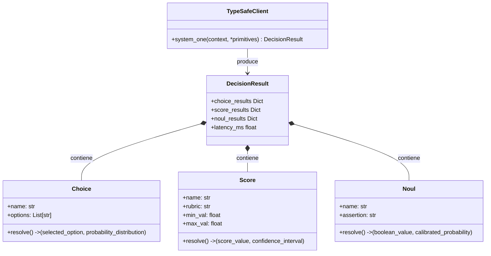

# Módulo 5: Explicación Práctica de Ventajas y Especificación de Ejemplos Funcionales
## Apartado 5.1: Anatomía del SDK y las Primitivas Nativas de TypeSafe AI

**Serie:** *Fundamentos y Arquitectura de Sistemas con Modelos System One (Jev)*  
**Autor:** Antigravity Engineering Lab  
**Bibliografía y Referencias O'Reilly:**
* [AI Engineering](https://learning.oreilly.com/library/view/-/9781098166298/?orm_source=mcp) por Chip Huyen (*O'Reilly Media, Inc., 2024*)
* [Building Applications with AI Agents](https://learning.oreilly.com/library/view/-/9781098176495/?orm_source=mcp) por Michael Albada (*O'Reilly Media, Inc., 2025*)
* [Hands-On Large Language Models](https://learning.oreilly.com/library/view/-/9781098150952/?orm_source=mcp) por Jay Alammar y Maarten Grootendorst (*O'Reilly Media, Inc., 2024*)
* [Prompt Engineering for LLMs](https://learning.oreilly.com/library/view/-/9781098156145/?orm_source=mcp) por John Berryman y Albert Ziegler (*O'Reilly Media, Inc., 2024*)

---

## 1. El Salto Paradigmático en la Interfaz de Programación (API)

En los SDKs de modelos generativos tradicionales (como la API de completions de OpenAI, Anthropic o Google), la interacción del programador está mediada por cadenas de texto:
1. Se construye un prompt con instrucciones de formato ("Responde únicamente en formato JSON con las claves X e Y").
2. Se envía la petición por la red y se espera entre 3 y 15 segundos mientras el modelo genera tokens secuencialmente.
3. Se recibe un bloque de texto que debe ser limpiado, parseado mediante `json.loads` o validado con librerías como *Pydantic*, gestionando excepciones cuando el modelo omite corchetes o inventa campos.

**La API de TypeSafe AI para Jev rompe radicalmente con este modelo.**  
No existe generación de texto, no hay prompts de formato ni validación defensiva posterior. La llamada al modelo se asemeja a una consulta funcional síncrona a un motor de base de datos o un compilador de tipos:

$$\text{Contexto no estructurado} + \text{Primitivas Tipadas} \xrightarrow[\text{70 ms}]{\text{Paso Único } O(1)} \text{Objeto de Decisión Estrictamente Tipado}$$

---

## 2. Los Tres Fragmentos de Código en Pantalla

A continuación se presentan los tres bloques de código que se proyectarán en pantalla durante la exposición técnica para ilustrar la inicialización, la llamada paralela y el consumo determinista en lógica de negocio.

### Fragmento 1: Inicialización y Definición de Primitivas Atómicas
*Este bloque muestra cómo se instancia el cliente y se declaran las preguntas atómicas de decisión utilizando las tres primitivas nativas de TypeSafe AI:*

```python
# ==============================================================================
# FRAGMENTO 1: Inicialización y Declaración de Primitivas Nativas
# ==============================================================================
from typesafe import TypeSafeClient, Choice, Score, Noul

# Inicialización del cliente de alta velocidad
client = TypeSafeClient(api_key="ts_live_secret_key")

# Definición de las tres primitivas atómicas del sistema:
# 1. Choice: Selección categórica cerrada con distribución de probabilidad
p1 = Choice("departamento", options=["soporte_tecnico", "facturacion", "ventas"])

# 2. Score: Calificación continua en intervalo semántico normalizado (1 a 10)
p2 = Score("urgencia", rubric="Evalúa la severidad del impacto operativo de 1 a 10")

# 3. Noul: Verificación probabilística booleana calibrada (True/False)
p3 = Noul("riesgo_fuga", assertion="¿El cliente manifiesta intención inminente de cancelar?")
```

---

### Fragmento 2: Invocación en un Solo Paso (`system_one`)
*Este bloque ilustra la llamada al método principal, evaluando múltiples preguntas en paralelo sobre el mismo contexto en apenas 70 milisegundos y con coste cero en tokens de salida:*

```python
# ==============================================================================
# FRAGMENTO 2: Invocación en un Solo Paso con Muestreo Paralelo (70 ms)
# ==============================================================================
ticket_usuario = """
Llevamos tres horas con la base de datos de producción congelada.
Si no lo solucionan antes de mediodía, migraremos a la competencia.
"""

# Ejecución paralela en un único paso hacia adelante (O(1)):
# Se resuelven las 3 primitivas simultáneamente sobre el mismo estado latente.
resultado = client.system_one(ticket_usuario, p1, p2, p3)
```

---

### Fragmento 3: Consumo Determinista en Código Tradicional
*Este bloque demuestra cómo el software tradicional consume las respuestas tipadas directamente en sentencias `if`, con probabilidades actuariales calibradas y sin parsers intermedios:*

```python
# ==============================================================================
# FRAGMENTO 3: Consumo Directo y Seguro en Lógica de Negocio
# ==============================================================================
# Acceso directo a propiedades tipadas sin validación defensiva ni regex
print(f"Departamento: {resultado.departamento.choice} (p = {resultado.departamento.probability:.2f})")
print(f"Nivel de Urgencia: {resultado.urgencia.score}/10")
print(f"Riesgo de Fuga: {resultado.riesgo_fuga.value} (confianza = {resultado.riesgo_fuga.probability:.2f})")

# Lógica de decisión determinista en código tradicional:
if resultado.riesgo_fuga.probability >= 0.85 and resultado.urgencia.score >= 8.0:
    escalar_a_guardia_critica(
        departamento=resultado.departamento.choice,
        prioridad="P0_EMERGENCIA"
    )
```

---

## 3. Anatomía Detallada de las 3 Primitivas Nativas



### 3.1. `Choice(name, options=[...])`: Selección Categórica Cerrada
* **Comportamiento:** La red neuronal proyecta el estado del contexto sobre los cabezales de decisión y distribuye la masa de probabilidad únicamente entre los elementos definidos en el array de opciones.
* **Garantía:** Es físicamente imposible que devuelva un valor fuera del conjunto. La probabilidad de error sintáctico es matemáticamente cero.

### 3.2. `Score(name, rubric, range=(min, max))`: Calificación Continua Calibrada
* **Comportamiento:** Evalúa una cualidad semántica según una rúbrica explícita en lenguaje natural, mapeándola a un escalar continuo o entero normalizado.
* **Aplicación:** Medición de urgencia operativa, nivel de satisfacción, toxicidad o calidad de un borrador sin generar explicaciones discursivas.

### 3.3. `Noul(name, assertion)`: Verificación Probabilística Booleana
* **Comportamiento:** Evalúa la veracidad de una proposición fáctica en el contexto. A diferencia de un booleano ingenuo de un LLM, `Noul` devuelve el valor binario (`True` o `False`) junto a la **probabilidad real calibrada mediante RLCD** ($p \in [0, 1]$).
* **Aplicación:** El "condicional semántico seguro" para sentencias `if`, activando salvaguardas solo cuando la probabilidad supera umbrales actuariales formales.

---

## 4. Bibliografía y Referencias en O'Reilly Learning

1. **[AI Engineering](https://learning.oreilly.com/library/view/-/9781098166298/?orm_source=mcp)**  
   *Chip Huyen (O'Reilly Media, Inc., 2024)*  
   *Aborda el diseño de contratos de interfaz en sistemas de software basados en modelos, eliminando la sobrecarga de parseo de cadenas no estructuradas.*

2. **[Building Applications with AI Agents](https://learning.oreilly.com/library/view/-/9781098176495/?orm_source=mcp)**  
   *Michael Albada (O'Reilly Media, Inc., 2025)*  
   *Examina el diseño de primitivas atómicas de decisión para desacoplar el bucle de control de los agentes de la generación de lenguaje natural.*

3. **[Hands-On Large Language Models](https://learning.oreilly.com/library/view/-/9781098150952/?orm_source=mcp)**  
   *Jay Alammar y Maarten Grootendorst (O'Reilly Media, Inc., 2024)*  
   *Detalla la arquitectura de cabezales de clasificación paralelos sobre representaciones latentes de transformadores.*

4. **[Prompt Engineering for LLMs](https://learning.oreilly.com/library/view/-/9781098156145/?orm_source=mcp)**  
   *John Berryman y Albert Ziegler (O'Reilly Media, Inc., 2024)*  
   *Analiza la fragilidad de forzar salidas estructuradas mediante ingeniería de prompts frente a interfaces tipadas nativas.*

---

## 5. Versión para Gemini Notebook (Texto Exacto con Ortografía Canónica)
*Para procesar en Gemini Notebook y generar diapositivas y esquemas visuales perfectamente sincronizados:*

Al entrar en la dimensión práctica de Jev, descubrimos que programar con un modelo System One no se parece en nada a interactuar con los modelos generativos convencionales. En lugar de redactar prompts complejos rogando al modelo que responda en formato JSON para luego lidiar con errores de parseo, TypeSafe AI trata la inteligencia artificial como una llamada a una función estrictamente tipada.

Como vemos en el primer fragmento de código en pantalla, la inicialización del cliente nos da acceso a las tres primitivas atómicas nativas que gobiernan el sistema. La primera es Choice, diseñada para selecciones categóricas cerradas donde el modelo distribuye probabilidades entre una lista fija de opciones. La segunda es Score, que califica una propiedad semántica según una rúbrica en una escala numérica continua. Y la tercera es Noul, la primitiva booleana que verifica afirmaciones devolviendo un valor verdadero o falso junto a su probabilidad matemática exacta.

Observen ahora en el segundo fragmento de código la invocación del método principal, llamado system_one. En una sola línea pasamos el texto no estructurado del usuario y las tres preguntas a la vez. Gracias a su muestreo paralelo en una única pasada computacional, Jev resuelve todas las decisiones simultáneamente en apenas 70 milisegundos, facturando exactamente cero dólares por los datos de salida al no tener que generar texto.

Fíjense finalmente en el tercer fragmento de código, donde consumimos estos resultados directamente en la lógica tradicional del programa. Como las salidas son tipos de datos nativos de Python y las probabilidades están rigurosamente calibradas mediante RLCD, podemos escribir sentencias condicionales seguras basadas en umbrales actuariales reales, por ejemplo ejecutando una acción de emergencia solo cuando la certeza de riesgo de fuga supera el 85 por ciento.

Como destacan expertos en arquitectura de sistemas como Chip Huyen y Michael Albada en sus tratados para O'Reilly, la madurez en ingeniería de software consiste en eliminar la fragilidad de las interfaces. Con el SDK de TypeSafe AI, la inteligencia artificial deja de ser una caja negra impredecible que escupe texto libre para convertirse en un componente determinista, seguro y ultrarrápido integrado en el código.

---

## 6. Versión para ElevenLabs (Texto de Locución con Adaptación Fonética)
*Texto idéntico al anterior, adaptado para pronunciación natural en voz en off con referencias a pantalla y sin etiquetas de formato:*

Al entrar en la dimensión práctica de Yev, descubrimos que programar con un modelo Sistema Uno no se parece en nada a interactuar con los modelos generativos convencionales. En lugar de redactar prompts complejos rogando al modelo que responda en formato yeison para luego lidiar con errores de parseo, Taip Seif Ei Ai trata la inteligencia artificial como una llamada a una función estrictamente tipada.

Como vemos en el primer fragmento de código en pantalla, la inicialización del cliente nos da acceso a las tres primitivas atómicas nativas que gobiernan el sistema. La primera es Choys, diseñada para selecciones categóricas cerradas donde el modelo distribuye probabilidades entre una lista fija de opciones. La segunda es Escor, que califica una propiedad semántica según una rúbrica en una escala numérica continua. Y la tercera es Noul, la primitiva booleana que verifica afirmaciones devolviendo un valor verdadero o falso junto a su probabilidad matemática exacta.

Observen ahora en el segundo fragmento de código la invocación del método principal, llamado sistem uan. En una sola línea pasamos el texto no estructurado del usuario y las tres preguntas a la vez. Gracias a su muestreo paralelo en una única pasada computacional, Yev resuelve todas las decisiones simultáneamente en apenas setenta milisegundos, facturando exactamente cero dólares por los datos de salida al no tener que generar texto.

Fíjense finalmente en el tercer fragmento de código, donde consumimos estos resultados directamente en la lógica tradicional del programa. Como las salidas son tipos de datos nativos de Paiton y las probabilidades están rigurosamente calibradas mediante erre ele ce de, podemos escribir sentencias condicionales seguras basadas en umbrales actuariales reales, por ejemplo ejecutando una acción de emergencia solo cuando la certeza de riesgo de fuga supera el ochenta y cinco por ciento.

Como destacan expertos en arquitectura de sistemas como Chip Juyen y Michael Albada en sus tratados para O Reili, la madurez en ingeniería de software consiste en eliminar la fragilidad de las interfaces. Con el kit de desarrollo de Taip Seif Ei Ai, la inteligencia artificial deja de ser una caja negra impredecible que escupe texto libre para convertirse en un componente determinista, seguro y ultrarrápido integrado en el código.
