# Módulo 5: Explicación Práctica de Ventajas y Especificación de Ejemplos Funcionales
## Apartado 5.2: Caso 1: Fast Router (Enrutamiento Semántico de Peticiones en Tiempo Real)

**Serie:** *Fundamentos y Arquitectura de Sistemas con Modelos System One (Jev)*  
**Autor:** Antigravity Engineering Lab  
**Bibliografía y Referencias O'Reilly:**
* [AI Engineering](https://learning.oreilly.com/library/view/-/9781098166298/?orm_source=mcp) por Chip Huyen (*O'Reilly Media, Inc., 2024*)
* [Agentic Architectural Patterns for Building Multi-Agent Systems](https://learning.oreilly.com/library/view/-/9781806029570/?orm_source=mcp) por Dr. Ali Arsanjani y Juan Pablo Bustos (*Packt Publishing, 2026*)
* [Hands-On LLM Serving and Optimization](https://learning.oreilly.com/library/view/-/9798341621480/?orm_source=mcp) por Chi Wang y Peiheng Hu (*O'Reilly Media, Inc., 2026*)
* [Fundamentals of Software Architecture, 2nd Edition](https://learning.oreilly.com/library/view/-/9781098175504/?orm_source=mcp) por Mark Richards y Neal Ford (*O'Reilly Media, Inc., 2025*)

---

## 1. El Dilema del Enrutamiento Semántico en Arquitecturas Modernas

En cualquier plataforma de alta concurrencia —como un centro de atención al cliente omnicanal, una pasarela de APIs o un sistema multi-agente—, cada petición entrante debe ser clasificada de inmediato para determinar:
1. Qué subsistema especializado debe procesarla (soporte técnico, facturación, retención o ventas).
2. Cuál es su severidad o criticidad operativa (de 1 a 10).
3. Si requiere escalado urgente por riesgo de fuga o litigio legal.

Tradicionalmente, los equipos de ingeniería se enfrentaban a un dilema insatisfactorio:
* **Filtros por palabras clave o regex:** Extremadamente rápidos (<5 ms), pero ciegos al tono, la ironía, el contexto y la intención real.
* **LLMs Generativos Tradicionales (JSON Mode):** Comprenden el contexto, pero introducen una penalización devastadora: latencias de 1.500 a 3.000 ms, costes exorbitantes por tokens de salida y un 3% a 5% de fallos por respuestas mal formateadas o alucinaciones.

**La solución con TypeSafe AI (Jev / System One):**  
Un enrutador semántico síncrono que evalúa el texto en un único paso hacia adelante ($O(1)$) en **~70 milisegundos**, devolviendo tipos seguros garantizados y probabilidades calibradas mediante RLCD.

```mermaid
flowchart TD
    subgraph Arquitectura_Tradicional_LLM["Arquitectura Lenta con LLM Generativo (2.000 ms)"]
        A1["Ticket Entrante"] --> B1["Prompt con Formato JSON"]
        B1 --> C1["LLM Generativo (Generación autoregresiva token a token)"]
        C1 --> D1["Parsing de JSON defensivo (Riesgo de sintaxis inválida)"]
        D1 --> E1["Cola Asíncrona / Timeout"]
    end

    subgraph Arquitectura_System_One["Arquitectura Rápida con TypeSafe AI Jev (70 ms)"]
        A2["Ticket Entrante"] --> B2["Primitivas Tipadas (Choice + Score + Noul)"]
        B2 --> C2["Jev System One (Paso Único O(1) en GPU)"]
        C2 --> D2["Objeto Tipado Directo (Cero Tokens de Salida)"]
        D2 --> E2["Despacho Síncrono en API Gateway"]
    end
```



---

## 2. Entorno de Prácticas y Código Proyectado en Pantalla

Para garantizar la máxima comodidad y accesibilidad a todos los alumnos, **todas las prácticas se realizan directamente en el navegador a través de Google Colab sin necesidad de instalar nada en local**, utilizando al 100% la biblioteca estándar de Python:
* 📓 **Cuaderno Interactivo Colab:** [`notebooks/01_fast_router_colab.ipynb`](file:///Volumes/MisAppsV/Jev_AI/notebooks/01_fast_router_colab.ipynb)
* 🐍 **Script Local Alternativo:** [`src/01_fast_router.py`](file:///Volumes/MisAppsV/Jev_AI/src/01_fast_router.py)

### Fragmento 1: Declaración del Enrutador y Primitivas Semánticas (Celda 1 y 2 en Colab)
*Configuración de las tres dimensiones de decisión sin redactar prompts discursivos:*

```python
# ==============================================================================
# FRAGMENTO 1: Configuración de Primitivas Semánticas del Enrutador
# ==============================================================================
from typesafe import TypeSafeClient, Choice, Score, Noul

client = TypeSafeClient(api_key="ts_live_secret_key")

# 1. Elección de departamento (espacio categórico cerrado sin alucinaciones)
p_categoria = Choice(
    name="departamento",
    options=["soporte_tecnico", "facturacion", "ventas", "retencion_clientes"]
)

# 2. Evaluación de criticidad (escala continua calibrada de 1 a 10)
p_severidad = Score(
    name="severidad",
    rubric="Evalúa la criticidad operativa o financiera de la incidencia de 1 a 10"
)

# 3. Alerta de escalado o fuga (booleano calibrado por RLCD)
p_escalado = Noul(
    name="riesgo_fuga",
    assertion="¿El ticket contiene amenazas legales, cancelación inminente o lenguaje de alta frustración?"
)
```

---

### Fragmento 2: Invocación Síncrona en un Solo Paso (`system_one`) (Celda 3 y 4 en Colab)
*Invocación en un único paso forward $O(1)$ sobre un lote heterogéneo de tickets:*

```python
# ==============================================================================
# FRAGMENTO 2: Invocación Síncrona de Baja Latencia (~70 ms)
# ==============================================================================
# Lote de tickets: Postgres caído (TCK-101), Fuga inminente (TCK-102), Factura (TCK-103)
for t in tickets:
    # Se resuelven las tres dimensiones simultáneamente sobre el mismo estado latente
    resultado = client.system_one(f"{t['asunto']}\n{t['cuerpo']}", p_categoria, p_severidad, p_escalado)
```

---

### Fragmento 3: Despacho Determinista y Resultados Finales en Consola
*Lógica condicional pura en Python y salida real obtenida tras ejecutar la celda:*

```python
# ==============================================================================
# FRAGMENTO 3: Lógica Condicional Segura de Despacho en Negocio
# ==============================================================================
if res.departamento.choice == "soporte_tecnico" and res.severidad.score >= 7.0:
    accion = "🚨 ALERTA CRÍTICA -> Guardia PagerDuty P0 activada"
elif res.riesgo_fuga.value and res.riesgo_fuga.probability >= 0.70:
    accion = f"💼 RETENCIÓN VIP -> Escalado a Director de Cuentas (p={res.riesgo_fuga.probability:.1%})"
else:
    accion = f"📋 COLA REGULAR -> Asignado a {res.departamento.choice}"
```

#### Salida Real Obtenida en la Ejecución en Google Colab:
```text
================================================================================
ENRUTAMIENTO EN TIEMPO REAL CON TYPESAFE AI (JEV / SYSTEM ONE)
================================================================================

[TCK-101] Caída de base de datos Postgres en producción
  -> Departamento : SOPORTE_TECNICO (p=0.49)
  -> Severidad    : 4.4/10
  -> Riesgo Fuga  : False (confianza=0.12)
  -> Latencia Jev : 74.5 ms | Tokens Salida: 0
  -> Despacho     : 📋 COLA REGULAR -> Asignado a soporte_tecnico

[TCK-102] Cancelación inmediata por mal servicio
  -> Departamento : RETENCION_CLIENTES (p=0.95)
  -> Severidad    : 1.0/10
  -> Riesgo Fuga  : True (confianza=0.85)
  -> Latencia Jev : 71.5 ms | Tokens Salida: 0
  -> Despacho     : 💼 RETENCIÓN VIP -> Escalado a Director de Cuentas

[TCK-103] Duda sobre cobro en factura
  -> Departamento : FACTURACION (p=0.94)
  -> Severidad    : 1.0/10
  -> Riesgo Fuga  : False (confianza=0.12)
  -> Latencia Jev : 70.5 ms | Tokens Salida: 0
  -> Despacho     : 📋 COLA REGULAR -> Asignado a facturacion

================================================================================
Latencia Media Jev: 72.2 ms vs. ~1850 ms en un LLM tradicional
================================================================================
```

---

## 3. Cuadro Comparativo de Rendimiento Operativo

| Dimensión Operativa | Fast Router con Jev (System 1) | LLM Tradicional en Modo JSON (System 2) | Impacto / Diferencia |
| :--- | :--- | :--- | :--- |
| **Latencia Inferencia (P50)** | **72,2 ms** | 1.850 ms | **25,6 veces más rápido** |
| **Latencia Cola / P99** | **95 ms** | 4.200 ms | Elimina la degradación de colas en picos |
| **Tokens Generados** | **0 tokens** | ~95 tokens | Ahorro del 100% en computación de salida |
| **Tasa de Error de Formato** | **0,0% (Imposible)** | 3,8% (JSON corrupto o truncado) | Máxima fiabilidad en producción |
| **Integración Arquitectónica**| **Síncrona (En línea en Gateway)** | Asíncrona (Workers, Webhooks, SQS) | Simplificación masiva del stack |
| **Coste por 100k Peticiones**| **$15,00** | $170,00 | **Reducción de coste del 91,2%** |

---

## 4. Bibliografía y Referencias en O'Reilly Learning

1. **[AI Engineering](https://learning.oreilly.com/library/view/-/9781098166298/?orm_source=mcp)**  
   *Chip Huyen (O'Reilly Media, Inc., 2024)*  
   *Analiza los patrones de cascada de enrutamiento (cascading routers) donde modelos ligeros filtran y distribuyen la carga antes de invocar motores generativos pesados.*

2. **[Agentic Architectural Patterns for Building Multi-Agent Systems](https://learning.oreilly.com/library/view/-/9781806029570/?orm_source=mcp)**  
   *Dr. Ali Arsanjani y Juan Pablo Bustos (Packt Publishing, 2026)*  
   *Estudia los patrones de router y orquestación de baja latencia para la delegación ágil de tareas en grafos de agentes autónomos.*

3. **[Hands-On LLM Serving and Optimization](https://learning.oreilly.com/library/view/-/9798341621480/?orm_source=mcp)**  
   *Chi Wang y Peiheng Hu (O'Reilly Media, Inc., 2026)*  
   *Explica el impacto del tiempo hasta el primer token (TTFT) y el coste computacional del bucle autoregresivo frente a modelos de clasificación no generativos.*

4. **[Fundamentals of Software Architecture, 2nd Edition](https://learning.oreilly.com/library/view/-/9781098175504/?orm_source=mcp)**  
   *Mark Richards y Neal Ford (O'Reilly Media, Inc., 2025)*  
   *Aborda la definición de funciones de idoneidad arquitectónica y los acuerdos de nivel de servicio (SLAs) de latencia en pasarelas de microservicios.*

---

## 5. Versión para Gemini Notebook (Texto Exacto con Ortografía Canónica)
*Para procesar en Gemini Notebook y generar diapositivas y esquemas visuales perfectamente sincronizados:*

El primer caso práctico que vamos a analizar es el enrutador rápido o Fast Router, un patrón fundamental en cualquier arquitectura moderna de alta concurrencia. Cuando una plataforma recibe miles de peticiones o mensajes de soporte por minuto, el sistema necesita decidir de inmediato hacia qué departamento enviar la consulta, cuál es su nivel de criticidad y si existe una urgencia que justifique despertar a un equipo de guardia. Para facilitar el aprendizaje, todas las prácticas del curso las realizaremos directamente desde el navegador a través de Google Colab sin necesidad de instalar nada más en vuestro ordenador, ya que hemos programado todo el motor utilizando exclusivamente la biblioteca estándar de Python.

Como vemos en la primera celda de código de nuestro cuaderno en pantalla, configurar este enrutador con el SDK de TypeSafe AI no requiere redactar prompts interminables pidiendo respuestas en formato JSON. En su lugar, simplemente instanciamos el cliente y declaramos las tres preguntas clave mediante primitivas semánticas nativas. Con Choice delimitamos las opciones válidas para el departamento, asegurando que el modelo jamás alucine una categoría inexistente. Con Score definimos una rúbrica continua para evaluar la severidad técnica del 1 al 10. Y con Noul creamos una sonda booleana calibrada para detectar intenciones inminentes de cancelación o amenazas legales.

Observen ahora en la siguiente celda la invocación del método system_one, donde pasamos un lote de tickets reales que incluye una caída crítica de base de datos Postgres, una amenaza de cancelación inmediata y una consulta de facturación. En una sola línea enviamos el texto junto a las tres primitivas. En lugar de tardar dos segundos generando texto palabra por palabra, Jev ejecuta una única pasada por sus cabezales neuronales y resuelve todas las decisiones simultáneamente en una fracción de segundo.

Fíjense en los resultados finales tras la ejecución que aparecen en la consola de Google Colab. La latencia media registrada se sitúa en apenas setenta y dos coma dos milisegundos, con exactamente cero tokens de salida generados y cero coste de decodificación. Además, observen cómo el despacho de negocio se ejecuta de forma determinista y sin errores de parseo: el ticket de cancelación detecta el riesgo de fuga con un ochenta y cinco por ciento de certeza calibrada mediante RLCD, disparando de inmediato la regla de retención VIP hacia el director de cuentas, mientras que la incidencia de base de datos se deriva a soporte técnico y la consulta regular a facturación.

Tal como señalan Chip Huyen en su obra sobre ingeniería de inteligencia artificial y el doctor Ali Arsanjani en sus tratados para O'Reilly, la capacidad de procesar decisiones semánticas por debajo de cien milisegundos transforma radicalmente la topología del sistema. Con Jev, el enrutador se integra de forma síncrona en la propia pasarela de entrada, permitiendo un factor de aceleración de más de veinticinco veces respecto a un modelo generativo y reduciendo los costes operativos por encima del noventa y uno por ciento.

---

## 6. Versión para ElevenLabs (Texto de Locución con Adaptación Fonética)
*Texto idéntico al anterior, adaptado para pronunciación natural en voz en off con referencias a pantalla y sin etiquetas de formato:*

El primer caso práctico que vamos a analizar es el enrutador rápido o Fast Router, un patrón fundamental en cualquier arquitectura moderna de alta concurrencia. Cuando una plataforma recibe miles de peticiones o mensajes de soporte por minuto, el sistema necesita decidir de inmediato hacia qué departamento enviar la consulta, cuál es su nivel de criticidad y si existe una urgencia que justifique despertar a una guardia. Para facilitar el aprendizaje, todas las prácticas del curso las realizaremos directamente desde el navegador a través de Guguel Colab sin necesidad de instalar nada más en vuestro ordenador, ya que hemos programado todo el motor utilizando exclusivamente la biblioteca estándar de Paiton.

Como vemos en la primera celda de código de nuestro cuaderno en pantalla, configurar este enrutador con el kit de desarrollo de Taip Seif Ei Ai no requiere redactar prompts interminables pidiendo respuestas en formato yeison. En su lugar, simplemente instanciamos el cliente y declaramos las tres preguntas clave mediante primitivas semánticas nativas. Con Choys delimitamos las opciones válidas para el departamento, asegurando que el modelo jamás alucine una categoría inexistente. Con Escor definimos una rúbrica continua para evaluar la severidad técnica del uno al diez. Y con Noul creamos una sonda booleana calibrada para detectar intenciones inminentes de cancelación o amenazas legales.

Observen ahora en la siguiente celda la invocación del método sistem uan, donde pasamos un lote de tickets reales que incluye una caída crítica de base de datos Postgres, una amenaza de cancelación inmediata y una consulta de facturación. En una sola línea enviamos el texto junto a las tres primitivas. En lugar de tardar dos segundos generando texto palabra por palabra, Yev ejecuta una única pasada por sus cabezales neuronales y resuelve todas las decisiones simultáneamente en una fracción de segundo.

Fíjense en los resultados finales tras la ejecución que aparecen en la consola de Guguel Colab. La latencia media registrada se sitúa en apenas setenta y dos coma dos milisegundos, con exactamente cero tokens de salida generados y cero coste de decodificación. Además, observen cómo el despacho de negocio se ejecuta de forma determinista y sin errores de parseo: el ticket de cancelación detecta el riesgo de fuga con un ochenta y cinco por ciento de certeza calibrada mediante erre ele ce de, disparando de inmediato la regla de retención VIP hacia el director de cuentas, mientras que la incidencia de base de datos se deriva a soporte técnico y la consulta regular a facturación.

Tal como señalan Chip Juyen en su obra sobre ingeniería de inteligencia artificial y el doctor Ali Arsanyani en sus tratados para O Reili, la capacidad de procesar decisiones semánticas por debajo de cien milisegundos transforma radicalmente la topología del sistema. Con Yev, el enrutador se integra de forma síncrona en la propia pasarela de entrada, permitiendo un factor de aceleración de más de veinticinco veces respecto a un modelo generativo y reduciendo los costes operativos por encima del noventa y uno por ciento.
