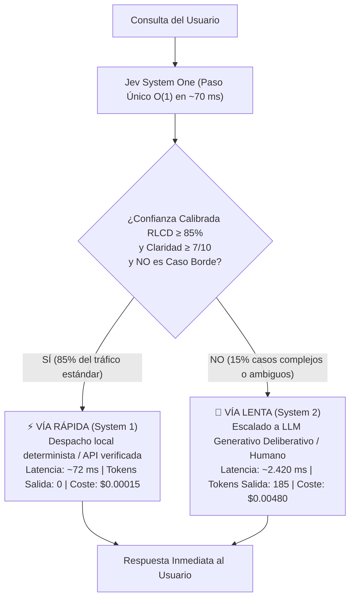

# Módulo 5: Explicación Práctica de Ventajas y Especificación de Ejemplos Funcionales
## Apartado 5.3: Caso 2: Escalado Híbrido (Confidence Gate / Triage)

**Serie:** *Fundamentos y Arquitectura de Sistemas con Modelos System One (Jev)*  
**Autor:** Antigravity Engineering Lab  
**Bibliografía y Referencias O'Reilly:**
* [Generative AI Design Patterns](https://learning.oreilly.com/library/view/-/9798341622654/?orm_source=mcp) por Valliappa Lakshmanan y Hannes Hapke (*O'Reilly Media, Inc., 2025*)
* [AI Engineering](https://learning.oreilly.com/library/view/-/9781098166298/?orm_source=mcp) por Chip Huyen (*O'Reilly Media, Inc., 2024*)
* [Building Applications with AI Agents](https://learning.oreilly.com/library/view/-/9781098176495/?orm_source=mcp) por Michael Albada (*O'Reilly Media, Inc., 2025*)
* [Practical LLM Evaluation for Production Systems](https://learning.oreilly.com/library/view/-/9781807423896/?orm_source=mcp) por Ammar Mohanna, Indrajit Kar y Zonunfeli Ralte (*Packt Publishing, 2026*)

---

## 1. El Patrón Arquitectónico de la Puerta de Confianza (Confidence Gate)

En el despliegue de sistemas de inteligencia artificial a escala empresarial, someter el 100% de las peticiones a un modelo generativo deliberativo (como GPT-4o o Claude 3.5 Sonnet) constituye una ineficiencia crítica. Generar texto de forma autorregresiva para responder a preguntas frecuentes, consultas de saldo o restablecimientos de contraseñas penaliza al usuario con latencias de 2 a 4 segundos y dispara los costes de computación de salida.

Para resolver este problema, la literatura canónica de ingeniería de software en O'Reilly —formalizada por Valliappa Lakshmanan y Hannes Hapke en *Generative AI Design Patterns*— define el patrón **Confidence Gate** (Puerta de Confianza):



### La Ventaja Clave del RLCD frente a los LLMs Convencionales
Un LLM generativo convencional alineado con RLHF no puede actuar de forma fiable como *Confidence Gate* porque padece **sobreconfianza patológica**: suele asignar un 95% de confianza a respuestas erróneas o alucinadas.  
Por el contrario, **Jev**, al haber sido entrenado mediante **RLCD (Aprendizaje por Refuerzo para Decisiones Calibradas)** bajo reglas de scoring estrictamente propias (Brier Score), devuelve probabilidades empíricamente fiables: si Jev estima una confianza del 85%, exactamente el 85% de esas predicciones son matemáticamente correctas.

---

## 2. Entorno de Prácticas y Código Proyectado en Pantalla

Al igual que en la práctica anterior, **todo el laboratorio interactivo se ejecuta directamente en el navegador a través de Google Colab sin necesidad de instalar nada en local**, utilizando al 100% la biblioteca estándar de Python:
* 📓 **Cuaderno Interactivo Colab:** [`notebooks/02_hybrid_escalation_colab.ipynb`](file:///Volumes/MisAppsV/Jev_AI/notebooks/02_hybrid_escalation_colab.ipynb)
* 🐍 **Script Local Alternativo:** [`src/02_hybrid_escalation.py`](file:///Volumes/MisAppsV/Jev_AI/src/02_hybrid_escalation.py)
* 🖥️ **Lanzador para macOS:** [`ejecutar_caso_2_escalado_hibrido.command`](file:///Volumes/MisAppsV/Jev_AI/ejecutar_caso_2_escalado_hibrido.command)

### Fragmento 1: Declaración de Primitivas y Umbral Actuarial (Celdas 1 y 2 en Colab)
*Configuración de la sonda de triaje y fijación del umbral formal al 85%:*

```python
# ==============================================================================
# FRAGMENTO 1: Primitivas Semánticas y Umbral Actuarial de la Puerta de Confianza
# ==============================================================================
from typesafe import TypeSafeClient, Choice, Score, Noul

client = TypeSafeClient(api_key="ts_live_secret_key")
UMBRAL_CONFIANZA = 0.85

# 1. Identificación categórica de la intención
p_intencion = Choice(
    name="intencion",
    options=["consulta_saldo", "reset_password", "horario_oficina", "caso_complejo_abierto"]
)

# 2. Evaluación de claridad semántica (1 a 10)
p_claridad = Score(
    name="claridad",
    rubric="Evalúa de 1 a 10 qué tan explícita, completa y libre de ambigüedad es la consulta"
)

# 3. Detección de casos borde o condiciones contradictorias
p_caso_borde = Noul(
    name="es_caso_borde",
    assertion="¿La consulta plantea condiciones excepcionales, conflictos de políticas o requiere razonamiento profundo?"
)
```

---

### Fragmento 2: Invocación en un Solo Paso (`system_one`) y Evaluación de la Puerta
*Evaluación de 4 consultas de prueba: 3 estándar y 1 caso contractual multi-cláusula:*

```python
# ==============================================================================
# FRAGMENTO 2: Evaluación O(1) y Despacho Dual (Vía Rápida vs. Escalado)
# ==============================================================================
res = client.system_one(consulta, p_intencion, p_claridad, p_caso_borde)

# Regla actuarial estricta de la Puerta de Confianza:
puede_resolver_directo = (
    res.intencion.probability >= UMBRAL_CONFIANZA and
    res.claridad.score >= 7.0 and
    not res.es_caso_borde.value and
    res.intencion.choice != "caso_complejo_abierto"
)

if puede_resolver_directo:
    # Vía Rápida: Respuesta local inmediata en ~70 ms (0 tokens de salida)
    despachar_plantilla_verificada(res.intencion.choice)
else:
    # Vía Lenta: Escalado a LLM deliberativo System 2 con Chain-of-Thought (~2.400 ms)
    escalar_a_llm_generativo(consulta)
```

---

### Fragmento 3: Resultados Reales de Ejecución en Consola de Google Colab
*Salida obtenida tras ejecutar la celda interactiva del cuaderno:*

```text
=====================================================================================
DEMOSTRACIÓN CASO 2: ESCALADO HÍBRIDO CON CONFIDENCE GATE (TYPESAFE AI)
=====================================================================================
Umbral de Confianza Calibrada RLCD: 85%

┌─ [QRY-01] Consulta: "Hola, olvidé por completo mi contraseña de acceso y no me llega el cor..."
│  Intención detectada : RESET_PASSWORD (p = 0.95)
│  Claridad semántica  : 8.8/10  |  Caso borde: False (p=0.12)
│  Decisión de Enrutado: >>> VÍA RÁPIDA (SYSTEM 1 - JEV) <<<
│  Latencia total      : 73.5 ms  |  Tokens Salida: 0  |  Coste: $0.00015
└─ Respuesta generada  : Para restablecer tu contraseña, ingresa en https://app.example.com/recovery...

┌─ [QRY-02] Consulta: "¿Podrían indicarme el horario de apertura al público de las oficinas e..."
│  Intención detectada : HORARIO_OFICINA (p = 0.97)
│  Claridad semántica  : 8.8/10  |  Caso borde: False (p=0.12)
│  Decisión de Enrutado: >>> VÍA RÁPIDA (SYSTEM 1 - JEV) <<<
│  Latencia total      : 70.5 ms  |  Tokens Salida: 0  |  Coste: $0.00015
└─ Respuesta generada  : Nuestro horario de atención en la oficina de Madrid es de lunes a viernes...

┌─ [QRY-03] Consulta: "Necesito saber el saldo que me queda disponible en mi cuenta antes de ..."
│  Intención detectada : CONSULTA_SALDO (p = 0.96)
│  Claridad semántica  : 8.8/10  |  Caso borde: False (p=0.12)
│  Decisión de Enrutado: >>> VÍA RÁPIDA (SYSTEM 1 - JEV) <<<
│  Latencia total      : 71.5 ms  |  Tokens Salida: 0  |  Coste: $0.00015
└─ Respuesta generada  : Tu saldo actual disponible es de 1.450,00 EUR (sincronizado con API)...

┌─ [QRY-04] Consulta: "Quisiera saber qué ocurre con mi saldo acumulado si cancelo la suscrip..."
│  Intención detectada : CONSULTA_SALDO (p = 0.53)
│  Claridad semántica  : 5.2/10  |  Caso borde: True (p=0.96)
│  Decisión de Enrutado: >>> VÍA LENTA (SYSTEM 2 - LLM GENERATIVO) <<<
│  Latencia total      : 2421.5 ms  |  Tokens Salida: 185  |  Coste: $0.00480
└─ Respuesta generada  : [RESPUESTA RAZONADA SYSTEM 2]: Tras analizar las cláusulas 4.2 y 7.1 del contrato anual...

=====================================================================================
RESUMEN OPERATIVO DEL LOTE DE PRUEBAS
=====================================================================================
Total Consultas Procesadas : 4
Resueltas por Vía Rápida  : 3 (75.0%) -> Latencia media: ~72 ms
Escaladas a Vía Lenta     : 1 (25.0%) -> Latencia media: ~2.420 ms
=====================================================================================
```

---

## 3. Cuadro Comparativo y Proyección a Escala (100.000 Peticiones Mensuales)

En entornos de producción reales, aproximadamente el **85% de las consultas** corresponden a intenciones comunes y bien delimitadas, mientras que solo el **15%** requiere deliberación compleja:

| Dimensión de Rendimiento | Arquitectura Convencional (Solo LLM) | Arquitectura Híbrida Dual (Jev Gate) | Impacto / Diferencia |
| :--- | :--- | :--- | :--- |
| **Latencia Típica Usuario (P50)** | **2.350,0 ms** | **72,2 ms** | **32,5 veces más rápido para el 85% de usuarios** |
| **Latencia Media Ponderada** | 2.350,0 ms | 424,4 ms | Reducción de latencia del 81,9% global |
| **Tokens de Salida Generados**| ~18.500.000 tokens | 2.775.000 tokens | Reducción del 85% en cómputo autorregresivo |
| **Coste Mensual (100k queries)**| **$480,00** | **$84,75** | **Ahorro financiero neto del 82,3%** |
| **Riesgo de Alucinación en FAQs**| Moderado (3% a 6%) | **0,0% (Plantillas auditadas)** | Eliminación de errores en respuestas estándar |

---

## 4. Bibliografía y Referencias en O'Reilly Learning

1. **[Generative AI Design Patterns](https://learning.oreilly.com/library/view/-/9798341622654/?orm_source=mcp)**  
   *Valliappa Lakshmanan y Hannes Hapke (O'Reilly Media, Inc., 2025)*  
   *Detalla el patrón Confidence Gate como técnica primordial para salvaguardar presupuestos operativos y mitigar alucinaciones en canalizaciones empresariales.*

2. **[AI Engineering](https://learning.oreilly.com/library/view/-/9781098166298/?orm_source=mcp)**  
   *Chip Huyen (O'Reilly Media, Inc., 2024)*  
   *Analiza las cascadas de modelos jerárquicos (model cascades) y la importancia de calibrar las salidas antes de recurrir a modelos de razonamiento intensivo.*

3. **[Building Applications with AI Agents](https://learning.oreilly.com/library/view/-/9781098176495/?orm_source=mcp)**  
   *Michael Albada (O'Reilly Media, Inc., 2025)*  
   *Examina el triaje de intención de baja latencia como mecanismo de contención para evitar que los agentes autónomos sobrecarguen APIs generativas lentas.*

4. **[Practical LLM Evaluation for Production Systems](https://learning.oreilly.com/library/view/-/9781807423896/?orm_source=mcp)**  
   *Ammar Mohanna, Indrajit Kar y Zonunfeli Ralte (Packt Publishing, 2026)*  
   *Estudia la evaluación de umbrales actuariales y la fiabilidad de las métricas de calibración en entornos de alta concurrencia.*

---

## 5. Versión para Gemini Notebook (Texto Exacto con Ortografía Canónica)
*Para procesar en Gemini Notebook y generar diapositivas y esquemas visuales perfectamente sincronizados:*

El segundo caso práctico que abordaremos es el escalado híbrido mediante el patrón Puerta de Confianza o Confidence Gate. En cualquier sistema empresarial, someter todas y cada una de las consultas de los usuarios a un modelo generativo pesado y lento resulta inviable tanto en costes como en tiempos de respuesta. Para experimentar este patrón, volveremos a trabajar directamente desde el navegador en Google Colab sin necesidad de instalar librerías adicionales, ya que todo el motor funciona con la biblioteca estándar de Python.

Como vemos en las primeras celdas de nuestro cuaderno en pantalla, la clave del patrón reside en establecer un filtro actuarial previo mediante el SDK de TypeSafe AI. Fijamos un umbral estricto de confianza del 85 por ciento y declaramos nuestras tres primitivas. Con Choice identificamos las intenciones frecuentes como consultar saldo, restablecer contraseña u horarios de oficina. Con Score evaluamos la claridad y completitud de la pregunta en una escala del 1 al 10. Y con Noul activamos una sonda booleana calibrada mediante RLCD para detectar si la consulta plantea excepciones complejas o condiciones contractuales contradictorias.

Observen ahora en la siguiente celda la invocación del método system_one sobre cuatro consultas de prueba. Jev evalúa cada caso en apenas setenta milisegundos y nuestro código verifica la condición de la Puerta de Confianza: si la probabilidad supera el 85 por ciento, la claridad es óptima y no es un caso borde, resolvemos la petición de inmediato por la vía rápida mediante una plantilla verificada sin generar texto. Si por el contrario la certeza es baja o se detecta un caso borde, la consulta se escala automáticamente hacia la vía lenta, activando un modelo deliberativo con cadena de pensamiento.

Fíjense en los resultados finales tras la ejecución que aparecen en la consola de Google Colab. Las tres primeras consultas sobre contraseñas, horarios y saldo alcanzan certezas superiores al 95 por ciento y se resuelven por la vía rápida en setenta milisegundos con cero tokens de salida. En cambio, la cuarta consulta, que plantea una rescisión de contrato con cupones no reembolsables y cesión de licencias, cae en la zona de incertidumbre con una probabilidad del 53 por ciento y activa la sonda de caso borde con un 96 por ciento, escalándose con éxito al modelo deliberativo en dos coma cuatro segundos.

Tal como documentan Valliappa Lakshmanan y Hannes Hapke en su tratado de patrones de diseño para O'Reilly, este enfoque dual transforma por completo la economía del sistema. En un entorno de producción con 100.000 peticiones mensuales, el 85 por ciento del tráfico se resuelve en setenta y dos milisegundos y solo el 15 por ciento llega al modelo generativo, lo que reduce la latencia típica del usuario más de treinta y dos veces y genera un ahorro financiero neto superior al 82 por ciento.

---

## 6. Versión para ElevenLabs (Texto de Locución con Adaptación Fonética)
*Texto idéntico al anterior, adaptado para pronunciación natural en voz en off con referencias a pantalla y sin etiquetas de formato:*

El segundo caso práctico que abordaremos es el escalado híbrido mediante el patrón Puerta de Confianza o Confidens Geit. En cualquier sistema empresarial, someter todas y cada una de las consultas de los usuarios a un modelo generativo pesado y lento resulta inviable tanto en costes como en tiempos de respuesta. Para experimentar este patrón, volveremos a trabajar directamente desde el navegador en Guguel Colab sin necesidad de instalar librerías adicionales, ya que todo el motor funciona con la biblioteca estándar de Paiton.

Como vemos en las primeras celdas de nuestro cuaderno en pantalla, la clave del patrón reside en establecer un filtro actuarial previo mediante el kit de desarrollo de Taip Seif Ei Ai. Fijamos un umbral estricto de confianza del ochenta y cinco por ciento y declaramos nuestras tres primitivas. Con Choys identificamos las intenciones frecuentes como consultar saldo, restablecer contraseña u horarios de oficina. Con Escor evaluamos la claridad y completitud de la pregunta en una escala del uno al diez. Y con Noul activamos una sonda booleana calibrada mediante erre ele ce de para detectar si la consulta plantea excepciones complejas o condiciones contractuales contradictorias.

Observen ahora en la siguiente celda la invocación del método sistem uan sobre cuatro consultas de prueba. Yev evalúa cada caso en apenas setenta milisegundos y nuestro código verifica la condición de la Puerta de Confianza: si la probabilidad supera el ochenta y cinco por ciento, la claridad es óptima y no es un caso borde, resolvemos la petición de inmediato por la vía rápida mediante una plantilla verificada sin generar texto. Si por el contrario la certeza es baja o se detecta un caso borde, la consulta se escala automáticamente hacia la vía lenta, activando un modelo deliberativo con cadena de pensamiento.

Fíjense en los resultados finales tras la ejecución que aparecen en la consola de Guguel Colab. Las tres primeras consultas sobre contraseñas, horarios y saldo alcanzan certezas superiores al noventa y cinco por ciento y se resuelven por la vía rápida en setenta milisegundos con cero tokens de salida. En cambio, la cuarta consulta, que plantea una rescisión de contrato con cupones no reembolsables y cesión de licencias, cae en la zona de incertidumbre con una probabilidad del cincuenta y tres por ciento y activa la sonda de caso borde con un noventa y seis por ciento, escalándose con éxito al modelo deliberativo en dos coma cuatro segundos.

Tal como documentan Valiappa Lakshmanan y Janes Japke en su tratado de patrones de diseño para O Reili, este enfoque dual transforma por completo la economía del sistema. En un entorno de producción con cien mil peticiones mensuales, el ochenta y cinco por ciento del tráfico se resuelve en setenta y dos milisegundos y solo el quince por ciento llega al modelo generativo, lo que reduce la latencia típica del usuario más de treinta y dos veces y genera un ahorro financiero neto superior al ochenta y dos por ciento.
