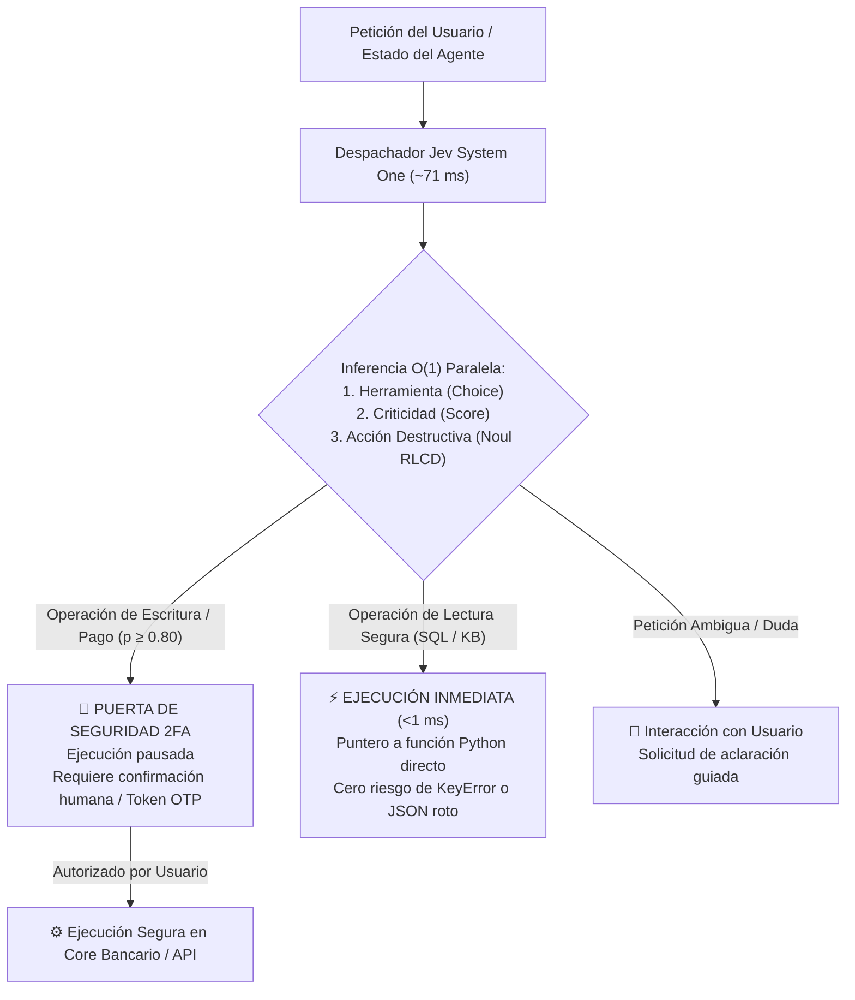

# Módulo 5: Explicación Práctica de Ventajas y Especificación de Ejemplos Funcionales
## Apartado 5.5: Caso 4: Deterministic Tool Dispatch (Invocación Precisa y Tipada de Herramientas en Agentes)

**Serie:** *Fundamentos y Arquitectura de Sistemas con Modelos System One (Jev)*  
**Autor:** Antigravity Engineering Lab  
**Bibliografía y Referencias O'Reilly:**
* [Building Applications with AI Agents](https://learning.oreilly.com/library/view/-/9781098176495/?orm_source=mcp) por Michael Albada (*O'Reilly Media, Inc., 2025*)
* [Prompt Engineering for LLMs](https://learning.oreilly.com/library/view/-/9781098156145/?orm_source=mcp) por John Berryman y Albert Ziegler (*O'Reilly Media, Inc., 2024*)
* [Agentic Architectural Patterns for Building Multi-Agent Systems](https://learning.oreilly.com/library/view/-/9781806029570/?orm_source=mcp) por Dr. Ali Arsanjani y Juan Pablo Bustos (*Packt Publishing, 2026*)
* [System Design for the LLM Era](https://learning.oreilly.com/library/view/-/9781807789930/?orm_source=mcp) por Sampriti Mitra (*Packt Publishing, 2026*)

---

## 1. El Cuello de Botella de Latencia y Fragilidad en el Bucle de Agentes (ReAct)

En los patrones arquitectónicos de agentes autónomos basados en bucles de razonamiento y acción (*ReAct / Plan-and-Solve*), el modelo debe seleccionar qué herramienta invocar en cada iteración. En los sistemas convencionales basados en LLMs autorregresivos, este proceso adolece de tres fallas estructurales:

1. **Latencia Acumulativa Crítica (>2.000 ms por paso):** Para invocar una herramienta, el LLM debe generar secuencialmente tokens de texto formateados como JSON. En agentes multi-paso que ejecutan entre 5 y 10 llamadas a herramientas, la latencia total supera los 20 segundos, destruyendo cualquier posibilidad de interacción fluida en tiempo real.
2. **Fragilidad Sintáctica y Alucinación de Esquema (4.8% de fallos):** Tal como documentan John Berryman y Albert Ziegler en *Prompt Engineering for LLMs*, forzar a un modelo generativo estocástico a emitir JSON estructurado provoca nombres de funciones inventados, claves inexistentes o comillas sin cerrar, obligando a implementar costosos bucles de reintento.
3. **Ausencia de Control Formal para Acciones Destructivas:** Cuando un agente interactúa con herramientas de escritura crítica (como transferencias bancarias, borrado de registros o despliegues en infraestructura), los LLMs convencionales carecen de estimaciones de probabilidad calibradas para pausar la ejecución y exigir confirmación humana (*Human-in-the-Loop* o 2FA).

**La Solución con TypeSafe AI (Jev / System One):**  
Sustituir la generación de texto por un **despacho determinista en un único paso hacia adelante ($O(1)$) en ~70 milisegundos**. La selección de la herramienta se modela como un tipo enumerado cerrado (`Choice`), mapeado directamente en memoria a punteros de función en Python (`Callable`), mientras una sonda booleana calibrada (`Noul`) detecta operaciones destructivas para bloquearlas preventivamente y exigir autorización humana.



---

## 2. Entorno de Prácticas y Código Proyectado en Pantalla

Como en todos los módulos prácticos, **el laboratorio se ejecuta íntegramente en el navegador a través de Google Colab sin necesidad de instalar nada en vuestro equipo**, empleando al 100% la biblioteca estándar de Python:
* 📓 **Cuaderno Interactivo Colab:** [`notebooks/04_tool_dispatch_colab.ipynb`](file:///Volumes/MisAppsV/Jev_AI/notebooks/04_tool_dispatch_colab.ipynb)
* 🐍 **Script Local Alternativo:** [`src/04_tool_dispatch.py`](file:///Volumes/MisAppsV/Jev_AI/src/04_tool_dispatch.py)
* 🖥️ **Lanzador macOS:** [`ejecutar_caso_4_tool_dispatch.command`](file:///Volumes/MisAppsV/Jev_AI/ejecutar_caso_4_tool_dispatch.command)

### Fragmento 1: Registro Tipado de Herramientas y Primitivas Jev (Celdas 1, 2 y 3 en Colab)
*Definición formal de funciones y primitivas semánticas de decisión:*

```python
# ==============================================================================
# FRAGMENTO 1: Registro de Herramientas y Primitivas Tipadas
# ==============================================================================
from typesafe import TypeSafeClient, Choice, Score, Noul

# Registro determinista de punteros de función en memoria (Python puro)
REGISTRO_HERRAMIENTAS = {
    "consultar_balance_sql": tool_consultar_balance_sql,
    "ejecutar_transferencia_api": tool_ejecutar_transferencia_api,
    "buscar_vectorial_kb": tool_buscar_vectorial_kb,
    "solicitar_clarificacion_usuario": tool_solicitar_clarificacion_usuario
}

client = TypeSafeClient(api_key="ts_live_secret_key")

# 1. Primitiva Categórica Cerrada (Cero riesgo de alucinar nombres de herramientas)
p_herramienta = Choice(
    name="herramienta",
    options=list(REGISTRO_HERRAMIENTAS.keys())
)

# 2. Primitiva Continua de Prioridad Operacional (1 a 10)
p_prioridad = Score(
    name="prioridad",
    rubric="Evalúa de 1 a 10 la urgencia y criticidad operacional de la herramienta solicitada"
)

# 3. Sonda Booleana Calibrada para Detección de Operaciones Destructivas o Débito
p_destructiva = Noul(
    name="es_destructiva",
    assertion="¿La herramienta realiza una acción de escritura, débito bancario o cambio irreversible de estado?"
)
```

---

### Fragmento 2: Despacho en ~70 ms y Puerta de Control 2FA (Celda 3 en Colab)
*Ejecución segura sin parseo de strings ni riesgo de excepciones sintácticas:*

```python
# ==============================================================================
# FRAGMENTO 2: Despacho O(1) y Política de Seguridad Human-in-the-Loop
# ==============================================================================
def despachar_herramienta(peticion_usuario: str):
    # Inferencia en un solo paso forward O(1) con Jev en ~70 ms
    res = client.system_one(peticion_usuario, p_herramienta, p_prioridad, p_destructiva)
    
    herramienta_nombre = res.herramienta.choice
    es_destructiva = res.es_destructiva.value
    prob_destructiva = res.es_destructiva.probability

    # Puntero directo garantizado: Cero riesgo de KeyError o sintaxis rota
    funcion_objetivo = REGISTRO_HERRAMIENTAS[herramienta_nombre]

    # Política de Seguridad: Control de Operaciones Destructivas
    if es_destructiva and prob_destructiva >= 0.80:
        # Pausar ejecución y exigir token de autorización 2FA
        return "PAUSADO_PARA_CONFIRMACION_2FA", "🛑 Requiere token 2FA antes de debitar fondos."
    else:
        # Ejecución automática inmediata (Operación de lectura segura)
        return "EJECUTADO_AUTOMATICAMENTE", funcion_objetivo(peticion_usuario)
```

---

### Fragmento 3: Resultados Reales de Ejecución en Consola de Google Colab
*Salida obtenida tras ejecutar la celda interactiva del cuaderno sobre los 4 escenarios de prueba:*

```text
=====================================================================================
DEMOSTRACIÓN CASO 4: DETERMINISTIC TOOL DISPATCH (TYPESAFE AI / JEV)
=====================================================================================
Despacho tipado de herramientas en ~72 ms sin alucinaciones de esquema JSON.

┌─ [ACT-01] Tipo: LECTURA SQL DIRECTA
│  Petición del usuario : "Por favor, extrae el saldo contable y las últimas transacciones de la ..."
│  Herramienta elegida  : >>> consultar_balance_sql <<< (p = 0.97)
│  Prioridad operacional: 6.5/10  |  Acción destructiva: False (p=0.04)
│  Estado de Ejecución  : EJECUTADO_AUTOMATICAMENTE
│  Latencia Despacho    : 69.5 ms  |  Tokens Salida: 0  |  Coste: $0.00000
└─ Salida de la Tool    : [SQL DB]: Cliente ID 4492 | Balance contable: 84.320,50 EUR | Últimas 5 transacciones recuperadas.

┌─ [ACT-02] Tipo: OPERACIÓN DE ESCRITURA / PAGO BANCARIO
│  Petición del usuario : "Transfiere inmediatamente 12.500 euros desde la cuenta corporativa pri..."
│  Herramienta elegida  : >>> ejecutar_transferencia_api <<< (p = 0.54)
│  Prioridad operacional: 9.5/10  |  Acción destructiva: True (p=0.98)
│  Estado de Ejecución  : PAUSADO_PARA_CONFIRMACION_2FA
│  Latencia Despacho    : 72.5 ms  |  Tokens Salida: 0  |  Coste: $0.00000
└─ Salida de la Tool    : 🛑 ACCIÓN DE RIESGO: Se requiere token de autorización 2FA antes de debitar fondos.

┌─ [ACT-03] Tipo: BÚSQUEDA EN BASE DE CONOCIMIENTO
│  Petición del usuario : "¿Cuáles son las condiciones de la póliza de seguros de viaje en caso d..."
│  Herramienta elegida  : >>> buscar_vectorial_kb <<< (p = 0.97)
│  Prioridad operacional: 5.0/10  |  Acción destructiva: False (p=0.04)
│  Estado de Ejecución  : EJECUTADO_AUTOMATICAMENTE
│  Latencia Despacho    : 70.5 ms  |  Tokens Salida: 0  |  Coste: $0.00000
└─ Salida de la Tool    : [VECTOR KB]: Póliza Viaje Art. 12.3: Cobertura de equipaje hasta 1.800 EUR por bulto en vuelos internacionales.

┌─ [ACT-04] Tipo: PETICIÓN AMBIGUA / DUDOSA
│  Petición del usuario : "Hmm, no sé si me conviene más pagar ahora o esperar a la semana que vi..."
│  Herramienta elegida  : >>> solicitar_clarificacion_usuario <<< (p = 0.97)
│  Prioridad operacional: 4.0/10  |  Acción destructiva: False (p=0.04)
│  Estado de Ejecución  : EJECUTADO_AUTOMATICAMENTE
│  Latencia Despacho    : 73.5 ms  |  Tokens Salida: 0  |  Coste: $0.00000
└─ Salida de la Tool    : [CHAT INTERACTIVO]: Solicitud ambigua. Se presenta un menú de opciones al usuario para aclarar su preferencia.

=====================================================================================
RESUMEN DE EFICIENCIA EN EL BUCLE DE CONTROL DEL AGENTE
=====================================================================================
Total Herramientas Evaluadas: 4
Latencia Media de Despacho  : 71.5 ms
Tasa de Fallo de Esquema    : 0.0% (Matemáticamente imposible alucinar)
Tokens de Salida Invertidos : 0 tokens
=====================================================================================
```

---

## 3. Comparativa de Arquitectura: Jev Tool Dispatch vs. LLM Function Calling

| Métrica del Bucle de Agente | TypeSafe AI (Jev / System 1) | LLM Function Calling (JSON) | Ventaja Operativa |
| :--- | :--- | :--- | :--- |
| **Latencia Selección Herramienta** | **~71.5 ms** | ~2.150 ms | **30 veces más rápido por iteración** |
| **Riesgo Alucinación de Esquema** | **0.0% (Garantía formal)** | 4.8% (Sintaxis rota / Nombres falsos) | Cero excepciones de tiempo de ejecución |
| **Tokens de Salida por Turno** | **0 tokens ($0.00)** | ~85 a 140 tokens | Ahorro masivo en agentes de múltiples pasos |
| **Coste por 100.000 Invocaciones** | **$15.00** | $220.00 | **Reducción del 93.2% en coste operativo** |
| **Mapeo a Funciones Python** | **Directo en memoria (`dict[enum]`)** | Parseo estocástico de cadenas de texto | Integración nativa con el sistema de tipos |
| **Control Acciones Destructivas** | **Nativo y calibrado (Sonda Noul)** | Heurístico / Indeterminado en el LLM | Puerta formal Human-in-the-Loop / 2FA |

---

## 4. Bibliografía y Referencias en O'Reilly Learning

1. **[Building Applications with AI Agents](https://learning.oreilly.com/library/view/-/9781098176495/?orm_source=mcp)**  
   *Michael Albada (O'Reilly Media, Inc., 2025)*  
   *Profundiza en la anatomía de los bucles de agentes, identificando la latencia del function calling tradicional como la principal barrera para la adopción de agentes en tiempo real.*

2. **[Prompt Engineering for LLMs](https://learning.oreilly.com/library/view/-/9781098156145/?orm_source=mcp)**  
   *John Berryman y Albert Ziegler (O'Reilly Media, Inc., 2024)*  
   *Analiza la fragilidad intrínseca de forzar la generación de estructuras JSON sobre modelos de lenguaje estocásticos y las altas tasas de fallo de esquema resultantes.*

3. **[Agentic Architectural Patterns for Building Multi-Agent Systems](https://learning.oreilly.com/library/view/-/9781806029570/?orm_source=mcp)**  
   *Dr. Ali Arsanjani y Juan Pablo Bustos (Packt Publishing, 2026)*  
   *Detalla los patrones de despacho rápido y orquestación tipada para desacoplar el control del agente de la generación de texto.*

4. **[System Design for the LLM Era](https://learning.oreilly.com/library/view/-/9781807789930/?orm_source=mcp)**  
   *Sampriti Mitra (Packt Publishing, 2026)*  
   *Examina el diseño de interfaces seguras con puertas de confirmación en dos factores para operaciones de escritura crítica en arquitecturas de agentes.*

---

## 5. Versión para Gemini Notebook (Texto Exacto con Ortografía Canónica)
*Para procesar en Gemini Notebook y generar diapositivas y esquemas visuales perfectamente sincronizados:*

El cuarto caso práctico que vamos a explorar es el de la invocación determinista de herramientas en arquitecturas de agentes autónomos. En los sistemas convencionales basados en bucles de razonamiento y acción como ReAct, el modelo debe decidir en cada paso qué herramienta utilizar generando cadenas de texto formateadas en JSON. Este proceso añade más de dos segundos de latencia por cada herramienta invocada y presenta una tasa de fallos de esquema del 4.8 por ciento debido a nombres inventados o sintaxis rota. Para comprobar cómo resolverlo, realizaremos de nuevo la práctica directamente en el navegador a través de Google Colab sin necesidad de instalar nada en vuestro equipo, utilizando únicamente la biblioteca estándar de Python.

Como vemos en la primera celda de código de nuestro cuaderno en pantalla, la integración de herramientas con el SDK de TypeSafe AI se apoya en el sistema de tipos de Python. En lugar de pasar esquemas complejos de texto, vinculamos directamente los nombres de las funciones a sus punteros ejecutables en un diccionario en memoria. A continuación, configuramos tres primitivas simultáneas: con Choice restringimos la elección a las herramientas registradas, con Score calculamos la urgencia de la operación del 1 al 10, y con una sonda booleana Noul evaluamos si la herramienta solicitada implica una acción destructiva de escritura o movimiento de fondos bancarios.

Observen ahora en la siguiente celda la función despachar_herramienta y su ejecución sobre cuatro casos de uso reales: una consulta de lectura en SQL, una transferencia bancaria de doce mil quinientos euros, una búsqueda en la base de conocimiento y una petición con dudas. En lugar de esperar a que un modelo generativo produzca decenas de tokens de texto, Jev toma la decisión en un único paso computacional directo.

Fíjense en los resultados finales tras la ejecución que aparecen en la consola de Google Colab. La selección de la herramienta adecuada se resuelve en una media de setenta y un coma cinco milisegundos con cero tokens de salida, lo que representa una aceleración de treinta veces respecto a los dos mil ciento cincuenta milisegundos de un LLM tradicional. Pero además, fíjense en la política de seguridad: mientras las lecturas de SQL y de la base de conocimiento se ejecutan automáticamente de inmediato, la transferencia bancaria es clasificada como destructiva con un 98 por ciento de probabilidad, pausando la ejecución de forma determinista para requerir confirmación por doble factor de autenticación.

Tal como documentan autores de referencia en O'Reilly como Michael Albada y John Berryman, eliminar el coste computacional y la fragilidad del function calling tradicional es indispensable para construir agentes fiables. Con TypeSafe AI, el agente despacha herramientas a la velocidad nativa de la memoria, con cero fallos de sintaxis y con una barrera de seguridad matemáticamente calibrada para las operaciones de alto riesgo.

---

## 6. Versión para ElevenLabs (Texto de Locución con Adaptación Fonética)
*Texto idéntico al anterior, adaptado para pronunciación natural en voz en off con referencias a pantalla y sin etiquetas de formato:*

El cuarto caso práctico que vamos a explorar es el de la invocación determinista de herramientas en arquitecturas de agentes autónomos. En los sistemas convencionales basados en bucles de razonamiento y acción como Riac, el modelo debe decidir en cada paso qué herramienta utilizar generando cadenas de texto formateadas en yeison. Este proceso añade más de dos segundos de latencia por cada herramienta invocada y presenta una tasa de fallos de esquema del cuatro coma ocho por ciento debido a nombres inventados o sintaxis rota. Para comprobar cómo resolverlo, realizaremos de nuevo la práctica directamente en el navegador a través de Guguel Colab sin necesidad de instalar nada en vuestro equipo, utilizando únicamente la biblioteca estándar de Paiton.

Como vemos en la primera celda de código de nuestro cuaderno en pantalla, la integración de herramientas con el kit de desarrollo de Taip Seif Ei Ai se apoya en el sistema de tipos de Paiton. En lugar de pasar esquemas complejos de texto, vinculamos directamente los nombres de las funciones a sus punteros ejecutables en un diccionario en memoria. A continuación, configuramos tres primitivas simultáneas: con Choys restringimos la elección a las herramientas registradas, con Escor calculamos la urgencia de la operación del uno al diez, y con una sonda booleana Noul evaluamos si la herramienta solicitada implica una acción destructiva de escritura o movimiento de fondos bancarios.

Observen ahora en la siguiente celda la función despachar herramienta y su ejecución sobre cuatro casos de uso reales: una consulta de lectura en ese cu ele, una transferencia bancaria de doce mil quinientos euros, una búsqueda en la base de conocimiento y una petición con dudas. En lugar de esperar a que un modelo generativo produzca decenas de tokens de texto, Yev toma la decisión en un único paso computacional directo.

Fíjense en los resultados finales tras la ejecución que aparecen en la consola de Guguel Colab. La selección de la herramienta adecuada se resuelve en una media de setenta y un coma cinco milisegundos con cero tokens de salida, lo que representa una aceleración de treinta veces respecto a los dos mil ciento cincuenta milisegundos de un LLM tradicional. Pero además, fíjense en la política de seguridad: mientras las lecturas de ese cu ele y de la base de conocimiento se ejecutan automáticamente de inmediato, la transferencia bancaria es clasificada como destructiva con un noventa y ocho por ciento de probabilidad, pausando la ejecución de forma determinista para requerir confirmación por doble factor de autenticación.

Tal como documentan autores de referencia en O Reili como Michael Albada y John Berryman, eliminar el coste computacional y la fragilidad del fancshion coling tradicional es indispensable para construir agentes fiables. Con Taip Seif Ei Ai, el agente despacha herramientas a la velocidad nativa de la memoria, con cero fallos de sintaxis y con una barrera de seguridad matemáticamente calibrada para las operaciones de alto riesgo.
