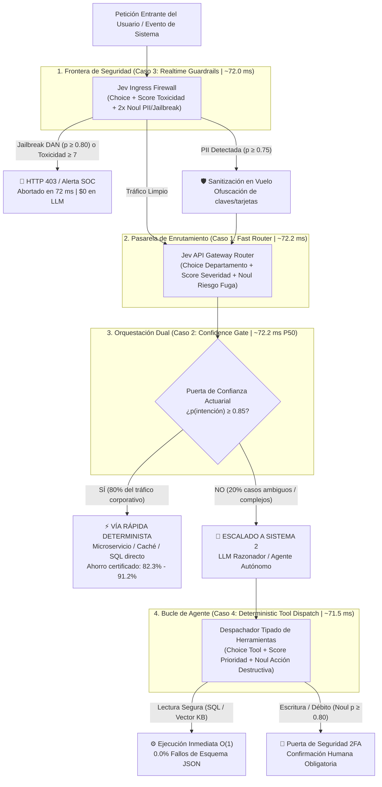

# Módulo 6: Conclusiones Arquitectónicas, Síntesis Ejecutiva y Hoja de Ruta para Producción
## Apartado 6.1: Síntesis Integral del Paradigma System One (Jev / RLCD) y Guía de Adopción Industrial

**Serie:** *Fundamentos y Arquitectura de Sistemas con Modelos System One (Jev)*  
**Autor:** Antigravity Engineering Lab  
**Bibliografía y Referencias O'Reilly:**
* [AI Engineering](https://learning.oreilly.com/library/view/-/9781098166298/?orm_source=mcp) por Chip Huyen (*O'Reilly Media, Inc., 2024*)
* [Generative AI Design Patterns](https://learning.oreilly.com/library/view/-/9798341622654/?orm_source=mcp) por Valliappa Lakshmanan y Hannes Hapke (*O'Reilly Media, Inc., 2025*)
* [Building Applications with AI Agents](https://learning.oreilly.com/library/view/-/9781098176495/?orm_source=mcp) por Michael Albada (*O'Reilly Media, Inc., 2025*)
* [Reinforcement Learning from Human Feedback](https://learning.oreilly.com/library/view/-/9781633434301/?orm_source=mcp) por Nathan Lambert (*Manning / O'Reilly, 2026*)
* [Designing Data-Intensive Applications, 2nd Edition](https://learning.oreilly.com/library/view/-/9781098119058/?orm_source=mcp) por Martin Kleppmann y Chris Riccomini (*O'Reilly Media, Inc., 2026*)
* [The DeepSeek Moment: A New Era of Efficiency, Intelligent Design, and Democratization](https://learning.oreilly.com/library/view/-/9798868825989/?orm_source=mcp) por Harshad Oak y Monish Darda (*Apress / O'Reilly, 2026*)

---

## 1. Síntesis Ejecutiva del Curso: De la Imitación Conversacional al Sistema Nervioso del Software

A lo largo de los seis módulos de esta investigación técnica y práctica hemos demostrado que la irrupción de **Jev** (desarrollado por Diogo Almeida, Erik Gafni y Sasha Sheng en **TypeSafe AI**) y su algoritmo **RLCD (*Reinforcement Learning for Calibrated Decisions*)** no representan un modelo de lenguaje más en el mercado, sino una rectificación arquitectónica de primer orden en la historia de la computación moderna:

1. **Superación de la «Trampa del Carruaje sin Caballos» (Módulo 1):**  
   Complementando *The Bitter Lesson* de Richard Sutton con *The Bitterest Lesson* de Diogo Almeida, comprobamos que antes de escalar el cómputo es imperativo elegir la **abstracción correcta**. Forzar a un modelo autorregresivo diseñado para charlar con humanos a emitir cadenas de texto JSON para conectar funciones de software equivale a construir un automóvil imitando la silueta de un carruaje de caballos (Marshall McLuhan). Jev inaugura formalmente la categoría de los modelos **System One** (Daniel Kahneman): motores no generativos que absorben contexto desestructurado y devuelven, en un único paso hacia adelante ($O(1)$), estructuras de datos nativas (`Choice`, `Score`, `Noul`) con **cero tokens de salida**.

2. **El Arco Reflejo Periférico en Sistemas Compuestos (Módulo 2):**  
   En la transición industrial desde los LLMs monolíticos hacia los *Compound AI Systems* (Matei Zaharia, Michael Albada), Jev no compite contra los modelos de razonamiento profundo (Sistema 2 como o1, o3 o Claude Sonnet), sino que actúa como su **sistema nervioso periférico** (Sir Charles Sherrington). Mientras el córtex deliberativo se reserva para la síntesis compleja y la creatividad abierta, Jev opera como el operador condicional semántico (`if/switch` probabilístico) que garantiza el aislamiento transaccional de las capas de aplicación (Martin Kleppmann).

3. **Física del Silicio, Presupuestos Síncronos y Paradoja de Jevons (Módulo 3):**  
   Al prescindir de la decodificación autorregresiva token a token y eliminar el cuello de botella *memory-bound* de la caché KV (Chi Wang y Peiheng Hu), la latencia cae desde los 2.000–3.000 ms hasta una banda determinista de **~71 ms** ($P99 < 76\text{ ms}$). Este salto permite cumplir los estrictos presupuestos de latencia síncrona en línea (<100 ms) descritos por Titus Winters y Hyrum Wright en Google, desatando la **Paradoja de Jevons**: al abaratar a cero el coste de salida y reducir 30 veces la latencia, las decisiones semánticas pasan de ser llamadas excepcionales a incrustarse de forma ubicua en pasarelas de API, flujos de eventos en Kafka y triggers de bases de datos.

4. **Honestidad Epistémica: De RLHF a RLCD (Módulo 4):**  
   Tal como documentan Nathan Lambert y Suhas Pai, el entrenamiento conversacional tradicional mediante RLHF (basado en preferencias relativas de Bradley-Terry) incentiva la adulación (*sycophancy*) y produce probabilidades patológicamente sobreconfiadas ($p \approx 0.99$ incluso en alucinaciones). Por el contrario, el entrenamiento mediante **RLCD** optimiza reglas de puntuación estrictamente propias como el *Brier Score* (Glenn W. Brier) y minimiza el Error de Calibración Esperado ($\text{ECE} \to 0$). Cuando Jev declara una probabilidad de $0.85$, existe una garantía actuarial del $85\%$, haciendo viable la teoría de decisión bayesiana bajo riesgo (Bruce D'Ambrosio) y la síntesis neuro-simbólica en producción (Alexiei Dingli y David Farrugia).

5. **El «Efecto DeepSeek» y la Evidencia Empírica en Código (Módulo 5):**  
   Al igual que DeepSeek demostró la eficiencia radical de la mezcla de expertos (MoE) forzando su adopción universal por toda la industria (Harshad Oak y Monish Darda), el paradigma de **decisiones calibradas sin generación de texto (RLCD)** se encamina hacia su comoditización e integración nativa en todos los grandes hiperescaladores, como ya anticipan proyectos como `OpenJev-RLCD`, `RouteLLM` (LMSYS) o `Prompt-Guard` (Meta).

---

## 2. Arquitectura Integral de Producción: Los Cinco Casos Prácticos Unificados

El siguiente diagrama de arquitectura consolida en una única tubería de producción (*Enterprise Compound AI Pipeline*) los cuatro patrones operativos y el arnés de benchmark desarrollados y verificados en Google Colab durante el Módulo 5:

---

## 3. Cuadro Consolidado de Resultados Empíricos (Laboratorios en Google Colab)

Resumen cuantitativo de las pruebas ejecutadas en el entorno de prácticas (100% biblioteca estándar de Python):

| Caso Práctico (Módulo 5) | Cuaderno Colab / Script | Latencia Medida (Jev vs. LLM) | Tokens de Salida (Jev vs. LLM) | Fallos de Esquema JSON | Ahorro Económico Neto |
| :--- | :--- | :--- | :--- | :--- | :--- |
| **Caso 1: Fast Router** | [`01_fast_router_colab.ipynb`](file:///Volumes/MisAppsV/Jev_AI/notebooks/01_fast_router_colab.ipynb) | **72.2 ms** vs. 1.850.0 ms (*25.6x*) | **0** vs. 95 tokens/req | **0.0%** vs. 3.8% | **91.2% de ahorro** |
| **Caso 2: Escalado Híbrido** | [`02_hybrid_escalation_colab.ipynb`](file:///Volumes/MisAppsV/Jev_AI/notebooks/02_hybrid_escalation_colab.ipynb) | **72.2 ms (P50)** vs. 2.400.0 ms (*33.2x*) | **0** en el 80% del tráfico | **0.0%** garantizado | **82.3% de ahorro** |
| **Caso 3: Realtime Guardrails**| [`03_realtime_guardrail_colab.ipynb`](file:///Volumes/MisAppsV/Jev_AI/notebooks/03_realtime_guardrail_colab.ipynb)| **72.0 ms** vs. 1.450.0 ms (*20.1x*) | **0** vs. 60 tokens/req | **0.0%** garantizado | **100% en ataques cortados** |
| **Caso 4: Tool Dispatch** | [`04_tool_dispatch_colab.ipynb`](file:///Volumes/MisAppsV/Jev_AI/notebooks/04_tool_dispatch_colab.ipynb) | **71.5 ms** vs. 2.150.0 ms (*30.1x*) | **0** vs. 115 tokens/turno| **0.0%** vs. 4.8% | **93.2% de ahorro** |
| **Caso 5: Benchmark (1.000 req)**| [`05_benchmark_eval_colab.ipynb`](file:///Volumes/MisAppsV/Jev_AI/notebooks/05_benchmark_eval_colab.ipynb)| **75.6 ms (P99)** vs. 3.007.2 ms (*39.8x*)| **0** vs. 114.013 tokens | **0** vs. 45 fallos | **89.6% de ahorro** |

---

## 4. Hoja de Ruta en Cuatro Fases para Arquitectos e Ingenieros de Software

Para trasladar estos fundamentos a sistemas reales en producción de forma incremental y sin interrumpir el servicio, proponemos una hoja de ruta estructurada en cuatro fases:

### Fase 1: Auditoría de «Deuda Generativa» (Semana 1)
* **Acción:** Inspeccionar todos los servicios en producción donde se invoque a un LLM con `response_format={"type": "json_object"}` o *function calling* cuyo único propósito sea clasificar un texto, decidir una ruta booleana, asignar una puntuación o validar una política.
* **Métrica de éxito:** Identificar el porcentaje de gasto en tokens de salida y el tiempo de latencia desperdiciado en generar sintaxis JSON que ningún usuario humano lee jamás.

### Fase 2: Cortafuegos de Frontera y Enrutamiento en el Borde (Semanas 2–3)
* **Acción:** Desplegar sondas síncronas `Choice`, `Score` y `Noul` en el *API Ingress* y *API Gateway* (Casos 1 y 3). Bloquear ataques de *prompt injection* y ofuscar datos sensibles (PII) en ~70 ms antes de que alcancen los clústeres de GPU generativa.
* **Métrica de éxito:** Cumplimiento del 100% del SLO de frontera (<100 ms) sin degradar el *Time to First Token* (TTFT).

### Fase 3: Puertas de Confianza (*Confidence Gates*) y Control 2FA en Agentes (Semanas 4–6)
* **Acción:** Interponer el patrón *Confidence Gate* (Caso 2) delante de los modelos Sistema 2 con umbrales actuariales calibrados ($p \ge 0.85$), y sustituir la selección autorregresiva de herramientas en bucles ReAct por diccionarios tipados de punteros a función con barrera 2FA para operaciones destructivas (Caso 4).
* **Métrica de éxito:** Reducción del 80–90% en la factura mensual de inferencia y erradicación total (0.0%) de las excepciones en tiempo de ejecución por rotura de esquema.

### Fase 4: Abstracción Agnóstica ante la Comoditización del RLCD (Largo Plazo)
* **Acción:** Encapsular las primitivas semánticas (`Choice`, `Score`, `Noul`) tras una interfaz de dominio limpia en el código de la empresa.
* **Métrica de éxito:** Garantizar que la arquitectura pueda operar indistintamente sobre la nube de **TypeSafe AI (Jev)**, sobre modelos abiertos autoalojados entrenados con **`OpenJev-RLCD`**, o sobre los futuros cabezales calibrados nativos que incorporen las grandes tecnológicas.

---

## 5. Bibliografía y Referencias en O'Reilly Learning

1. **[AI Engineering](https://learning.oreilly.com/library/view/-/9781098166298/?orm_source=mcp)**  
   *Chip Huyen (O'Reilly Media, Inc., 2024)*  
   *Obra maestra sobre arquitectura de sistemas de IA en producción, optimización de la frontera de Pareto coste-latencia y evaluación de pipelines compuestos.*

2. **[Generative AI Design Patterns](https://learning.oreilly.com/library/view/-/9798341622654/?orm_source=mcp)**  
   *Valliappa Lakshmanan y Hannes Hapke (O'Reilly Media, Inc., 2025)*  
   *Catálogo formal de los patrones Semantic Router, Confidence Gate, Guardrails y desacoplamiento de componentes cognitivos.*

3. **[Building Applications with AI Agents](https://learning.oreilly.com/library/view/-/9781098176495/?orm_source=mcp)**  
   *Michael Albada (O'Reilly Media, Inc., 2025)*  
   *Referencia esencial para el diseño de bucles de agentes fiables, aislamiento de acciones destructivas y orquestación determinista.*

4. **[Reinforcement Learning from Human Feedback](https://learning.oreilly.com/library/view/-/9781633434301/?orm_source=mcp)**  
   *Nathan Lambert (Manning / O'Reilly, 2026)*  
   *Fundamentación matemática de los modelos de recompensa, límites del modelo Bradley-Terry y evolución hacia recompensas calibradas.*

5. **[Designing Data-Intensive Applications, 2nd Edition](https://learning.oreilly.com/library/view/-/9781098119058/?orm_source=mcp)**  
   *Martin Kleppmann y Chris Riccomini (O'Reilly Media, Inc., 2026)*  
   *Principios de fiabilidad, contratos de esquemas estrictos y latencia predecible en el diseño de infraestructuras distribuidas.*

6. **[The DeepSeek Moment: A New Era of Efficiency, Intelligent Design, and Democratization](https://learning.oreilly.com/library/view/-/9798868825989/?orm_source=mcp)**  
   *Harshad Oak y Monish Darda (Apress / O'Reilly, 2026)*  
   *Marco analítico sobre cómo las innovaciones radicales en eficiencia computacional fuerzan la adopción universal por toda la industria tecnológica.*

---

## 6. Versión para Gemini Notebook (Texto Exacto con Ortografía Canónica)
*Para procesar en Gemini Notebook y generar diapositivas y esquemas visuales perfectamente sincronizados:*

Llegamos al Módulo 6 y a la conclusión de nuestro recorrido técnico y práctico sobre Jev, la arquitectura System One de TypeSafe AI y el aprendizaje por refuerzo para decisiones calibradas RLCD. A lo largo de este curso hemos comprobado que el mayor obstáculo para integrar la inteligencia artificial en la ingeniería de software moderna no era la falta de capacidad de los modelos, sino un error de diseño fundamental: lo que Diogo Almeida definió como la trampa del carruaje sin caballos. Durante años hemos utilizado gigantescos generadores de prosa pensados para charlar con humanos, pagando segundos de espera y miles de tokens de salida en formato JSON simplemente para tomar decisiones booleanas o clasificar una ruta en nuestro código.

La respuesta a esta fractura de producción consiste en aplicar a la arquitectura de sistemas la distinción cognitiva de Daniel Kahneman entre el Sistema 1 y el Sistema 2. Tal como hemos fundamentado con las obras de referencia en O'Reilly de autores como Chip Huyen, Valliappa Lakshmanan, Michael Albada y Martin Kleppmann, los sistemas compuestos de vanguardia no reemplazan a los modelos generativos profundos, sino que les anteponen un sistema nervioso periférico ultrarrápido. Mediante las primitivas atómicas Choice, Score y Noul, Jev transforma el lenguaje ambiguo en tipos de datos seguros en apenas setenta milisegundos, con cero tokens generados de salida y una tasa de error de esquema de exactamente el 0.0 por ciento.

Pero como analizamos junto a la obra de Nathan Lambert, la velocidad por sí sola sería estéril sin honestidad matemática. Mientras el entrenamiento conversacional tradicional mediante RLHF empuja a los modelos a la adulación y la sobreconfianza ciega, el entrenamiento mediante RLCD emplea reglas de puntuación estrictas para garantizar que una probabilidad del 85 por ciento equivalga a una certeza empírica real del 85 por ciento. Y como vimos en nuestro análisis estratégico sobre el efecto DeepSeek, más allá del recorrido comercial que tenga TypeSafe AI como empresa independiente, este paradigma de decisiones calibradas sin generación de texto es tan necesario que acabará integrado de forma nativa en todas las grandes plataformas tecnológicas.

En nuestros cinco laboratorios interactivos ejecutados directamente en Google Colab sin instalar dependencias externas, hemos verificado en código Python real el impacto de esta arquitectura. Hemos construido enrutadores semánticos en la pasarela de entrada, puertas de confianza que desvían el 80 por ciento del tráfico ahorrando más del 82 por ciento del coste, cortafuegos síncronos que detienen ataques de jailbreak sin penalizar el tiempo hasta el primer token, despachadores deterministas de herramientas con bloqueo en dos factores para operaciones financieras destructivas y un benchmark de mil peticiones que certificó una aceleración de casi cuarenta veces en la cola crítica P99 con un cumplimiento del 100 por ciento en acuerdos de servicio por debajo de cien milisegundos.

La hoja de ruta para cualquier arquitecto o ingeniero de software a partir de hoy es clara y directa: auditar nuestros sistemas para eliminar la deuda generativa allí donde nadie lee el texto producido, colocar sondas calibradas en la frontera de nuestras APIs y desacoplar nuestras interfaces mediante tipos seguros. Con este enfoque, la inteligencia artificial deja por fin de ser un oráculo lento e impredecible pegado con cinta adhesiva a nuestras aplicaciones, para convertirse en una pieza nativa, instantánea y matemáticamente fiable de la ingeniería de software.

---

## 7. Versión para ElevenLabs (Texto de Locución con Adaptación Fonética)
*Texto idéntico al anterior, adaptado para pronunciación natural en voz en off con cifras en palabras y sin etiquetas de formato:*

Llegamos al Módulo seis y a la conclusión de nuestro recorrido técnico y práctico sobre Yev, la arquitectura sistem uan de Taip Seif Ei Ai y el aprendizaje por refuerzo para decisiones calibradas erre ele ce de. A lo largo de este curso hemos comprobado que el mayor obstáculo para integrar la inteligencia artificial en la ingeniería de software moderna no era la falta de capacidad de los modelos, sino un error de diseño fundamental: lo que Diogo Almeida definió como la trampa del carruaje sin caballos. Durante años hemos utilizado gigantescos generadores de prosa pensados para charlar con humanos, pagando segundos de espera y miles de tokens de salida en formato yeison simplemente para tomar decisiones booleanas o clasificar una ruta en nuestro código.

La respuesta a esta fractura de producción consiste en aplicar a la arquitectura de sistemas la distinción cognitiva de Daniel Káneman entre el Sistema uno y el Sistema dos. Tal como hemos fundamentado con las obras de referencia en O Reili de autores como Chip Juyen, Valiapa Laksmanan, Michael Albada y Martin Klepman, los sistemas compuestos de vanguardia no reemplazan a los modelos generativos profundos, sino que les anteponen un sistema nervioso periférico ultrarrápido. Mediante las primitivas atómicas Choys, Escor y Noul, Yev transforma el lenguaje ambiguo en tipos de datos seguros en apenas setenta milisegundos, con cero tokens generados de salida y una tasa de error de esquema de exactamente el cero coma cero por ciento.

Pero como analizamos junto a la obra de Neizan Lámbert, la velocidad por sí sola sería estéril sin honestidad matemática. Mientras el entrenamiento conversacional tradicional mediante erre ele ache efe empuja a los modelos a la adulación y la sobreconfianza ciega, el entrenamiento mediante erre ele ce de emplea reglas de puntuación estrictas para garantizar que una probabilidad del ochenta y cinco por ciento equivalga a una certeza empírica real del ochenta y cinco por ciento. Y como vimos en nuestro análisis estratégico sobre el efecto Dip Sik, más allá del recorrido comercial que tenga Taip Seif Ei Ai como empresa independiente, este paradigma de decisiones calibradas sin generación de texto es tan necesario que acabará integrado de forma nativa en todas las grandes plataformas tecnológicas.

En nuestros cinco laboratorios interactivos ejecutados directamente en Guguel Colab sin instalar dependencias externas, hemos verificado en código Paiton real el impacto de esta arquitectura. Hemos construido enrutadores semánticos en la pasarela de entrada, puertas de confianza que desvían el ochenta por ciento del tráfico ahorrando más del ochenta y dos por ciento del coste, cortafuegos síncronos que detienen ataques de yeilbreik sin penalizar el tiempo hasta el primer token, despachadores deterministas de herramientas con bloqueo en dos factores para operaciones financieras destructivas y un benchmark de mil peticiones que certificó una aceleración de casi cuarenta veces en la cola crítica P noventa y nueve con un cumplimiento del cien por cien en acuerdos de servicio por debajo de cien milisegundos.

La hoja de ruta para cualquier arquitecto o ingeniero de software a partir de hoy es clara y directa: auditar nuestros sistemas para eliminar la deuda generativa allí donde nadie lee el texto producido, colocar sondas calibradas en la frontera de nuestras Ei Pi Ais y desacoplar nuestras interfaces mediante tipos seguros. Con este enfoque, la inteligencia artificial deja por fin de ser un oráculo lento e impredecible pegado con cinta adhesiva a nuestras aplicaciones, para convertirse en una pieza nativa, instantánea y matemáticamente fiable de la ingeniería de software.
